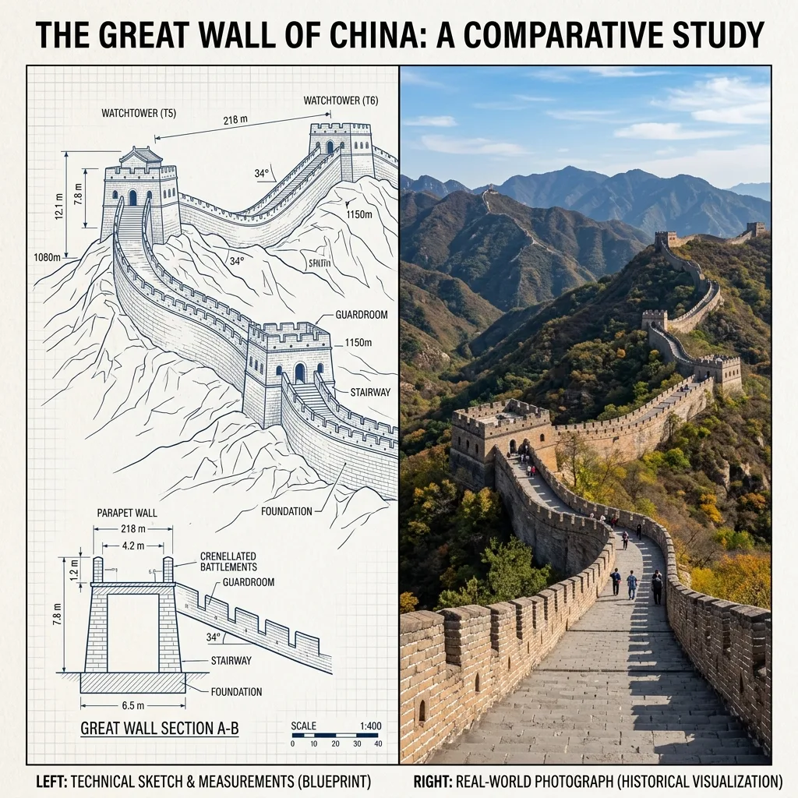

# Side-by-side comparison image featuring a technical sketch and real

[← Back to the collection](../../README.md) · Category: [Photography](../../gallery/photography.md) · Model: `Vinano Image Pro` · ID: `vn-00770`

<a href="https://vinano.ai?utm_source=github&utm_medium=readme&utm_campaign=awesome-image-video-prompts-updating&utm_content=prompt-page-image"></a>

<sub>Preview generated with <a href="https://vinano.ai?utm_source=github&utm_medium=readme&utm_campaign=awesome-image-video-prompts-updating&utm_content=prompt-page-caption">vinano.ai</a></sub>

## Prompt

```text
{
 "objective": "Create a side-by-side comparison image featuring a technical sketch and real photograph of the Great Wall of China",
 "image_specifications": {
 "style": "Mixed media (Technical drawing + Real photograph)",
 "layout": "Horizontal split - Left side: Sketch measurements, Right side: Real photo",
 "aspect_ratio": "3:2"
 },
 "left_side": {
 "content_type": "Technical sketch of the Great Wall of China",
 "features": ["Detailed architectural lines showing wall segments, watchtowers, and defensive structures",
 "Numerical measurements for wall height, width, and tower spacing",
 "Elevation labels for wall sections and towers",
 "Side elevation and top-down layout illustrating wall curvature along terrain"],
 "text_annotations": {
 "units": "Metric (meters)",
 "language": "English",
 "font_style": "Blueprint or engineering-style typography"
 },
 "positioning": "Take up the left half of the image"
 },
 "right_side": {
 "content_type": "High-resolution real photo of the Great Wall of China",
 "features": ["Wide panoramic view of the wall stretching across mountains",
 "Natural daylight clear or lightly clouded sky",
 "Realistic colors visible stone texture and surrounding landscape"],
 "positioning": "Take up the right half of the image"
 },
 "visual_elements": {
 "border_division": "Vertical line or subtle transition between left (sketch) and right (photo)",
 "color_palette": {
 "left": "Monochrome or blueprint blue for sketch",
 "right": "Natural realistic colors"
 }
 },
 "output_format": {
 "type": "Image",
 "use_case": ["Educational poster",
 "Architectural comparison",
 "Historical visualization",
 "Tourism visual aid"],
 "high_resolution": true
 }
}

Aim for an editorial, design-driven look with deliberate negative space.
```

## Try it on vinano.ai

1. Copy the prompt above.
2. Open **[vinano.ai](https://vinano.ai?utm_source=github&utm_medium=readme&utm_campaign=awesome-image-video-prompts-updating&utm_content=prompt-page-try)**, paste it into the image generator and pick a model.
3. Swap any placeholders (brand, product, city, person…) for your own details, then generate.

More prompts like this: [Photography gallery](../../gallery/photography.md) · [all categories](../../README.md#contents)
