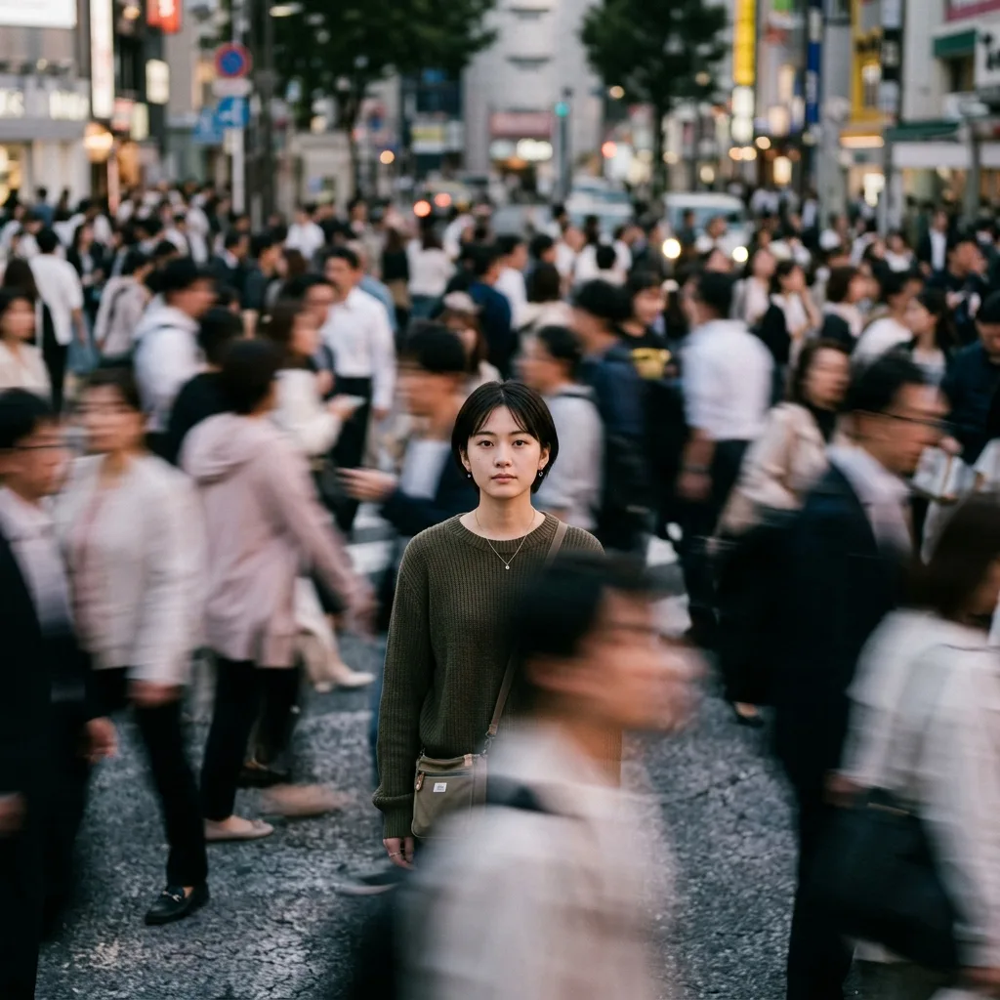

# Portrait of a young person standing still

[← Back to the collection](../../README.md) · Category: [Photography](../../gallery/photography.md) · Model: `Vinano Image v2` · ID: `vn-00776`

<a href="https://vinano.ai?utm_source=github&utm_medium=readme&utm_campaign=awesome-image-video-prompts-updating&utm_content=prompt-page-image"></a>

<sub>Preview generated with <a href="https://vinano.ai?utm_source=github&utm_medium=readme&utm_campaign=awesome-image-video-prompts-updating&utm_content=prompt-page-caption">vinano.ai</a></sub>

## Prompt

```text
Cinematic portrait of a young person standing still in the middle of a busy crowd, sharp focus on the subject while people move rapidly around them creating strong motion blur. The subject looks directly at the camera a calm, introspective expression. Soft natural lighting, shallow depth of field, dreamy atmosphere. Crowd blurred long exposure effect, dynamic movement streaks surrounding the subject. Neutral pastel background tones, subtle color grading, emotional storytelling composition. Shot on 85mm lens, f/1.8, long shutter speed, ultra-realistic skin texture, cinematic photography, 8K resolution. Keep edges clean and the overall composition balanced for a polished, gallery-ready result.
```

## Try it on vinano.ai

1. Copy the prompt above.
2. Open **[vinano.ai](https://vinano.ai?utm_source=github&utm_medium=readme&utm_campaign=awesome-image-video-prompts-updating&utm_content=prompt-page-try)**, paste it into the image generator and pick a model.
3. Swap any placeholders (brand, product, city, person…) for your own details, then generate.

More prompts like this: [Photography gallery](../../gallery/photography.md) · [all categories](../../README.md#contents)
