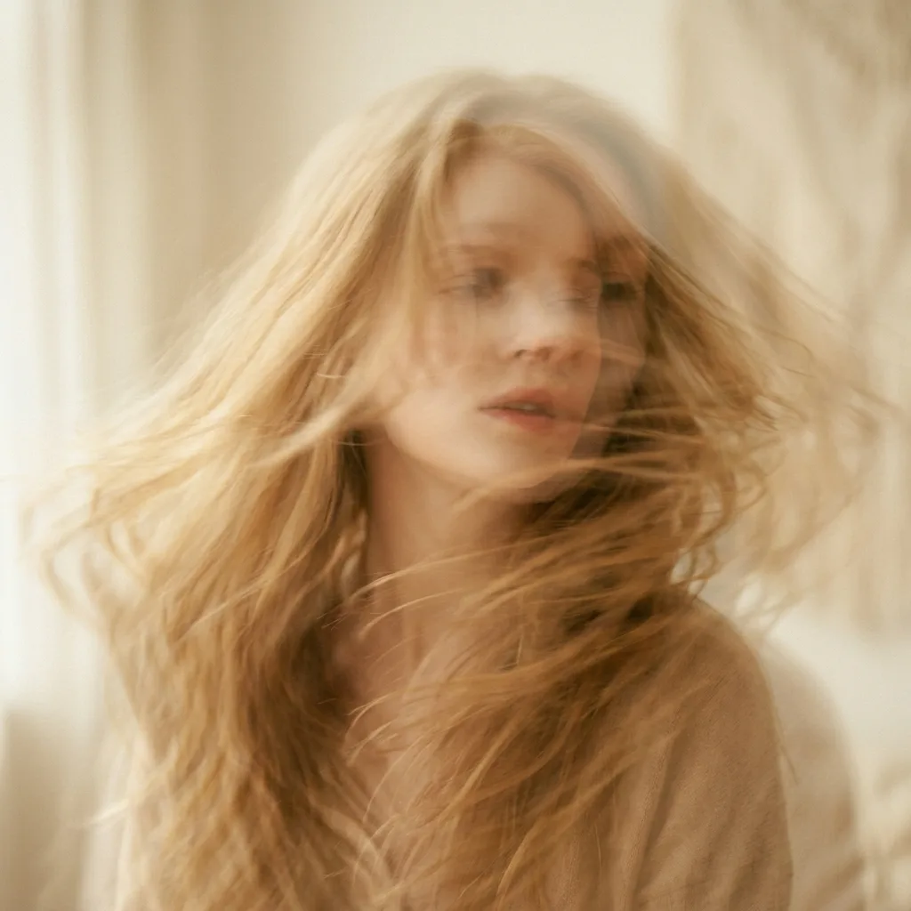

# Soft-focus, cinematic portrait of a young woman delicate facial

[← Back to the collection](../../README.md) · Category: [Photography](../../gallery/photography.md) · Model: `Vinano Image v2` · ID: `vn-00784`

<a href="https://vinano.ai?utm_source=github&utm_medium=readme&utm_campaign=awesome-image-video-prompts-updating&utm_content=prompt-page-image"></a>

<sub>Preview generated with <a href="https://vinano.ai?utm_source=github&utm_medium=readme&utm_campaign=awesome-image-video-prompts-updating&utm_content=prompt-page-caption">vinano.ai</a></sub>

## Prompt

```text
A soft-focus, cinematic portrait of a young woman delicate facial features and light golden hair, caught in motion. Her face appears partially blurred and ghosted, flowing strands of hair captured mid-sway, creating a dreamy, ethereal motion effect. Her expression is serene and slightly distant, parted lips and eyes softly open. The entire frame is bathed in golden beige and sepia tones, evoking a nostalgic, painterly atmosphere. The lighting is natural and diffused, coming from a nearby window, casting a warm glow on her skin and illuminating the strands of hair that dance across the frame. Photographed a Canon EOS R5 an 85mm lens at f/1.2, ISO 320, shutter speed 1/8s intentional slow exposure and handheld movement to create the artistic motion blur. The focus is soft, a shallow depth of field that isolates the subject from the pale, creamy background. Post-processed in Adobe Lightroom and Photoshop: cinematic LUTs applied, warmth enhanced through split-toning (shadows in soft amber, highlights in cream), clarity reduced, and motion streaks refined displacement layers and radial blur filters. A very subtle fine grain adds a filmic texture. Final mood: emotional, hazy, poetic. Style references: fine art portraiture, vintage editorial, and analog dream sequences. 4K ultra-resolution, no harsh contrasts, smooth gradients preserved. Emphasise material texture and natural light so the final frame feels tactile and premium.
```

## Try it on vinano.ai

1. Copy the prompt above.
2. Open **[vinano.ai](https://vinano.ai?utm_source=github&utm_medium=readme&utm_campaign=awesome-image-video-prompts-updating&utm_content=prompt-page-try)**, paste it into the image generator and pick a model.
3. Swap any placeholders (brand, product, city, person…) for your own details, then generate.

More prompts like this: [Photography gallery](../../gallery/photography.md) · [all categories](../../README.md#contents)
