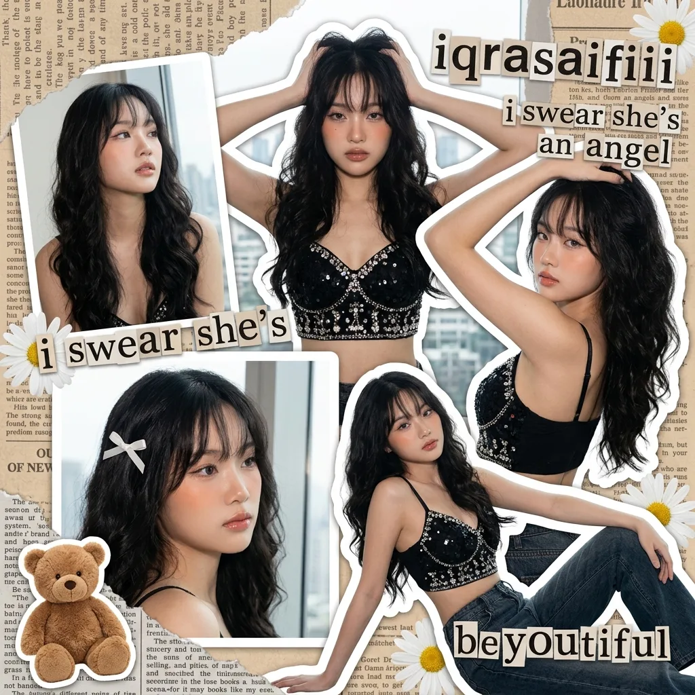

# Art style description

[← Back to the collection](../../README.md) · Category: [Photography](../../gallery/photography.md) · Model: `Vinano Image Pro` · ID: `vn-00785`

<a href="https://vinano.ai?utm_source=github&utm_medium=readme&utm_campaign=awesome-image-video-prompts-updating&utm_content=prompt-page-image"></a>

<sub>Preview generated with <a href="https://vinano.ai?utm_source=github&utm_medium=readme&utm_campaign=awesome-image-video-prompts-updating&utm_content=prompt-page-caption">vinano.ai</a></sub>

## Prompt

```text
{
"art_style_description": {
      "type": "Digital Scrapbook / Fan-Edit Collage.",
      "aesthetic": "Y2K, Coquette, K-pop Idol Fan Art.",
      "visual_structure": "Multiple photographic cutouts of the same subject arranged in a chaotic but cohesive layout on top of a vintage textured background. Each cutout has a thick white stroke/outline to resemble a sticker."
    },
    "subject_details": {
      "demographics": "Young Asian woman (K-pop idol aesthetic), fair skin, delicate features.",
      "hair": "Long, voluminous, dark wavy hair air bangs. In one panel, she wears a small white ribbon clip.",
      "outfit": "Black sequined/embellished crop top (bralette style), dark denim jeans.",
      "makeup": "Peach-toned blush, glossy lips, soft eyeliner."
    },
    "pose_breakdown_panels": {
      "panel_1_top_center": "Portrait shot. Subject looking straight ahead/slightly down hand in hair, elbows raised. Background shows a blurred cityscape.",
      "panel_2_bottom_right": "Seated/Reclining pose. Subject leaning back, one arm supporting weight, looking coolly at the camera. Wearing jeans.",
      "panel_3_middle_right": "Over-the-shoulder shot. Subject looking back at the camera a soft gaze, arm raised touching head.",
      "panel_4_bottom_left": "Close-up portrait. Subject looking to the side, wearing a white bow hair clip.",
      "panel_5_top_left": "Bust-up shot. Subject gazing off-camera a dreamy expression."
    },
    "graphic_elements_and_overlays": {
      "background_texture": "Vintage newspaper print text (sepia/beige toned).",
      "stickers": {
        "text": "Ransom-note style text blocks reading 'iqrasaifiii', 'i swear she's an angel', and 'beyoutiful'.",
        "objects": "A brown plush teddy bear sticker in the bottom left corner.",
        "decor": "White daisy flower graphics, jagged torn paper edges."
      }
    },
    "camera_technical_values": {
      "source_photo_style": "High-end fashion editorial photography.",
      "lens": "85mm (Portrait telephoto).",
      "lighting": "Natural Window Light (Soft, directional sunlight coming from the side).",
      "color_grading": "Slightly desaturated source photos contrasted against the warm beige newspaper background.",
      "resolution": "High fidelity cutouts."
    },
    "composition": "Overlapping layers. The center and right photos are larger, while smaller details fill the corners."

Keep edges clean and the overall composition balanced for a polished, gallery-ready result.
```

## Try it on vinano.ai

1. Copy the prompt above.
2. Open **[vinano.ai](https://vinano.ai?utm_source=github&utm_medium=readme&utm_campaign=awesome-image-video-prompts-updating&utm_content=prompt-page-try)**, paste it into the image generator and pick a model.
3. Swap any placeholders (brand, product, city, person…) for your own details, then generate.

More prompts like this: [Photography gallery](../../gallery/photography.md) · [all categories](../../README.md#contents)
