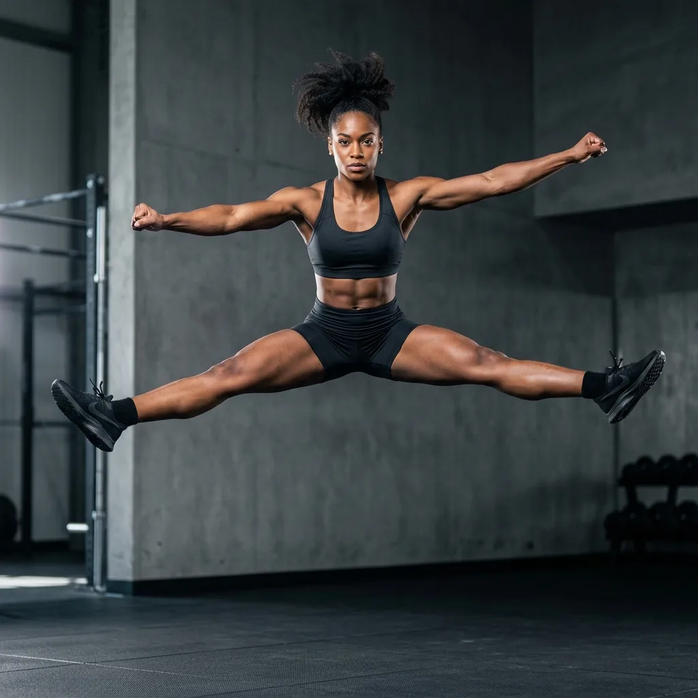

# Athletic feminine body performing a powerful jump freeze

[← Back to the collection](../../README.md) · Category: [Photography](../../gallery/photography.md) · Model: `Vinano Image v2` · ID: `vn-00790`

<a href="https://vinano.ai?utm_source=github&utm_medium=readme&utm_campaign=awesome-image-video-prompts-updating&utm_content=prompt-page-image"></a>

<sub>Preview generated with <a href="https://vinano.ai?utm_source=github&utm_medium=readme&utm_campaign=awesome-image-video-prompts-updating&utm_content=prompt-page-caption">vinano.ai</a></sub>

## Prompt

```text
{
 "content_goal":
"viral athletic jump freeze post",
 "image_type":
 "jump freeze action photography",
 "visual_style":
"cinematic sports editorial, high-impact, premium",
 "motion_concept": {
 "action_type":
 "jump freeze",
 "timing":
"captured at peak height",
 "motion_state":
"completely frozen mid-air",
 "energy":
 "explosive yet controlled"
 },
 "pose_details": {
 "pose_name":
 "jump freeze flex pose",
 "body_position":
"mid-air jump legs extended or flexed symmetrically",
 "core_engagement":
 "tight core visible strength",
 "arm_position":
"balanced, expressive, athletic alignment",
 "freeze_quality":
"sharp, suspended, gravity-defying"
 },
 "subject": {
 "description":
 "athletic feminine body performing a powerful jump freeze",
 "physique": "lean, flexible, toned",
 "body_language": "confident, fearless, strong",
 "expression": "focused intensity calm control"
 },
 "facial_details": {
 "emotion": "determination mixed ease",
 "micro_details": "relaxed face, steady eyes, natural expression"
 },
 "wardrobe": {
 "clothing": "professional athletic performance wear",
 "fit": "body-contoured to emphasize motion lines",
 "fabric": "stretch performance fabric, non-reflective",
 "color_tones": "solid neutral or bold single color"
 },
 "environment": {
 "location": "minimal studio or clean gym space",
 "background": "plain or gradient backdrop",
 "atmosphere": "focused, powerful, distraction-free"
 },
 "lighting": {
 "type": "high-speed studio lighting",
 "quality": "crisp, clean, cinematic",
 "direction": "side and top lighting",
 "effect": "freeze motion sharply defined muscle highlights"
 },
 "camera_details": {
 "angle": "slightly low angle for power emphasis",
 "framing": "full body mid-air capture",
 "lens_feel": "sports editorial realism",
 "focus": "ultra-sharp subject zero motion blur"
 },
 "color_palette": {
 "primary_colors": ["neutral background", "natural skin tone"],
 "contrast_level": "high",
 "mood": "bold, energetic, inspiring"
 },
 "emotional_impact": {
 "viewer_reaction": "scroll-stopping shock and admiration",
 "message": "power, balance, and control in one moment"
 },
 "quality_control": {
 "realism": "ultra-realistic photography",
 "detail_level": "high-definition muscle and fabric texture",
 "ai_artifacts": "none",
 "professional_standard": "editorial-grade"
 },
 "intended_use": {
 "primary": "viral jump freeze post on X",
 "secondary": "fitness branding, athletic inspiration"
 }
}

Maintain consistent colour harmony and crisp focus across the whole frame.
```

## Try it on vinano.ai

1. Copy the prompt above.
2. Open **[vinano.ai](https://vinano.ai?utm_source=github&utm_medium=readme&utm_campaign=awesome-image-video-prompts-updating&utm_content=prompt-page-try)**, paste it into the image generator and pick a model.
3. Swap any placeholders (brand, product, city, person…) for your own details, then generate.

More prompts like this: [Photography gallery](../../gallery/photography.md) · [all categories](../../README.md#contents)
