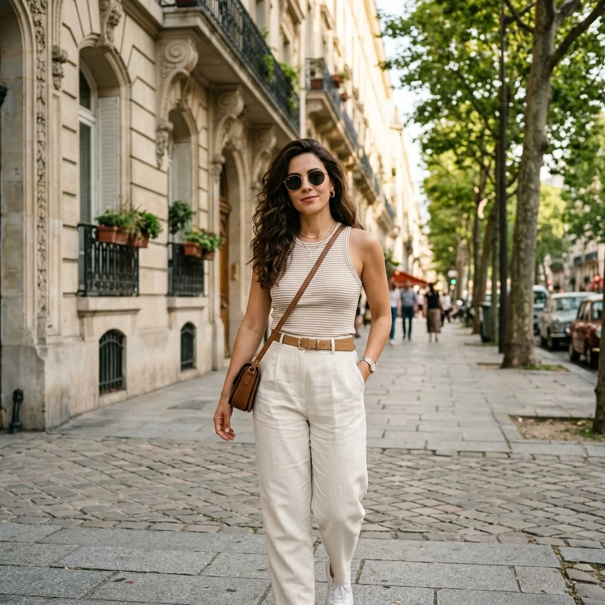

# Scene type

[← Back to the collection](../../README.md) · Category: [Photography](../../gallery/photography.md) · Model: `Vinano Image Pro` · ID: `vn-00796`

<a href="https://vinano.ai?utm_source=github&utm_medium=readme&utm_campaign=awesome-image-video-prompts-updating&utm_content=prompt-page-image"></a>

<sub>Preview generated with <a href="https://vinano.ai?utm_source=github&utm_medium=readme&utm_campaign=awesome-image-video-prompts-updating&utm_content=prompt-page-caption">vinano.ai</a></sub>

## Prompt

```text
{ "scene_type": "outdoor urban street portrait", "composition": { "framing": "vertical portrait orientation", "shot_type": "mid-length shot from head to mid-thigh", "camera_angle": "eye-level", "subject_position": "centered slight rightward offset", "leading_lines": "sidewalk and building facade create linear depth", "depth_of_field": "moderate depth, background softly detailed but not blurred", "balance": "subject balanced against architectural mass on left and greenery on right" }, "subject": { "gender_presentation": "female-presenting", "pose": "relaxed standing pose, one hand in pocket, one arm relaxed", "expression": "neutral to confident subtle smile", "gaze": "looking directly at camera", "hair": { "style": "long, loose waves", "part": "side-parted", "color": "dark brown warm undertones", "texture": "soft, voluminous" }, "accessories": ["round metal-frame sunglasses dark lenses", "small hoop earrings", "wristwatch metallic band", "brown leather shoulder bag"] }, "clothing": { "top": { "type": "sleeveless fitted tank top", "color": "warm beige", "pattern": "thin horizontal white stripes", "fit": "form-fitting" }, "bottom": { "type": baggy pant", "color": "off-white / cream", "fabric_appearance": "structured cotton or linen blend" }, "belt": { "color": "light brown", "buckle": "gold-toned refined minimalist buckle" } }, "environment": { "location_type": "historic city street", "architecture": { "style": "classical or colonial stone facade", "features": "arched windows, ornate stone detailing, balconies" }, "natural_elements": "trees and shrubs lining the sidewalk", "ground": "concrete sidewalk adjacent landscaped soil area", "background_activity": "parked cars partially visible, quiet street ambiance" }, "lighting": { "source": "natural sunlight", "time_of_day": "late morning or afternoon", "quality": "soft directional light", "shadows": "gentle shadows cast by trees and buildings", "skin_tone_rendering": "warm and even" }, "color_palette": { "dominant_colors": ["beige", "cream", "brown", "stone gray", "green"], "overall_tone": "warm, natural, lifestyle aesthetic", "contrast": "moderate contrast between subject and background" }, "camera_characteristics": { "lens_look": "standard to short telephoto perspective", "distortion": "minimal distortion", "sharpness": "sharp focus on subject clear texture detail", "noise": "low noise, clean image" }, "artistic_style": { "genre": "fashion lifestyle photography", "mood": "casual elegance, confident, relaxed", "styling_influence": "modern refined minimalist classic elements", "social_media_aesthetic": "Instagram-style street fashion portrait" }, "post_processing": { "color_grading": "warm tones natural saturation", "contrast_adjustment": "slightly enhanced", "retouching": "minimal, natural skin texture preserved", "overall_finish": "clean and polished" }, "typography": { "present": false } } Render with rich micro-detail while keeping the layout uncluttered and intentional.
```

## Try it on vinano.ai

1. Copy the prompt above.
2. Open **[vinano.ai](https://vinano.ai?utm_source=github&utm_medium=readme&utm_campaign=awesome-image-video-prompts-updating&utm_content=prompt-page-try)**, paste it into the image generator and pick a model.
3. Swap any placeholders (brand, product, city, person…) for your own details, then generate.

More prompts like this: [Photography gallery](../../gallery/photography.md) · [all categories](../../README.md#contents)
