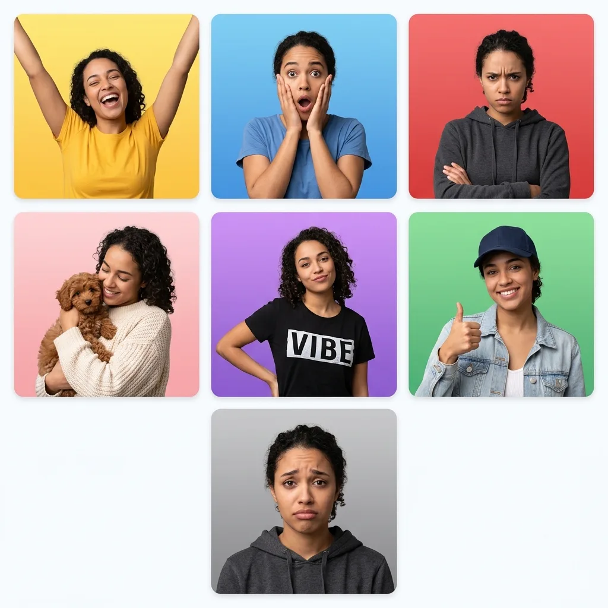

# Panels are NOT edge-to-edge Visible thin white spacing between

[← Back to the collection](../../README.md) · Category: [Photography](../../gallery/photography.md) · Model: `Vinano Image Pro` · ID: `vn-00799`

<a href="https://vinano.ai?utm_source=github&utm_medium=readme&utm_campaign=awesome-image-video-prompts-updating&utm_content=prompt-page-image"></a>

<sub>Preview generated with <a href="https://vinano.ai?utm_source=github&utm_medium=readme&utm_campaign=awesome-image-video-prompts-updating&utm_content=prompt-page-caption">vinano.ai</a></sub>

## Prompt

```text
Panels are NOT edge-to-edge
Visible thin white spacing between panels Subtle outer white margin around the entire grid clean modern UI-style layout
Slight rounded corners on each tile
Panel 1 — Joyful / Celebratory (Yellow) Bright yellow gradient background
Arms raised
Eyes closed
Big open laugh
Energetic posture
Panel 2 — Shocked (Blue)
Blue gradient background
Hands on cheeks
Wide eyes
Open mouth
Raised brows
Panel 3 — Serious / Stern (Red)
Red background
Arms crossed
Furrowed brows
Neutral tight lips
Wearing dark hoodie
Panel 4 — Affectionate (Pink)
Soft pink gradient
Holding small brown puppy
Gentle smile
Cozy knit sweater
Panel 5 — Confident / Sassy (Purple)
Purple gradient background
One hand on hip
Slight smirk
Graphic t-shirt
Relaxed stance
Panel 6 — Friendly / Casual Approval (Green)
Green gradient background
Wearing cap + denim jacket
Thumbs-up
Relaxed smile
Panel 7 — Sad / Emotional (Gray)
Gray gradient background
Slight downward gaze
Eyebrows slightly raised in center
Lips slightly curved downward

Preserve realistic proportions and depth for a confident, professional finish.
```

## Try it on vinano.ai

1. Copy the prompt above.
2. Open **[vinano.ai](https://vinano.ai?utm_source=github&utm_medium=readme&utm_campaign=awesome-image-video-prompts-updating&utm_content=prompt-page-try)**, paste it into the image generator and pick a model.
3. Swap any placeholders (brand, product, city, person…) for your own details, then generate.

More prompts like this: [Photography gallery](../../gallery/photography.md) · [all categories](../../README.md#contents)
