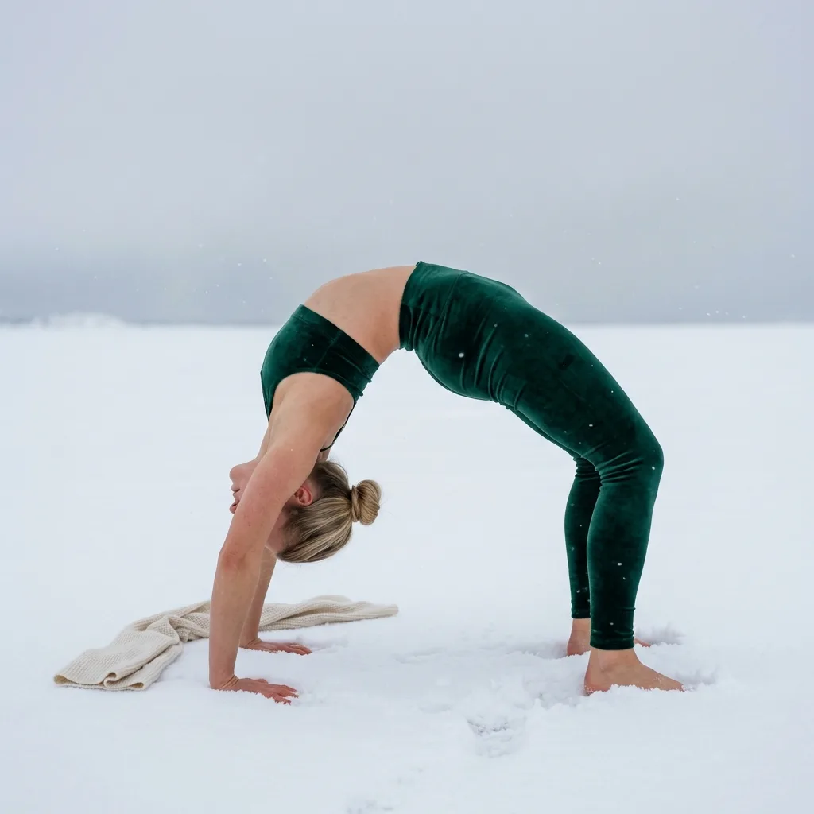

# Fit, graceful woman athletic poise and natural blonde hair

[← Back to the collection](../../README.md) · Category: [Photography](../../gallery/photography.md) · Model: `Vinano Image v2` · ID: `vn-00800`

<a href="https://vinano.ai?utm_source=github&utm_medium=readme&utm_campaign=awesome-image-video-prompts-updating&utm_content=prompt-page-image"></a>

<sub>Preview generated with <a href="https://vinano.ai?utm_source=github&utm_medium=readme&utm_campaign=awesome-image-video-prompts-updating&utm_content=prompt-page-caption">vinano.ai</a></sub>

## Prompt

```text
{
 "image_type":
"High-end fitness editorial / Cinematic lifestyle photography",
 "visual_style":
"refined minimalist luxury, ultra-true-to-life photorealistic, soft-focus realism",
 "composition": {
 "framing":
"Wide-angle side profile to capture the full silhouette",
 "camera_angle": "Low-angle shot to emphasize the height and strength of the arch",
 "perspective": "Clean, linear perspective against a flat, snowy horizon"
 },
 "subject": {
 "description": "A fit, graceful woman athletic poise and natural blonde hair tied in a sleek low bun",
 "pose": "Performing a perfect Yoga Arch (Urdhva Dhanurasana / Wheel Pose)",
 "body_language": "Strong and stable; back arched beautifully palms and feet firmly planted in the snow",
 "expression": "A serene, focused look; eyes closed in a state of meditative calm"
 },
 "facial_details": {
 "emotion": "Peaceful determination and internal quietude",
 "micro_details": "Soft natural skin texture, subtle flush from the cold, and faint visible breath in the air"
 },
 "wardrobe": {
 "clothing": "Premium emerald green velvet high-waist yoga leggings; matching velvet sports bra; a thin, cream-colored thermal scarf draped elegantly nearby",
 "textures": "Rich, light-reflecting velvet fabric against the soft, matte texture of fresh snow",
 "color_tones": "Vibrant emerald green contrasted against a monochrome white landscape"
 },
 "environment": {
 "location": "A vast, silent arctic landscape of pristine white snow",
 "background": "Empty, refined minimalist snowy field meeting a soft, misty gray sky at the horizon",
 "atmosphere": "Quiet, ethereal, and crisp; very light snowfall tiny drifting flakes"
 },
 "lighting": {
 "type": "Soft, natural overcast daylight",
 "quality": "Diffused and ethereal, creating gentle highlights on the velvet curves",
 "direction": "Side-ambient lighting to define the muscular form of the yoga pose"
 },
 "color_palette": {
 "primary": ["Deep Emerald Green", "Pristine White", "Charcoal Black"],
 "mood": "Sophisticated, calm, and visually striking"
 },
 "camera_details": {
 "lens": "50mm prime lens for realistic human proportions",
 "focus": "Sharp focus on the subject; creamy, soft-focus (bokeh) on the distant snowy background",
 "realism": "8K resolution, capturing every fiber of the velvet and the granular detail of the snow"
 },
 "overall_mood": "Graceful, powerful, and serene; a high-fashion approach to wellness",
 "intended_use": "Luxury fitness branding, Pinterest aesthetic editorial, or premium wellness magazine"
}

Preserve realistic proportions and depth for a confident, professional finish.
```

## Try it on vinano.ai

1. Copy the prompt above.
2. Open **[vinano.ai](https://vinano.ai?utm_source=github&utm_medium=readme&utm_campaign=awesome-image-video-prompts-updating&utm_content=prompt-page-try)**, paste it into the image generator and pick a model.
3. Swap any placeholders (brand, product, city, person…) for your own details, then generate.

More prompts like this: [Photography gallery](../../gallery/photography.md) · [all categories](../../README.md#contents)
