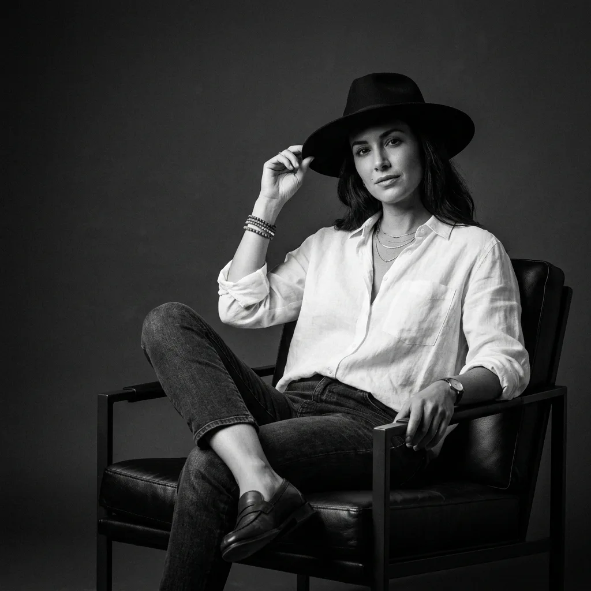

# 8K black-and-white studio portrait captured as a medium shot

[← Back to the collection](../../README.md) · Category: [Photography](../../gallery/photography.md) · Model: `Vinano Image v2` · ID: `vn-00801`

<a href="https://vinano.ai?utm_source=github&utm_medium=readme&utm_campaign=awesome-image-video-prompts-updating&utm_content=prompt-page-image"></a>

<sub>Preview generated with <a href="https://vinano.ai?utm_source=github&utm_medium=readme&utm_campaign=awesome-image-video-prompts-updating&utm_content=prompt-page-caption">vinano.ai</a></sub>

## Prompt

```text
{
 "prompt": "Hyper-realistic 8K black-and-white studio portrait captured as a medium shot from a slightly low-angle perspective, a 50mm lens for a natural field of view. The composition features a female subject, 100% the uploaded face as reference (do not alter facial features or identity), seated off-center to the right, leaving strong negative space above and to the left. She wears a wide-brimmed fedora-style hat, a loose white linen blouse unbuttoned at the collar revealing layered silver necklaces, white linen trousers, and dark leather loafers, delicate beaded bracelets on both wrists. The subject is seated comfortably in a sleek modern black leather lounge chair, left leg crossed over the right, left hand lightly touching the brim of the hat, and right arm casually resting on the chair’s armrest. Dramatic high-contrast chiaroscuro lighting dominates the scene, a strong key light from the front-left creating deep shadows and bright highlights that emphasize the detailed textures of the linen fabric, leather chair, felt hat, and hair. Subtle rim lighting outlines the subject and chair, separating them from a pure deep-black background, enhancing cinematic depth and a professional luxury studio photography aesthetic.",
 "color_style": "black and white",
 "resolution": "8K",
 "camera_lens": "50mm",
 "camera_angle": "slightly low-angle",
 "style": "cinematic studio portrait, luxury editorial",
 "lighting": "chiaroscuro, high-contrast studio lighting",
 "reference_image": "strictly use uploaded image only"
}

Keep edges clean and the overall composition balanced for a polished, gallery-ready result.
```

## Try it on vinano.ai

1. Copy the prompt above.
2. Open **[vinano.ai](https://vinano.ai?utm_source=github&utm_medium=readme&utm_campaign=awesome-image-video-prompts-updating&utm_content=prompt-page-try)**, paste it into the image generator and pick a model.
3. Swap any placeholders (brand, product, city, person…) for your own details, then generate.

More prompts like this: [Photography gallery](../../gallery/photography.md) · [all categories](../../README.md#contents)
