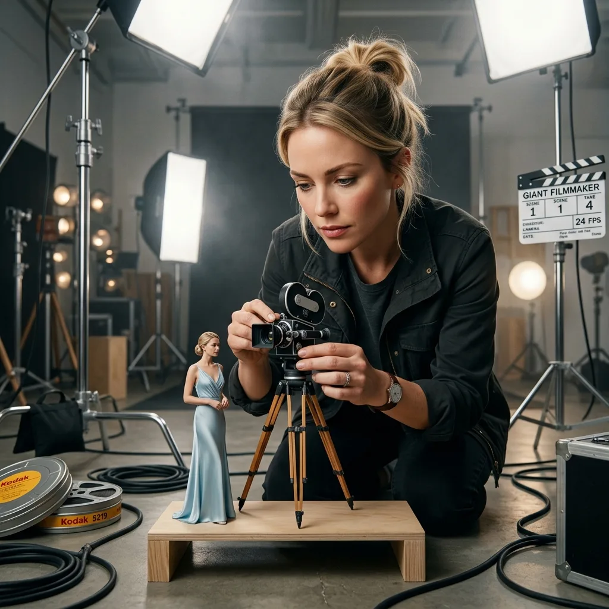

# Scene of a giant woman filmmaker carefully adjusting

[← Back to the collection](../../README.md) · Category: [Photography](../../gallery/photography.md) · Model: `Vinano Image v2` · ID: `vn-00802`

<a href="https://vinano.ai?utm_source=github&utm_medium=readme&utm_campaign=awesome-image-video-prompts-updating&utm_content=prompt-page-image"></a>

<sub>Preview generated with <a href="https://vinano.ai?utm_source=github&utm_medium=readme&utm_campaign=awesome-image-video-prompts-updating&utm_content=prompt-page-caption">vinano.ai</a></sub>

## Prompt

```text
A hyper-realistic cinematic scene of a giant woman filmmaker carefully adjusting a miniature vintage film camera on a tripod, inside a professional studio setup. A tiny elegant woman in a flowing pastel blue dress stands beside the camera like a model on set. Surrounding them are detailed studio lights, softboxes, film reels, cables, and a clapperboard. The giant woman has soft natural makeup, blonde hair tied back, and an intense focused expression. Dramatic soft, diffused lighting, shallow depth of field, ultra-detailed textures, 8K, true-to-life photorealistic, cinematic composition, studio photography, volumetric lighting. Aim for an editorial, design-driven look with deliberate negative space.
```

## Try it on vinano.ai

1. Copy the prompt above.
2. Open **[vinano.ai](https://vinano.ai?utm_source=github&utm_medium=readme&utm_campaign=awesome-image-video-prompts-updating&utm_content=prompt-page-try)**, paste it into the image generator and pick a model.
3. Swap any placeholders (brand, product, city, person…) for your own details, then generate.

More prompts like this: [Photography gallery](../../gallery/photography.md) · [all categories](../../README.md#contents)
