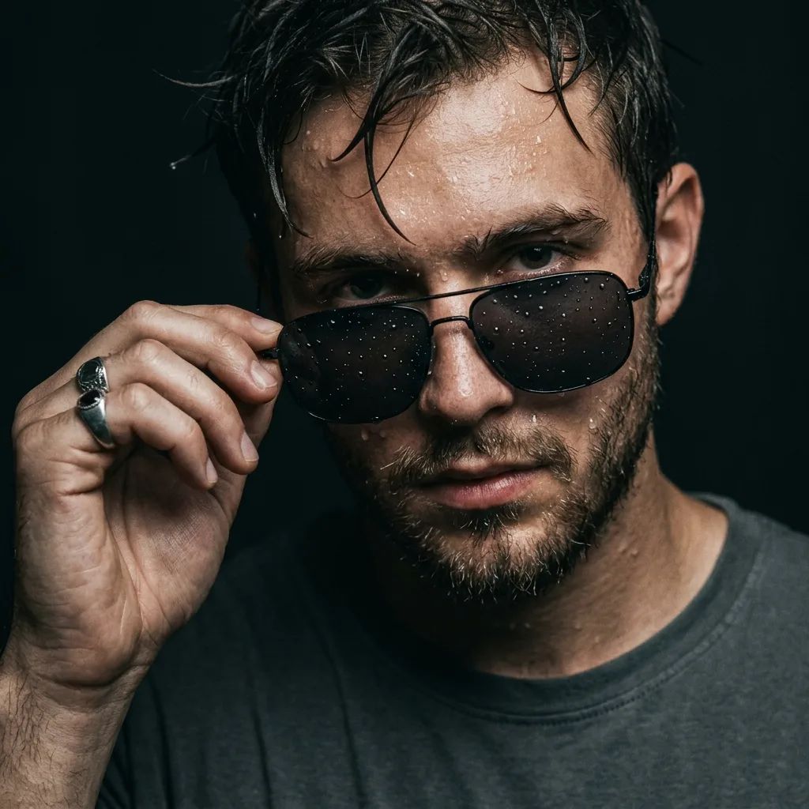

# Close-up portrait of a young man wet skin

[← Back to the collection](../../README.md) · Category: [Photography](../../gallery/photography.md) · Model: `Vinano Image v2` · ID: `vn-00803`

<a href="https://vinano.ai?utm_source=github&utm_medium=readme&utm_campaign=awesome-image-video-prompts-updating&utm_content=prompt-page-image"></a>

<sub>Preview generated with <a href="https://vinano.ai?utm_source=github&utm_medium=readme&utm_campaign=awesome-image-video-prompts-updating&utm_content=prompt-page-caption">vinano.ai</a></sub>

## Prompt

```text
Ultra-realistic cinematic close-up portrait of a young man wet skin and damp, messy hair. He is lightly touching the frame of dark, rectangular aviator sunglasses beaded clear water droplets. The lighting is low-key and dramatic, creating deep shadows that emphasize the moisture on his skin and the fine texture of his beard. He wears a plain, form-fitting matte black t-shirt that blends into a dark, minimal background. Detailed hand gesture showing defined knuckles and a silver ring stone on the pinky finger. Razor-sharp micro-details, shallow depth of field, 85mm f/1.4 lens effect, moody high-contrast realism, and a high-end fashion editorial aesthetic.

Use my uploaded face image as the facial and identity reference.

Render with rich micro-detail while keeping the layout uncluttered and intentional.
```

## Try it on vinano.ai

1. Copy the prompt above.
2. Open **[vinano.ai](https://vinano.ai?utm_source=github&utm_medium=readme&utm_campaign=awesome-image-video-prompts-updating&utm_content=prompt-page-try)**, paste it into the image generator and pick a model.
3. Swap any placeholders (brand, product, city, person…) for your own details, then generate.

More prompts like this: [Photography gallery](../../gallery/photography.md) · [all categories](../../README.md#contents)
