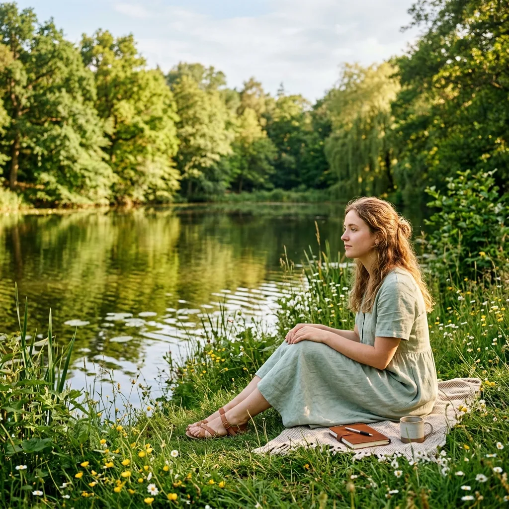

# Unfolds beside a tranquil pond, where gentle ripples catch

[← Back to the collection](../../README.md) · Category: [Photography](../../gallery/photography.md) · Model: `Vinano Image v2` · ID: `vn-00804`

<a href="https://vinano.ai?utm_source=github&utm_medium=readme&utm_campaign=awesome-image-video-prompts-updating&utm_content=prompt-page-image"></a>

<sub>Preview generated with <a href="https://vinano.ai?utm_source=github&utm_medium=readme&utm_campaign=awesome-image-video-prompts-updating&utm_content=prompt-page-caption">vinano.ai</a></sub>

## Prompt

```text
unfolds beside a tranquil pond, where gentle ripples catch the warm, golden sunlight. A young woman sits peacefully on the grassy bank at the water’s edge, her posture relaxed yet slightly leaning forward, as if immersed in quiet contemplation. Soft rays from the high, diffused sun bathe her face and shoulders in a tender glow, highlighting her delicate features and casting subtle, natural shadows. She wears light, flowy summer clothes in soft pastel tones that harmoniously blend the lush surroundings—perhaps a breezy linen dress fluttering faintly in the still air.
The pond mirrors the surrounding trees, their vibrant green leaves shimmering under the sunlight, while delicate reflections dance across the calm surface. The atmosphere feels utterly peaceful, warm, and timeless, no breeze to disturb the stillness. Her expression is calm and introspective, eyes softly gazing toward the water, conveying a deep emotional serenity—as though she’s savoring the beauty of solitude amid nature’s embrace.
This cinematic, highly detailed scene evokes a profound sense of tranquility, capturing the quiet magic of a slow afternoon in perfect harmony the natural world. Realistic lighting, natural colors, soft bokeh, and exquisite realism throughout

Preserve realistic proportions and depth for a confident, professional finish.
```

## Try it on vinano.ai

1. Copy the prompt above.
2. Open **[vinano.ai](https://vinano.ai?utm_source=github&utm_medium=readme&utm_campaign=awesome-image-video-prompts-updating&utm_content=prompt-page-try)**, paste it into the image generator and pick a model.
3. Swap any placeholders (brand, product, city, person…) for your own details, then generate.

More prompts like this: [Photography gallery](../../gallery/photography.md) · [all categories](../../README.md#contents)
