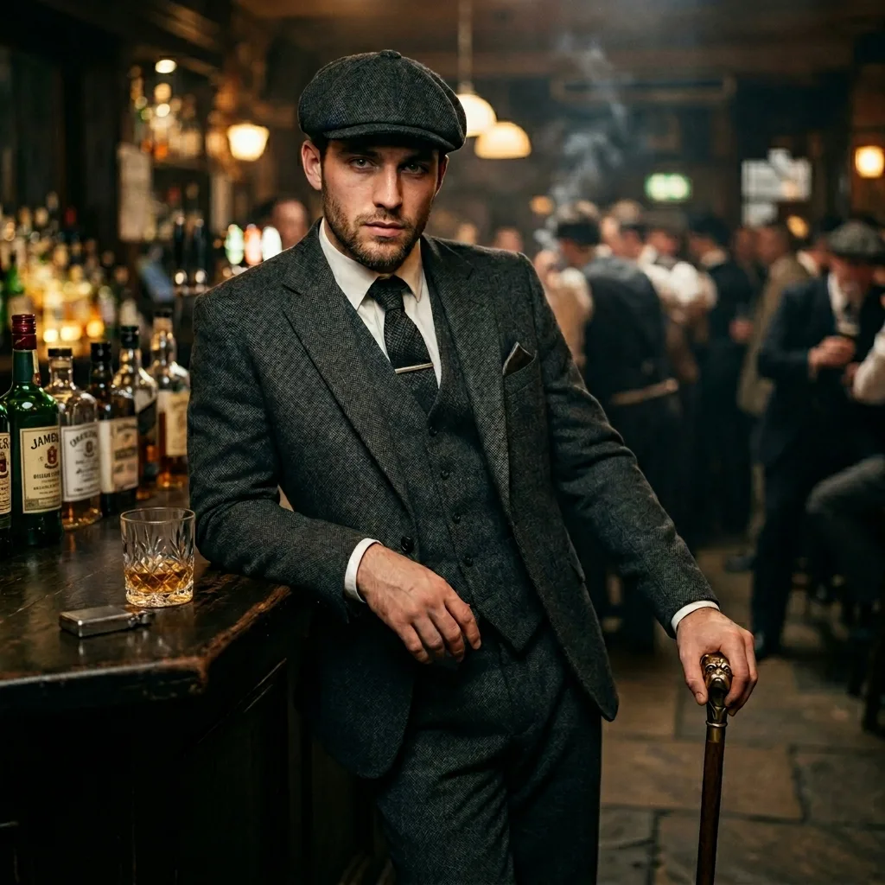

# 3:4 vertical half-body portrait of a young man

[← Back to the collection](../../README.md) · Category: [Photography](../../gallery/photography.md) · Model: `Vinano Image Pro` · ID: `vn-00807`

<a href="https://vinano.ai?utm_source=github&utm_medium=readme&utm_campaign=awesome-image-video-prompts-updating&utm_content=prompt-page-image"></a>

<sub>Preview generated with <a href="https://vinano.ai?utm_source=github&utm_medium=readme&utm_campaign=awesome-image-video-prompts-updating&utm_content=prompt-page-caption">vinano.ai</a></sub>

## Prompt

```text
A hyper-realistic cinematic 3:4 vertical half-body portrait of a young man the exact face from reference image, leaning casually against a 1920s smoky bar table, holding a vintage walking cane. He wears Peaky Blinders-inspired attire-tailored wool three-piece suit, waistcoat, tie, and flat cap. Head slightly down, eyes locked on camera an intense, confident stare. Warm, ambient lighting casts moody shadows; blurred crowd and glowing whisky bottles in soft bokeh create depth. Shot 85mm f/1.4 lens, 8K quality, highlighting fabric textures and facial expression. Aim for an editorial, design-driven look with deliberate negative space.
```

## Try it on vinano.ai

1. Copy the prompt above.
2. Open **[vinano.ai](https://vinano.ai?utm_source=github&utm_medium=readme&utm_campaign=awesome-image-video-prompts-updating&utm_content=prompt-page-try)**, paste it into the image generator and pick a model.
3. Swap any placeholders (brand, product, city, person…) for your own details, then generate.

More prompts like this: [Photography gallery](../../gallery/photography.md) · [all categories](../../README.md#contents)
