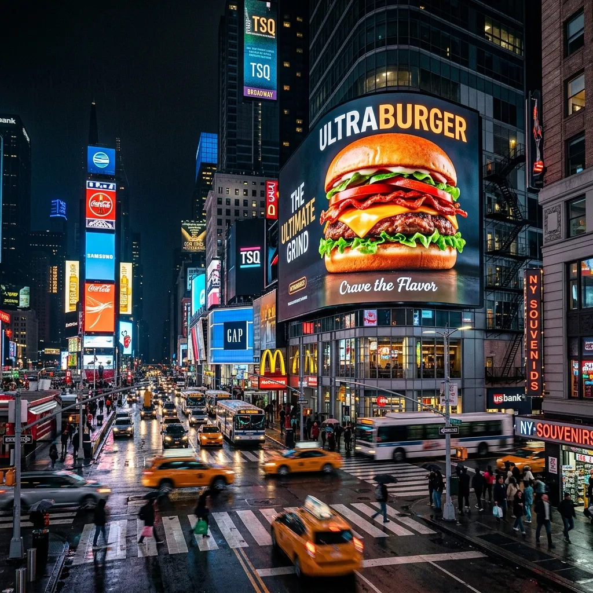

# Night cityscape inspired by Times Square, New York

[← Back to the collection](../../README.md) · Category: [Photography](../../gallery/photography.md) · Model: `Vinano Image Pro` · ID: `vn-00811`

<a href="https://vinano.ai?utm_source=github&utm_medium=readme&utm_campaign=awesome-image-video-prompts-updating&utm_content=prompt-page-image"></a>

<sub>Preview generated with <a href="https://vinano.ai?utm_source=github&utm_medium=readme&utm_campaign=awesome-image-video-prompts-updating&utm_content=prompt-page-caption">vinano.ai</a></sub>

## Prompt

```text
Ultra-realistic cinematic night cityscape inspired by Times Square, New York. A wide-angle street-level view of a busy urban intersection at night wet asphalt reflecting neon lights. Massive curved LED billboard on a corner building displaying a hyper-realistic gourmet burger advertisement, glowing vividly and dominating the scene. Surrounding skyscrapers covered bright digital screens, brand signage, and colorful ads. Motion-blurred traffic trails from passing cars, subtle pedestrians near sidewalks, dramatic contrast between dark sky and illuminated buildings. Cyber-urban atmosphere, commercial advertising aesthetic, long-exposure photography look, sharp architectural details, realistic lighting and reflections, ultra-high resolution, 8K photorealism, cinematic depth, no text overlay. Emphasise material texture and natural light so the final frame feels tactile and premium.
```

## Try it on vinano.ai

1. Copy the prompt above.
2. Open **[vinano.ai](https://vinano.ai?utm_source=github&utm_medium=readme&utm_campaign=awesome-image-video-prompts-updating&utm_content=prompt-page-try)**, paste it into the image generator and pick a model.
3. Swap any placeholders (brand, product, city, person…) for your own details, then generate.

More prompts like this: [Photography gallery](../../gallery/photography.md) · [all categories](../../README.md#contents)
