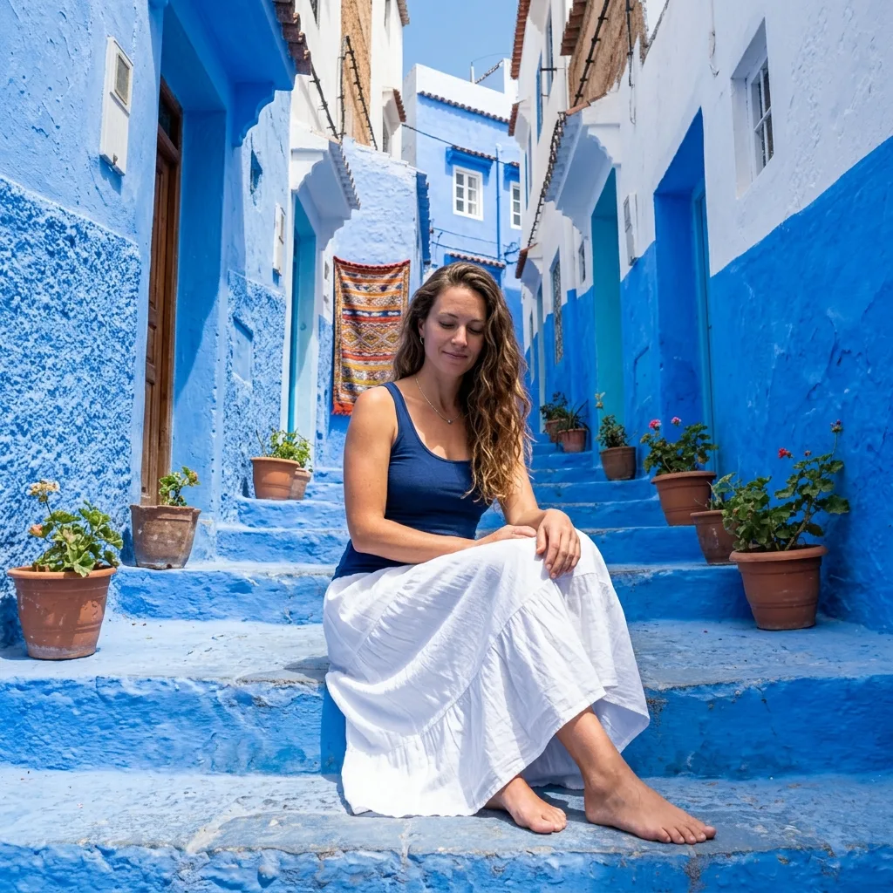

# Seated on steps one leg bent and the other

[← Back to the collection](../../README.md) · Category: [Photography](../../gallery/photography.md) · Model: `Vinano Image Pro` · ID: `vn-00823`

<a href="https://vinano.ai?utm_source=github&utm_medium=readme&utm_campaign=awesome-image-video-prompts-updating&utm_content=prompt-page-image"></a>

<sub>Preview generated with <a href="https://vinano.ai?utm_source=github&utm_medium=readme&utm_campaign=awesome-image-video-prompts-updating&utm_content=prompt-page-caption">vinano.ai</a></sub>

## Prompt

```text
{
 "scene": {
 "setting": "narrow outdoor alley stepped pathway in a Mediterranean blue-painted town",
 "background": "vivid blue walls, stairs, and buildings white accents, hanging fabric on wall, small windows, plants, and bright sky above",
 "lighting": "strong natural sunlight, high contrast defined shadows, bright and saturated colors"
 },
 "subject": {
 "type": "female",
 "pose": "seated on steps one leg bent and the other extended slightly forward, hands resting naturally by her sides",
 "expression": "soft relaxed expression eyes slightly downward, calm and serene mood",
 "face": "Use uploaded reference image, keep identity exact, natural facial proportions, visible skin texture and realistic lighting",
 "hair": "Use uploaded reference image, keep identity exact, long wavy hair falling over shoulders natural volume",
 "eyes": "Use uploaded reference image, keep identity exact, softly focused downward gaze",
 "skin": "natural skin tone sunlit highlights and realistic texture",
 "body": "natural proportions maintained"
 },
 "clothing": {
 "outfit": "blue fitted sleeveless top paired a long flowing white skirt",
 "footwear": "barefoot both feet visible resting naturally on the blue steps",
 "accessories": "minimal jewelry, subtle necklace"
 },
 "environment_details": {
 "props": "textured painted steps, hanging patterned fabric, architectural details of alley",
 "textures": "rough painted walls, fabric folds in skirt, smooth skin highlights, stone steps"
 },
 "camera": {
 "angle": "slightly low front-facing angle centered on subject",
 "framing": "full body framing capturing entire seated pose and surrounding stairs",
 "focus": "sharp focus on subject clear detailed background",
 "lens": "standard smartphone lens"
 },
 "style": {
 "realism": "ultra realistic photography",
 "color_tone": "highly saturated blues contrasted neutral white and natural skin tones",
 "effects": "natural sunlight, no artificial filters",
 "details": "high detail textures, crisp shadows, realistic depth and perspective"
 }
}

Maintain consistent colour harmony and crisp focus across the whole frame.
```

## Try it on vinano.ai

1. Copy the prompt above.
2. Open **[vinano.ai](https://vinano.ai?utm_source=github&utm_medium=readme&utm_campaign=awesome-image-video-prompts-updating&utm_content=prompt-page-try)**, paste it into the image generator and pick a model.
3. Swap any placeholders (brand, product, city, person…) for your own details, then generate.

More prompts like this: [Photography gallery](../../gallery/photography.md) · [all categories](../../README.md#contents)
