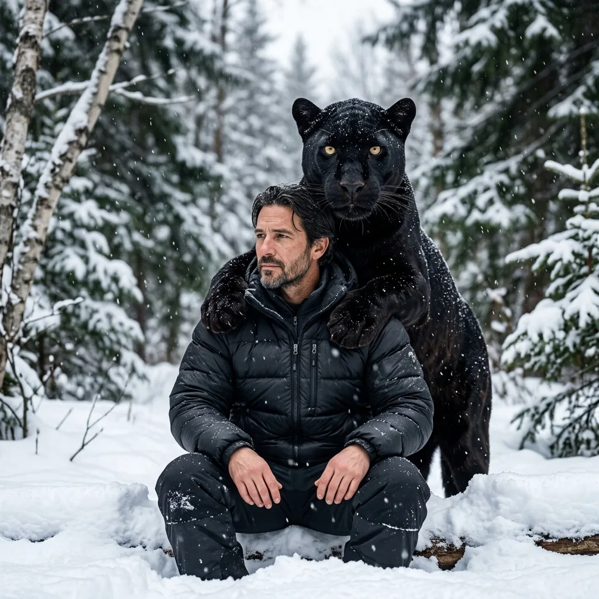

# Photography prompt #826

[← Back to the collection](../../README.md) · Category: [Photography](../../gallery/photography.md) · Model: `Vinano Image v2` · ID: `vn-00826`

<a href="https://vinano.ai?utm_source=github&utm_medium=readme&utm_campaign=awesome-image-video-prompts-updating&utm_content=prompt-page-image"></a>

<sub>Preview generated with <a href="https://vinano.ai?utm_source=github&utm_medium=readme&utm_campaign=awesome-image-video-prompts-updating&utm_content=prompt-page-caption">vinano.ai</a></sub>

## Prompt

```text
A hyper-realistic 8k medium shot, captured a standard lens (e.g., 85mm) at a slightly low angle, frames a man seated in deep snow within a snowy forest. The man, uploaded face as reference, wears a highly detailed black puffer jacket and black pants, looking calmly towards the left side of the frame. Directly behind him, a majestic black panther stands, its large front paws gently resting on his shoulders, creating a surreal yet intimate spatial relationship. The panther's head is positioned just above and slightly to the right of the man's head, its piercing yellow eyes looking forward. The scene is bathed in soft, natural daylight, typical of an overcast winter day, providing filmic, cinematic lighting subtle shadows and highlighting the highly detailed texture of the panther's sleek fur and the man's quilted jacket. Volumetric lighting is evident through the abundant falling snow, which dots the subjects and the environment. The background features a softly blurred snowy forest, emphasizing the central figures and their unique interaction. Keep edges clean and the overall composition balanced for a polished, gallery-ready result.
```

## Try it on vinano.ai

1. Copy the prompt above.
2. Open **[vinano.ai](https://vinano.ai?utm_source=github&utm_medium=readme&utm_campaign=awesome-image-video-prompts-updating&utm_content=prompt-page-try)**, paste it into the image generator and pick a model.
3. Swap any placeholders (brand, product, city, person…) for your own details, then generate.

More prompts like this: [Photography gallery](../../gallery/photography.md) · [all categories](../../README.md#contents)
