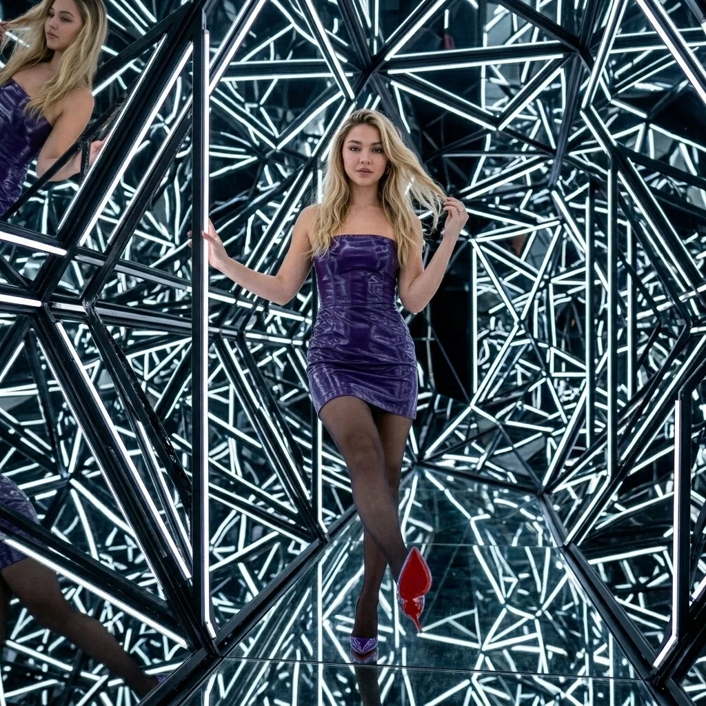

# Subject , type

[← Back to the collection](../../README.md) · Category: [Photography](../../gallery/photography.md) · Model: `Vinano Image Pro` · ID: `vn-00829`

<a href="https://vinano.ai?utm_source=github&utm_medium=readme&utm_campaign=awesome-image-video-prompts-updating&utm_content=prompt-page-image"></a>

<sub>Preview generated with <a href="https://vinano.ai?utm_source=github&utm_medium=readme&utm_campaign=awesome-image-video-prompts-updating&utm_content=prompt-page-caption">vinano.ai</a></sub>

## Prompt

```text
[{
 "id": "subject",
 "type": "person",
 "description": "Madelyn Cline long blonde hair, looking at the camera.",
 "pose": "She is walking forward through the mirrored structure mid-step, one hand lightly brushing the metal framework while the other adjusts her hair as she glances toward the camera.",
 "clothing": {
 "dress": {
 "color": "deep violet",
 "material": "patent leather",
 "style": "strapless mini-dress"
 },
 "legwear": {
 "color": "black",
 "type": "sheer pantyhose"
 },
 "footwear": {
 "color": "Violet",
 "material": "patent leather",
 "style": "Louboutin So Kate red sole"
 }
 }
 },
 {
 "id": "environment",
 "type": "room",
 "description": "A geometrically designed mirrored room a fractured, kaleidoscopic effect.",
 "elements": [{
 "type": "mirrors",
 "description": "Multiple angled mirror panels reflecting the subject and the room structure."
 },
 {
 "type": "structure",
 "description": "Black metal framework holding the mirror panels."
 }],
 "lighting": "Bright, high-contrast light from LED strips within the structure, creating sharp highlights and reflections, premium-quality, cinematic, Ultra-realistic photo and lighting, premium quality photo, depth of field, no Ai or cgi look, 8k resolution."
 }]

Render with rich micro-detail while keeping the layout uncluttered and intentional.
```

## Try it on vinano.ai

1. Copy the prompt above.
2. Open **[vinano.ai](https://vinano.ai?utm_source=github&utm_medium=readme&utm_campaign=awesome-image-video-prompts-updating&utm_content=prompt-page-try)**, paste it into the image generator and pick a model.
3. Swap any placeholders (brand, product, city, person…) for your own details, then generate.

More prompts like this: [Photography gallery](../../gallery/photography.md) · [all categories](../../README.md#contents)
