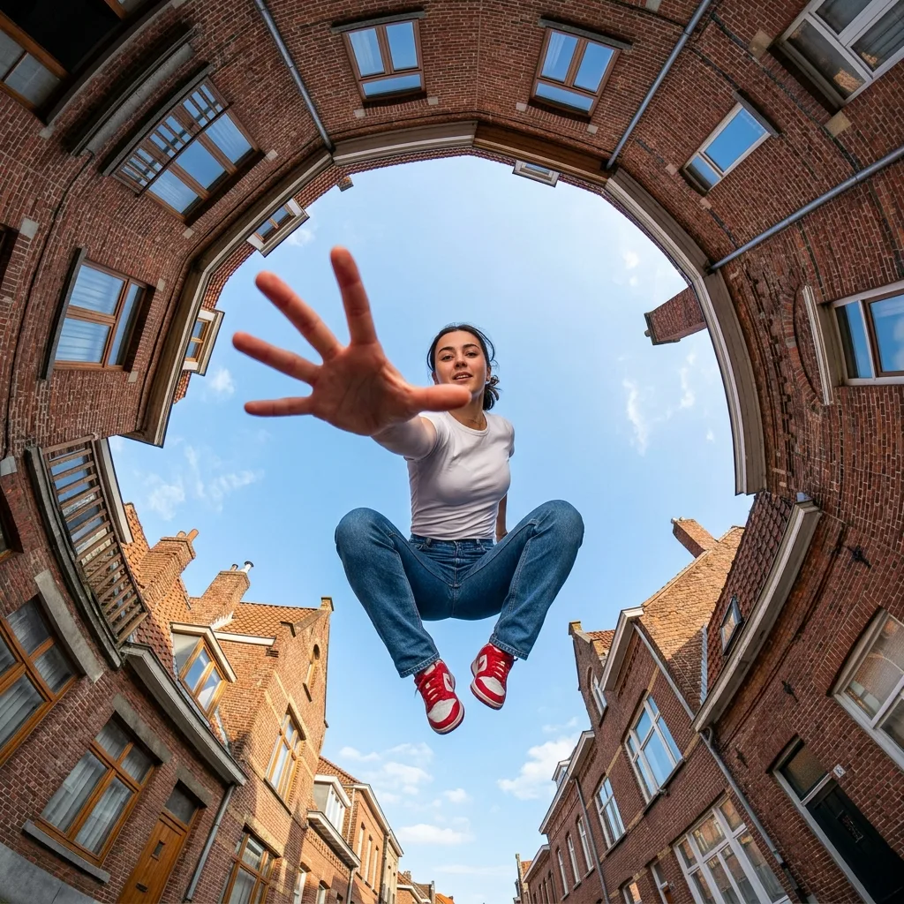

# Ultra-wide fisheye lens perspective shot from ground level looking

[← Back to the collection](../../README.md) · Category: [Photography](../../gallery/photography.md) · Model: `Vinano Image v2` · ID: `vn-00830`

<a href="https://vinano.ai?utm_source=github&utm_medium=readme&utm_campaign=awesome-image-video-prompts-updating&utm_content=prompt-page-image"></a>

<sub>Preview generated with <a href="https://vinano.ai?utm_source=github&utm_medium=readme&utm_campaign=awesome-image-video-prompts-updating&utm_content=prompt-page-caption">vinano.ai</a></sub>

## Prompt

```text
Make an Ultra-wide fisheye lens perspective shot from ground level looking straight up at a young woman use image for face reference crouching mid-air between brick buildings forming a circular frame around the sky. She reaches one hand dramatically toward the camera, fingers spread wide, creating strong foreground distortion and depth. Dynamic action pose, confident expression, casual streetwear outfit: fitted white t-shirt, blue straight-leg jeans, red and white sneakers. Urban European neighborhood setting brick houses, tiled roofs, windows visible around the edges. Bright daylight, clear blue sky, natural lighting, sharp focus, high detail, cinematic composition, exaggerated perspective, 8k resolution, true-to-life photorealistic, adventure photography style. Maintain consistent colour harmony and crisp focus across the whole frame.
```

## Try it on vinano.ai

1. Copy the prompt above.
2. Open **[vinano.ai](https://vinano.ai?utm_source=github&utm_medium=readme&utm_campaign=awesome-image-video-prompts-updating&utm_content=prompt-page-try)**, paste it into the image generator and pick a model.
3. Swap any placeholders (brand, product, city, person…) for your own details, then generate.

More prompts like this: [Photography gallery](../../gallery/photography.md) · [all categories](../../README.md#contents)
