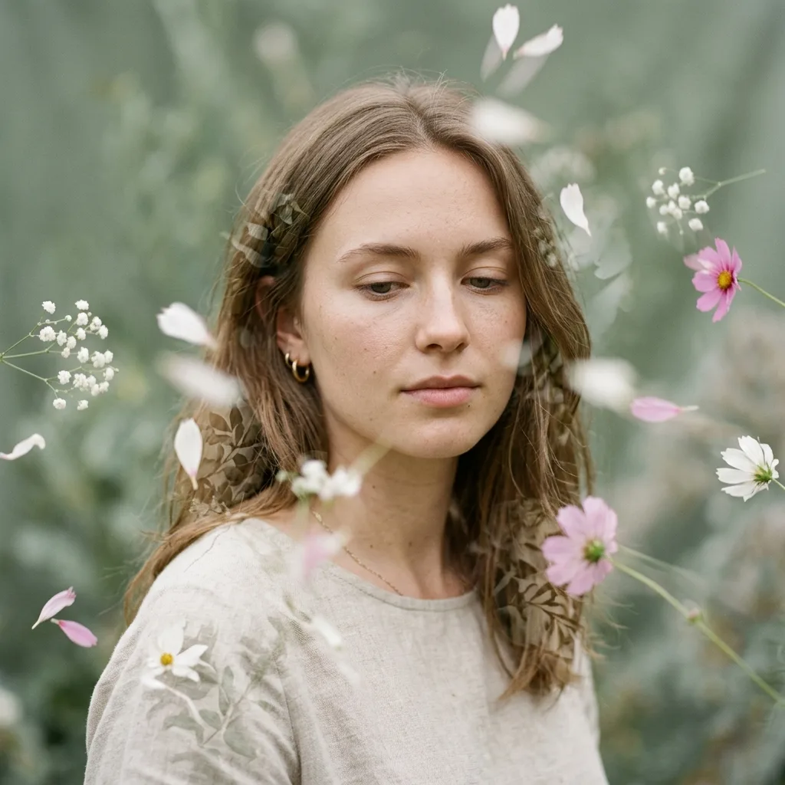

# Fine-art portrait of a young woman soft natural features

[← Back to the collection](../../README.md) · Category: [Photography](../../gallery/photography.md) · Model: `Vinano Image v2` · ID: `vn-00831`

<a href="https://vinano.ai?utm_source=github&utm_medium=readme&utm_campaign=awesome-image-video-prompts-updating&utm_content=prompt-page-image"></a>

<sub>Preview generated with <a href="https://vinano.ai?utm_source=github&utm_medium=readme&utm_campaign=awesome-image-video-prompts-updating&utm_content=prompt-page-caption">vinano.ai</a></sub>

## Prompt

```text
Ultra-realistic fine-art portrait of a young woman soft natural features, minimal makeup, and calm introspective expression. Pastel muted background in sage green tones. Delicate flowers drifting across the frame in the foreground, creating intentional motion blur and soft streaks of light. Subtle double exposure and slow-shutter motion effects across the face, dreamy and poetic atmosphere. Gentle diffused lighting smooth highlights on skin, natural texture preserved. Elegant refined minimalist composition, emotional and serene mood, editorial fine-art photography style, shallow depth of field, cinematic softness, painterly realism, ultra-high resolution, 8K quality. Keep edges clean and the overall composition balanced for a polished, gallery-ready result.
```

## Try it on vinano.ai

1. Copy the prompt above.
2. Open **[vinano.ai](https://vinano.ai?utm_source=github&utm_medium=readme&utm_campaign=awesome-image-video-prompts-updating&utm_content=prompt-page-try)**, paste it into the image generator and pick a model.
3. Swap any placeholders (brand, product, city, person…) for your own details, then generate.

More prompts like this: [Photography gallery](../../gallery/photography.md) · [all categories](../../README.md#contents)
