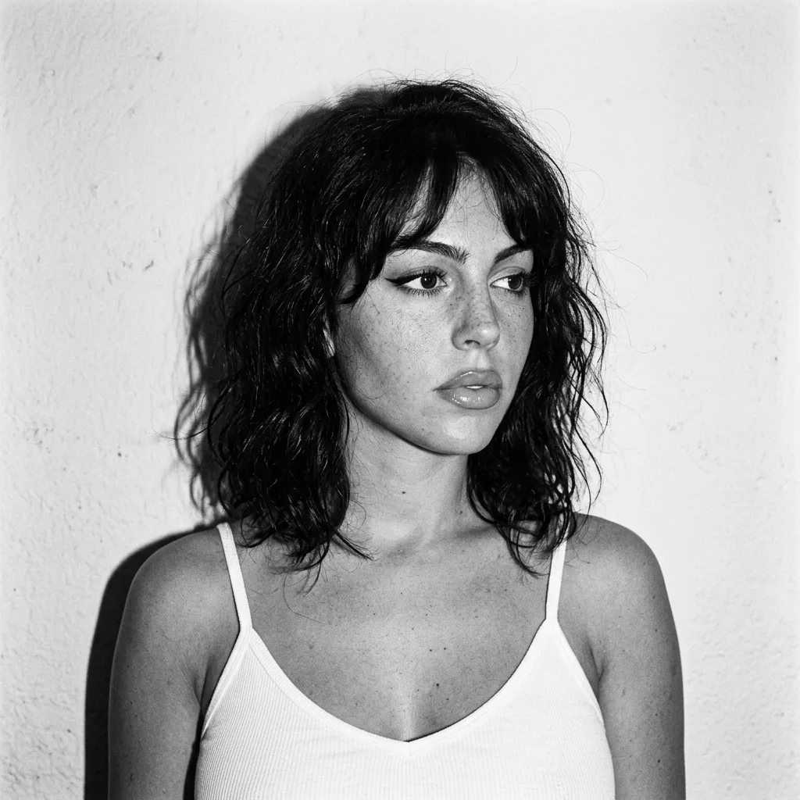

# 4k HD black and white portrait of a Georgina

[← Back to the collection](../../README.md) · Category: [Photography](../../gallery/photography.md) · Model: `Vinano Image v2` · ID: `vn-00841`

<a href="https://vinano.ai?utm_source=github&utm_medium=readme&utm_campaign=awesome-image-video-prompts-updating&utm_content=prompt-page-image"></a>

<sub>Preview generated with <a href="https://vinano.ai?utm_source=github&utm_medium=readme&utm_campaign=awesome-image-video-prompts-updating&utm_content=prompt-page-caption">vinano.ai</a></sub>

## Prompt

```text
{
 "image_analysis": {
 "subject": {
 "type": "Georgina Rodríguez",
 "expression": "Neutral, slightly sultry, contemplative, looking off-camera to the right",
 "pose": "Portrait shot, head and shoulders, slightly angled body"
 },
 "facial_features": {
 "skin": "Fair prominent natural freckles dusted across the nose and cheeks",
 "eyes": "Dark, almond-shaped, gazing sideways, adorned winged eyeliner and mascara",
 "eyebrows": "Dark, well-defined, slightly arched",
 "lips": "Full, plump, glossy, slightly parted",
 "structure": "Soft jawline, youthful features"
 },
 "hair": {
 "color": "Dark brown or black",
 "style": "Shoulder-length, layered, tousled waves, messy texture",
 "details": "Curtain bangs framing the face, loose flyaways catching the light"
 },
 "attire": {
 "garment": "White tank top / camisole",
 "details": "V-neck, thin spaghetti straps, simple texture"
 },
 "lighting_and_atmosphere": {
 "type": "Flash photography",
 "contrast": "High contrast black and white",
 "shadows": "Hard shadow behind the subject indicating direct front-facing flash",
 "vibe": "Vintage, 90s grunge aesthetic, lo-fi, candid"
 },
 "technical_enhancements": {
 "resolution": "4k HD, 8k resolution",
 "quality": "Ultra-detailed, true-to-life photorealistic, sharp focus",
 "texture": "Fine film grain, realistic skin texture"
 }
 },
 "generated_prompt": "A hyper-realistic 4k HD black and white portrait of a Georgina Rodríguez shoulder-length dark messy hair and curtain bangs. She has prominent freckles on her nose and cheeks, full glossy lips slightly parted, and dark eyes looking to the side winged eyeliner. She is wearing a simple white V-neck camisole. The lighting is direct flash photography style creating a vintage 90s aesthetic high contrast and a hard shadow against a plain background. The image should feature ultra-detailed skin texture, fine film grain, and sharp focus, capturing a candid, sultry mood."
}

Preserve realistic proportions and depth for a confident, professional finish.
```

## Try it on vinano.ai

1. Copy the prompt above.
2. Open **[vinano.ai](https://vinano.ai?utm_source=github&utm_medium=readme&utm_campaign=awesome-image-video-prompts-updating&utm_content=prompt-page-try)**, paste it into the image generator and pick a model.
3. Swap any placeholders (brand, product, city, person…) for your own details, then generate.

More prompts like this: [Photography gallery](../../gallery/photography.md) · [all categories](../../README.md#contents)
