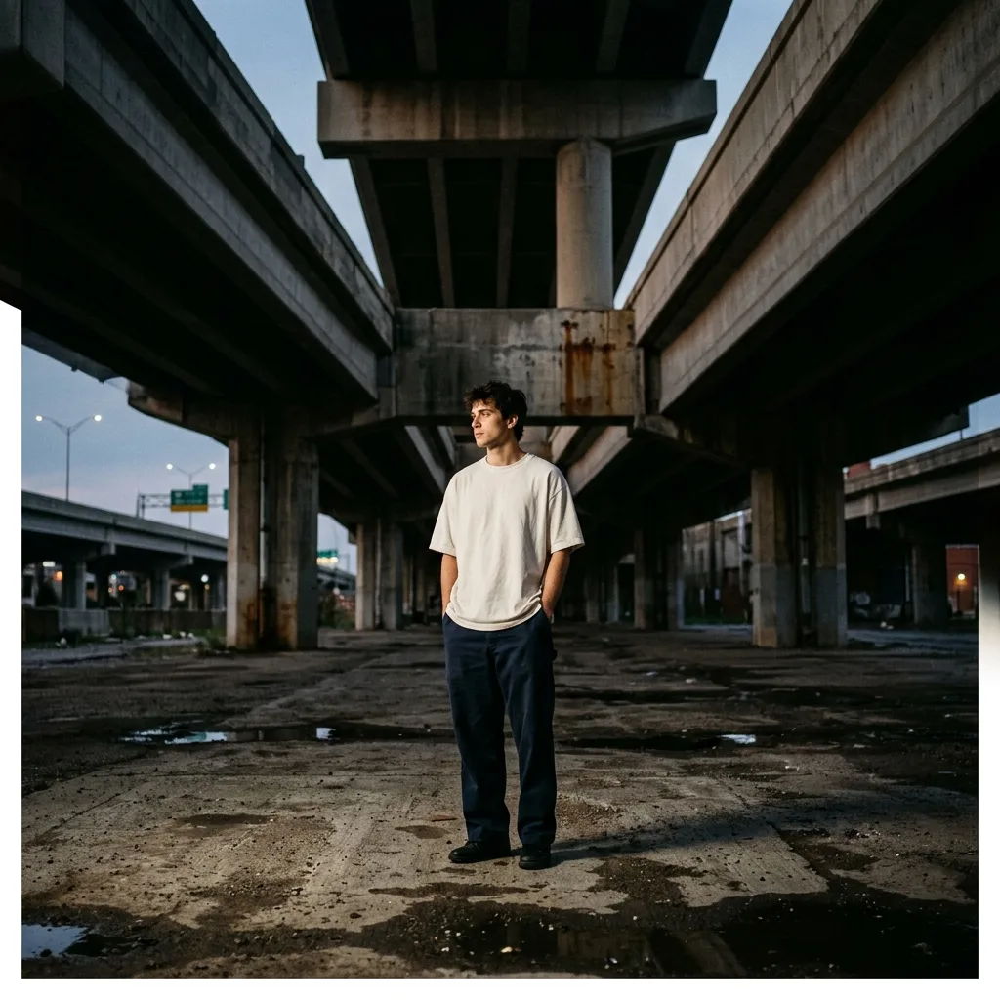

# Moody, urban portrait of me standing under a desolate

[← Back to the collection](../../README.md) · Category: [Photography](../../gallery/photography.md) · Model: `Vinano Image v2` · ID: `vn-00857`

<a href="https://vinano.ai?utm_source=github&utm_medium=readme&utm_campaign=awesome-image-video-prompts-updating&utm_content=prompt-page-image"></a>

<sub>Preview generated with <a href="https://vinano.ai?utm_source=github&utm_medium=readme&utm_campaign=awesome-image-video-prompts-updating&utm_content=prompt-page-caption">vinano.ai</a></sub>

## Prompt

```text
A moody, urban portrait of me standing under a desolate concrete overpass, the harsh architectural lines framing a lone figure. I'm wear ing an oversized white t-shirt and loose dark pants, hands in pockets, a relaxed posture. The ground is rough, textured concrete, hints of dampness. Cinematic top lighting deep shadows and rich tex ture, emphasizing the starkness of the environment.

Shot on 35mm, f/2.8, ISO 400, 1/125s. Apply Fuji Classic Chrome preset warm highlights, strong contrast, slight desaturation, light film grain, and soft vignette for a nostalgic, поп-blue tone look.

Aim for an editorial, design-driven look with deliberate negative space.
```

## Try it on vinano.ai

1. Copy the prompt above.
2. Open **[vinano.ai](https://vinano.ai?utm_source=github&utm_medium=readme&utm_campaign=awesome-image-video-prompts-updating&utm_content=prompt-page-try)**, paste it into the image generator and pick a model.
3. Swap any placeholders (brand, product, city, person…) for your own details, then generate.

More prompts like this: [Photography gallery](../../gallery/photography.md) · [all categories](../../README.md#contents)
