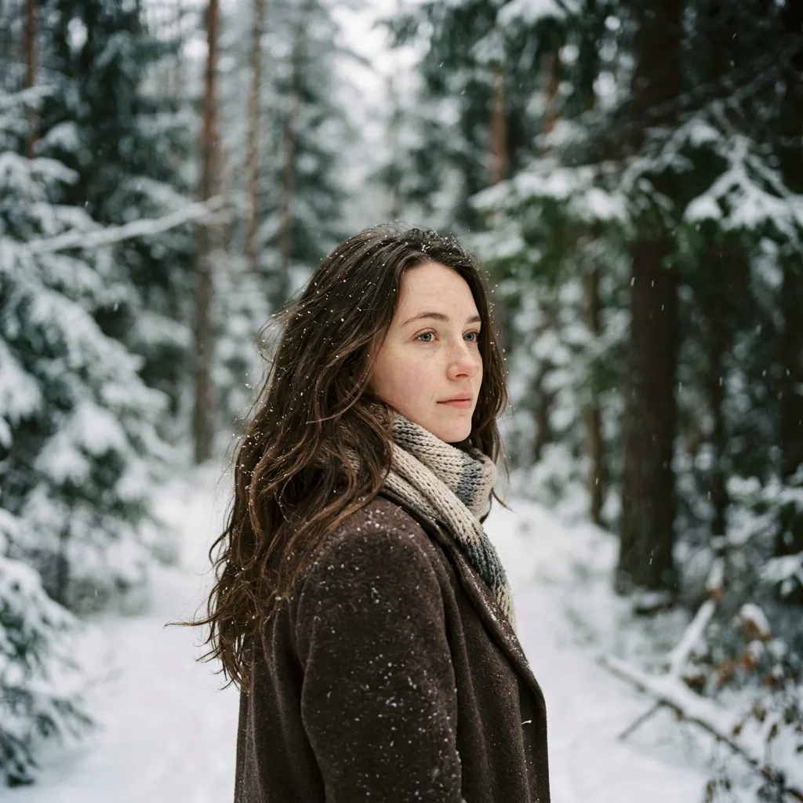

# Snowy forest soft-focus evergreen trees

[← Back to the collection](../../README.md) · Category: [Photography](../../gallery/photography.md) · Model: `Vinano Image v2` · ID: `vn-00860`

<a href="https://vinano.ai?utm_source=github&utm_medium=readme&utm_campaign=awesome-image-video-prompts-updating&utm_content=prompt-page-image"></a>

<sub>Preview generated with <a href="https://vinano.ai?utm_source=github&utm_medium=readme&utm_campaign=awesome-image-video-prompts-updating&utm_content=prompt-page-caption">vinano.ai</a></sub>

## Prompt

```text
{
 "Objective": "Generate a cinematic, true-to-life photorealistic portrait inspired by a winter forest atmosphere",
 "PersonaDetails": {
 "Subject": "Young woman",
 "Appearance": {
 "Hair": "Long, wavy dark brown hair, slightly windblown",
 "Eyes": "Light blue",
 "Skin": "Fair natural freckles",
 "Expression": "Soft, introspective, slightly wistful"
 },
 "Clothing": {
 "Outerwear": "Dark brown wool coat",
 "Accessories": "Knitted scarf in neutral tones"
 }
 },
 "SceneDescription": {
 "Environment": "Snowy forest soft-focus evergreen trees",
 "Weather": "Gentle snowfall",
 "Season": "Winter",
 "Mood": "Quiet, cinematic, melancholic, ethereal"
 },
 "PhotographyStyle": {
 "Type": "Cinematic portrait photography",
 "Lighting": "Soft natural light, overcast winter lighting",
 "DepthOfField": "Shallow depth of field creamy bokeh",
 "CameraAngle": "Three-quarter profile, subject looking back over shoulder",
 "Resolution": "Ultra high resolution, sharp facial details"
 },
 "ArtDirection": {
 "ColorPalette": "Muted earth tones, cool greens and soft whites",
 "Texture": "Natural skin texture, visible snow particles",
 "RealismLevel": "Highly true-to-life photorealistic"
 },
 "NegativePrompt": ["cartoon",
 "anime",
 "overly smooth skin",
 "harsh lighting",
 "blurry face",
 "distorted anatomy",
 "oversaturated colors"],
 "ResponseFormat": {
 "Type": "Single image",
 "Orientation": "Portrait",
 "AspectRatio": "2:3"
 }
}

Maintain consistent colour harmony and crisp focus across the whole frame.
```

## Try it on vinano.ai

1. Copy the prompt above.
2. Open **[vinano.ai](https://vinano.ai?utm_source=github&utm_medium=readme&utm_campaign=awesome-image-video-prompts-updating&utm_content=prompt-page-try)**, paste it into the image generator and pick a model.
3. Swap any placeholders (brand, product, city, person…) for your own details, then generate.

More prompts like this: [Photography gallery](../../gallery/photography.md) · [all categories](../../README.md#contents)
