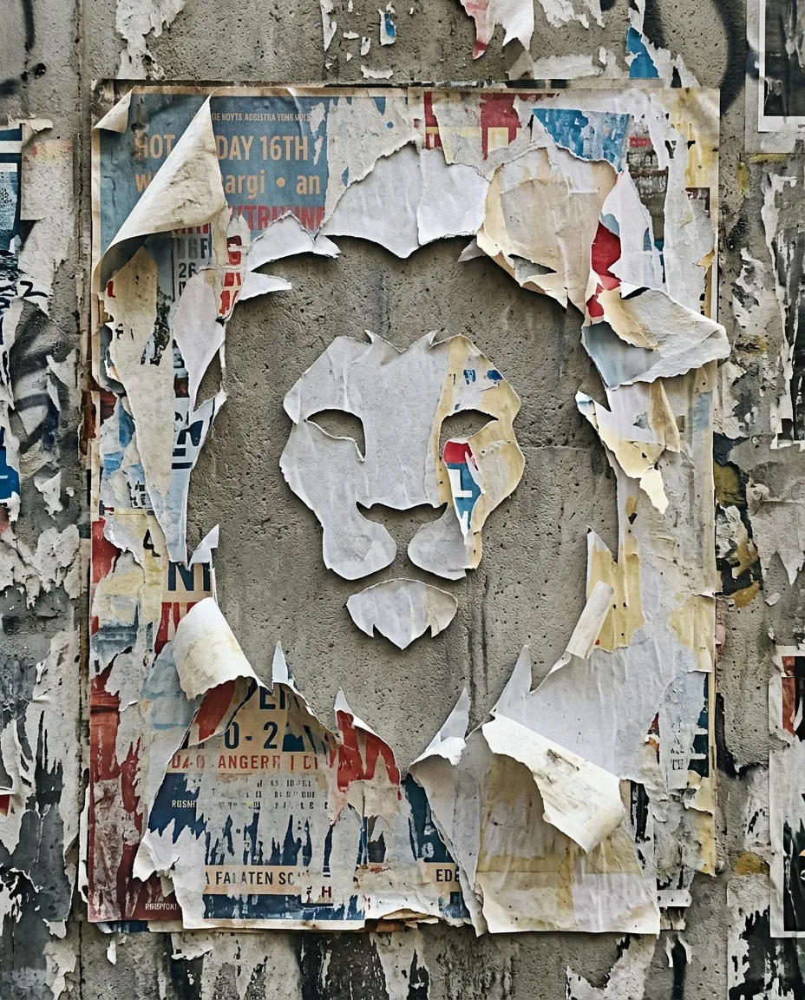

# Transform the uploaded logo into a realistic urban wall

[← Back to the collection](../../README.md) · Category: [Photography](../../gallery/photography.md) · Model: `Vinano Image Pro` · ID: `vn-00862`

<a href="https://vinano.ai?utm_source=github&utm_medium=readme&utm_campaign=awesome-image-video-prompts-updating&utm_content=prompt-page-image"></a>

<sub>Preview generated with <a href="https://vinano.ai?utm_source=github&utm_medium=readme&utm_campaign=awesome-image-video-prompts-updating&utm_content=prompt-page-caption">vinano.ai</a></sub>

## Prompt

```text
Transform the uploaded logo into a realistic urban wall scene where the logo silhouette is revealed through layers of torn posters. The logo must keep its exact shape and proportions, appearing as if multiple posters have been ripped away over time, exposing the shape naturally within the layered paper textures.

Material details:
Multiple overlapping poster layers different colors, prints, and paper types.
Ripped edges fibrous texture, curls, and torn fragments.
Aged paper fading, stains, glue residue, and slight peeling.
Some areas showing older layers beneath, creating depth.

Physics behavior:
Paper tearing should look natural — irregular edges, varying thickness, partial detachment.
Edges curling outward due to humidity and time.
Glue holding some sections while others peel away.
Layer separation revealing deeper textures gradually.

Surface interaction:
Rough concrete or plaster wall beneath the posters.
Glue marks and residue where posters were attached.
Cracks, dirt, and weathering visible on exposed wall areas.

Environment:
Urban street setting - alley wall or city corner.
Hints of surrounding posters, graffiti, or wear.
No overly clean or staged look.

Lighting:
Natural daylight or soft urban lighting.
Shadows inside torn layers creating depth.
Subtle highlights on curled paper edges.

Atmosphere:
Raw.
Layered.
Time-worn.
Authentic street texture.

Camera & composition:
Straight-on or slightly angled close-up view.
Logo clearly visible through torn layers.
Depth emphasized through overlapping paper textures.

Format:
Aspect ratio: STRICT 4:5 vertical.
No text overlays.

Style:
Hyper-real urban surface photography.
Physically accurate material aging and layering.

Preserve realistic proportions and depth for a confident, professional finish.
```

## Try it on vinano.ai

1. Copy the prompt above.
2. Open **[vinano.ai](https://vinano.ai?utm_source=github&utm_medium=readme&utm_campaign=awesome-image-video-prompts-updating&utm_content=prompt-page-try)**, paste it into the image generator and pick a model.
3. Swap any placeholders (brand, product, city, person…) for your own details, then generate.

More prompts like this: [Photography gallery](../../gallery/photography.md) · [all categories](../../README.md#contents)
