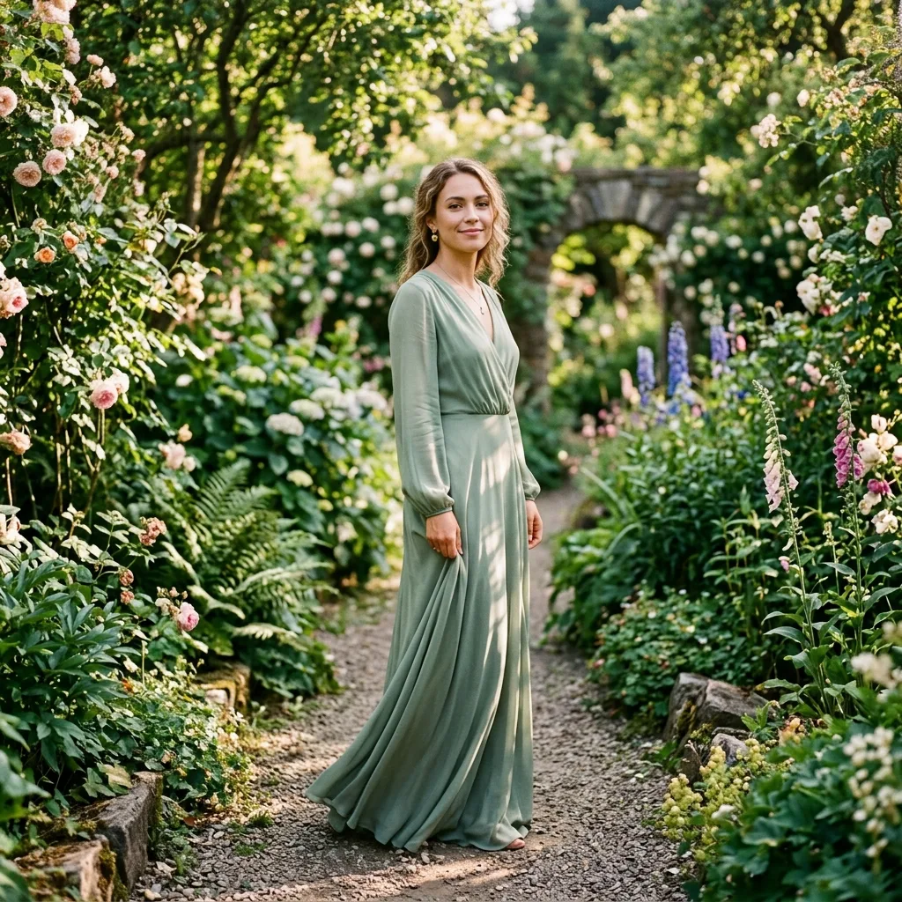

# Photography prompt #865

[← Back to the collection](../../README.md) · Category: [Photography](../../gallery/photography.md) · Model: `Vinano Image v2` · ID: `vn-00865`

<a href="https://vinano.ai?utm_source=github&utm_medium=readme&utm_campaign=awesome-image-video-prompts-updating&utm_content=prompt-page-image"></a>

<sub>Preview generated with <a href="https://vinano.ai?utm_source=github&utm_medium=readme&utm_campaign=awesome-image-video-prompts-updating&utm_content=prompt-page-caption">vinano.ai</a></sub>

## Prompt

```text
{
  "render_goal": "Natural cinematic garden portrait timeless elegance",
  "subject": {
    "pose": "female standing naturally on a garden path, relaxed posture",
    "expression": "calm composed confidence a genuine soft smile"
  },
  "wardrobe": "elegant silk chiffon gown in muted sage or soft ivory, minimal drape, realistic fabric weight, subtle movement, no shimmer, no fantasy elements",
  "environment": {
    "location": "lush botanical garden in daylight",
    "props": "realistic flowers and greenery, natural sunlight filtering through leaves, gentle shadows, earthy tones, organic depth of field"
  },
  "camera_style": "cinematic photography, 50mm lens look, shallow depth of field, natural skin texture, realistic color grading, film-like softness"
}

Keep edges clean and the overall composition balanced for a polished, gallery-ready result.
```

## Try it on vinano.ai

1. Copy the prompt above.
2. Open **[vinano.ai](https://vinano.ai?utm_source=github&utm_medium=readme&utm_campaign=awesome-image-video-prompts-updating&utm_content=prompt-page-try)**, paste it into the image generator and pick a model.
3. Swap any placeholders (brand, product, city, person…) for your own details, then generate.

More prompts like this: [Photography gallery](../../gallery/photography.md) · [all categories](../../README.md#contents)
