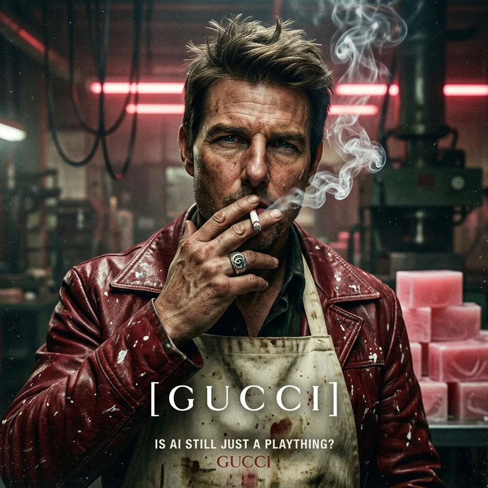

# Highly detailed, cinematic portrait of Tom Cruise

[← Back to the collection](../../README.md) · Category: [Photography](../../gallery/photography.md) · Model: `Vinano Image v2` · ID: `vn-00870`

<a href="https://vinano.ai?utm_source=github&utm_medium=readme&utm_campaign=awesome-image-video-prompts-updating&utm_content=prompt-page-image"></a>

<sub>Preview generated with <a href="https://vinano.ai?utm_source=github&utm_medium=readme&utm_campaign=awesome-image-video-prompts-updating&utm_content=prompt-page-caption">vinano.ai</a></sub>

## Prompt

```text
A highly detailed, cinematic portrait of Tom Cruise, featuring a gritty, industrial aesthetic. He has messy, spiked dark-blonde hair, facial stubble, and a look of intense, weary focus. He is captured in a close-up shot, holding a lit cigarette to his mouth his right hand; a thick trail of white smoke curls upward. On his finger is a prominent silver signet ring engraved a luxury interlocking "GG" logo. The man wears a distressed, dark red leather jacket heavily marked white paint splatters and deep creases, layered over a filthy, stained cream-colored canvas apron. The center of the frame features the word [GUCCI] in a clean, white, authoritative serif font. Below it, in smaller text on the apron, is the phrase "IS AI STILL JUST A PLAYTHING?" followed by a second, faded "GUCCI" logo. The background is a blurred industrial laboratory or "soap factory" setting. To the right are stacks of translucent pink rectangular soap blocks. In the upper background, dark industrial machinery and hanging wires are illuminated by glowing red horizontal neon lights, creating a moody, high-contrast atmosphere. The entire image has a heavy film grain, a hazy atmosphere, and a color palette dominated by deep reds, pale pinks, and grimy earth tones. Keep edges clean and the overall composition balanced for a polished, gallery-ready result.
```

## Try it on vinano.ai

1. Copy the prompt above.
2. Open **[vinano.ai](https://vinano.ai?utm_source=github&utm_medium=readme&utm_campaign=awesome-image-video-prompts-updating&utm_content=prompt-page-try)**, paste it into the image generator and pick a model.
3. Swap any placeholders (brand, product, city, person…) for your own details, then generate.

More prompts like this: [Photography gallery](../../gallery/photography.md) · [all categories](../../README.md#contents)
