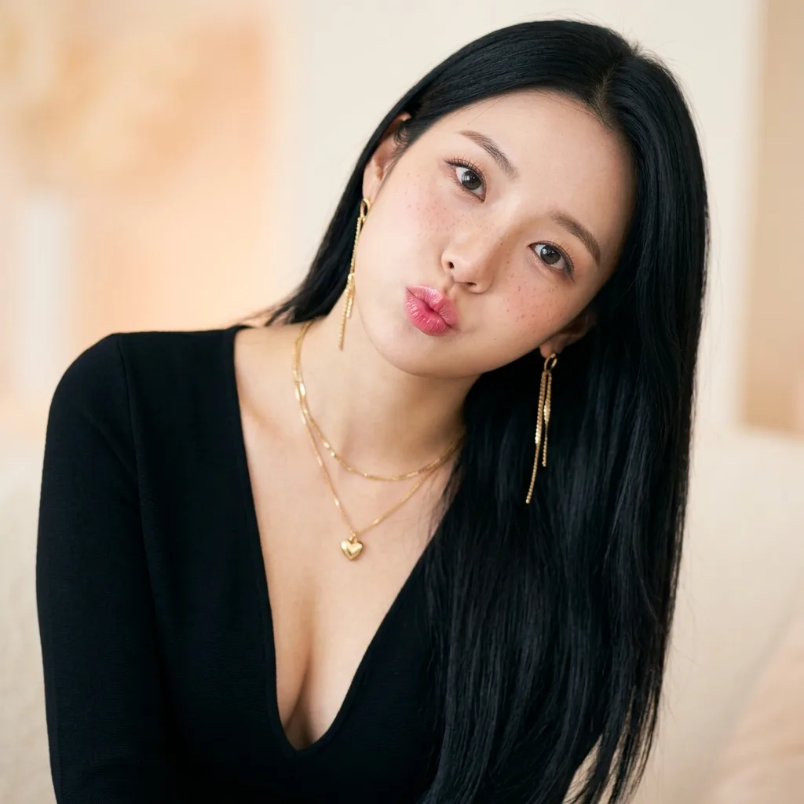

# Based on uploaded reference

[← Back to the collection](../../README.md) · Category: [Photography](../../gallery/photography.md) · Model: `Vinano Image v2` · ID: `vn-00878`

<a href="https://vinano.ai?utm_source=github&utm_medium=readme&utm_campaign=awesome-image-video-prompts-updating&utm_content=prompt-page-image"></a>

<sub>Preview generated with <a href="https://vinano.ai?utm_source=github&utm_medium=readme&utm_campaign=awesome-image-video-prompts-updating&utm_content=prompt-page-caption">vinano.ai</a></sub>

## Prompt

```text
{
 "style": "ultra-realistic celebrity portrait, soft romantic photography",
 "subject": {
 "identity": "based on uploaded reference",
 "gender": "female",
 "age": "young adult",
 "pose": "tilting head slightly to the side, looking up at camera through lashes, playful and cute posture",
 "expression": "pouting lips, acting cute, puppy eyes, innocent look, 'sajiao' vibe",
 "facial_details": {
 "eyes": "big imploring eyes, looking up, soft gaze",
 "mouth": "pouted lips, slight pout",
 "cheeks": "faint blush",
 "freckles": "visible natural freckles across nose and cheeks",
 "makeup": {
 "skin": "dewy natural finish",
 "lips": "glossy pink",
 "eyes": "doe-eyed makeup"
 }
 },
 "hair": {
 "color": "jet black",
 "length": "long",
 "style": "straight, soft texture, falling over one shoulder"
 },
 "outfit": {
 "dress": "black fitted dress deep plunging V-neckline",
 "jewelry": {
 "earrings": "long dangling gold chain earrings",
 "necklaces": "layered gold necklaces a small heart pendant"
 }
 }
 },
 "environment": {
 "setting": "soft studio setting",
 "background": "creamy soft focus background, blurred"
 },
 "lighting": {
 "type": "soft diffused light",
 "mood": "romantic, sweet, charming",
 "tone": "warm peach and cream tones"
 },
 "camera": {
 "shot_type": "close-up portrait",
 "angle": "slightly high angle (to emphasize big eyes)",
 "focus": "sharp focus on eyes",
 "lens": "85mm f/1.4"
 },
 "quality": {
 "resolution": "8k",
 "texture": "realistic skin texture",
 "aesthetic": "k-pop aesthetic influence, soft dreamy style"
 }
}

Emphasise material texture and natural light so the final frame feels tactile and premium.
```

## Try it on vinano.ai

1. Copy the prompt above.
2. Open **[vinano.ai](https://vinano.ai?utm_source=github&utm_medium=readme&utm_campaign=awesome-image-video-prompts-updating&utm_content=prompt-page-try)**, paste it into the image generator and pick a model.
3. Swap any placeholders (brand, product, city, person…) for your own details, then generate.

More prompts like this: [Photography gallery](../../gallery/photography.md) · [all categories](../../README.md#contents)
