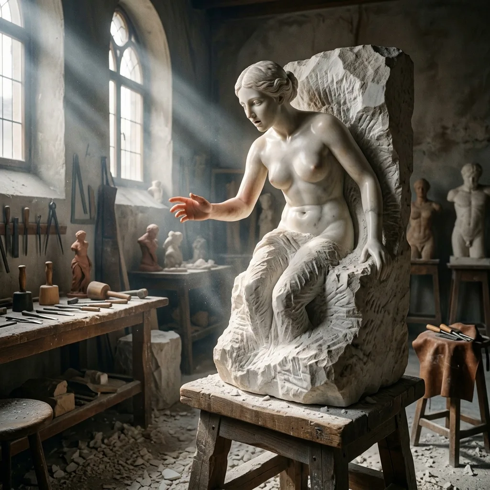

# Half-finished marble sculpture in a dusty Renaissance workshop,

[← Back to the collection](../../README.md) · Category: [Photography](../../gallery/photography.md) · Model: `Vinano Image v2` · ID: `vn-00881`

<a href="https://vinano.ai?utm_source=github&utm_medium=readme&utm_campaign=awesome-image-video-prompts-updating&utm_content=prompt-page-image"></a>

<sub>Preview generated with <a href="https://vinano.ai?utm_source=github&utm_medium=readme&utm_campaign=awesome-image-video-prompts-updating&utm_content=prompt-page-caption">vinano.ai</a></sub>

## Prompt

```text
A half-finished marble sculpture in a dusty Renaissance workshop, the [SUBJECT] emerging from the raw stone block in a breathtaking moment of creation becoming conscious. The figure is rough chisel marks at the base, transitioning through refined carving into impossibly lifelike flesh at the extremities. [KEY FEATURES] have achieved full life while the torso remains trapped in stone, mid-escape. Marble dust swirls in shaft lighting as if the awakening itself is generating atmosphere. The [SUBJECT] reaches forward, fingers transitioning from carved to living. Sculptor's tools scattered on wooden platforms: chisels, mallets, calipers, clay maquettes. Unfinished companion pieces watch from the shadows. The Pygmalion moment frozen. Cathedral-height workshop windows casting dramatic god-rays, cool marble tones warming to flesh, 8K, Bernini meets cinema. Emphasise material texture and natural light so the final frame feels tactile and premium.
```

## Try it on vinano.ai

1. Copy the prompt above.
2. Open **[vinano.ai](https://vinano.ai?utm_source=github&utm_medium=readme&utm_campaign=awesome-image-video-prompts-updating&utm_content=prompt-page-try)**, paste it into the image generator and pick a model.
3. Swap any placeholders (brand, product, city, person…) for your own details, then generate.

More prompts like this: [Photography gallery](../../gallery/photography.md) · [all categories](../../README.md#contents)
