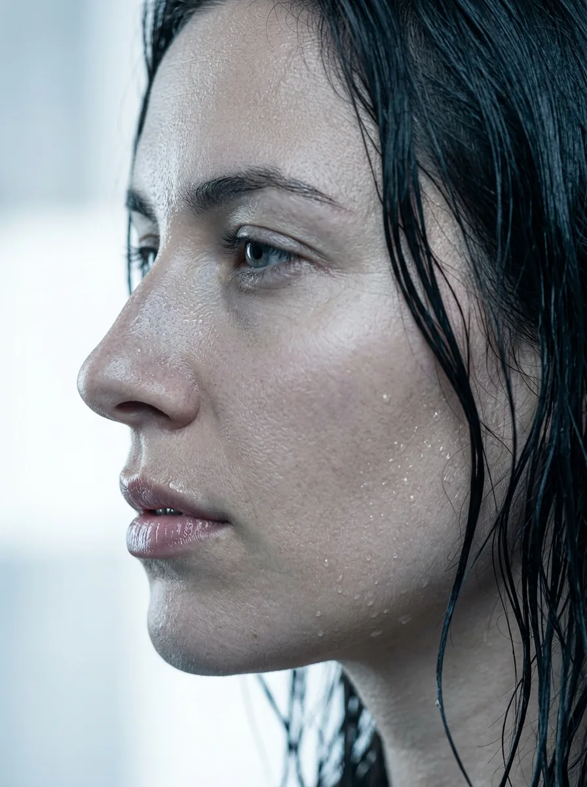

# Skin textures and identity fidelity

[← Back to the collection](../../README.md) · Category: [Photography](../../gallery/photography.md) · Model: `Vinano Image v2` · ID: `vn-00883`

<a href="https://vinano.ai?utm_source=github&utm_medium=readme&utm_campaign=awesome-image-video-prompts-updating&utm_content=prompt-page-image"></a>

<sub>Preview generated with <a href="https://vinano.ai?utm_source=github&utm_medium=readme&utm_campaign=awesome-image-video-prompts-updating&utm_content=prompt-page-caption">vinano.ai</a></sub>

## Prompt

```text
{
 "request_metadata": {
 "version": "2.0",
 "priority_focus": "Hyper-realistic skin textures and identity fidelity",
 "aspect_ratio": "3:4"
 },
 "subject_configuration": {
 "identity": {
 "name": "the person I uploaded",
 "reference_mode": "strict_identity_matching",
 "source_reference": "uploaded_files",
 "preservation_weight": 1.0,
 "angle": "Extreme profile view"
 },
 "facial_attributes": {
 "eyes": {
 "reflection_type": "Realistic catchlights",
 "aesthetic_constraint": "Avoid synthetic gloss or excessive shine"
 },
 "lips": {
 "state": "Parted / Moist",
 "surface_texture": "Soft natural ridges",
 "finish": "Glossy sheen without distortion"
 },
 "hair": {
 "color": "Dark Brunette",
 "state": "Saturated / Wet",
 "styling": "Clumping in natural strands, adhered to temples and neck"
 }
 }
 },
 "environmental_rendering": {
 "moisture_fx": {
 "sweat_layer": "Fine glistening mist across the bridge of nose and forehead",
 "water_droplets": "Micro-droplets scattered on cheekbones and jawline",
 "surface_tension": "Realistic liquid adhesion to skin"
 },
 "lighting_and_color": {
 "lighting_style": "Soft-box diffusion",
 "temperature": "Cool tones",
 "color_palette": ["Steel Blue", "Soft Cyan", "Natural Skin Tones"],
 "background": {
 "description": "refined minimalist bokeh",
 "colors": ["Light Grey", "Pure White"],
 "depth_of_field": "Shallow"
 }
 }
 },
 "technical_execution": {
 "rendering_engine": "CGI true-to-life photorealistic",
 "focal_length": "85mm macro",
 "texture_detail": "Pore-level resolution",
 "post_processing": "Raw photography style, no airbrushing"
 }
}

Maintain consistent colour harmony and crisp focus across the whole frame.
```

## Try it on vinano.ai

1. Copy the prompt above.
2. Open **[vinano.ai](https://vinano.ai?utm_source=github&utm_medium=readme&utm_campaign=awesome-image-video-prompts-updating&utm_content=prompt-page-try)**, paste it into the image generator and pick a model.
3. Swap any placeholders (brand, product, city, person…) for your own details, then generate.

More prompts like this: [Photography gallery](../../gallery/photography.md) · [all categories](../../README.md#contents)
