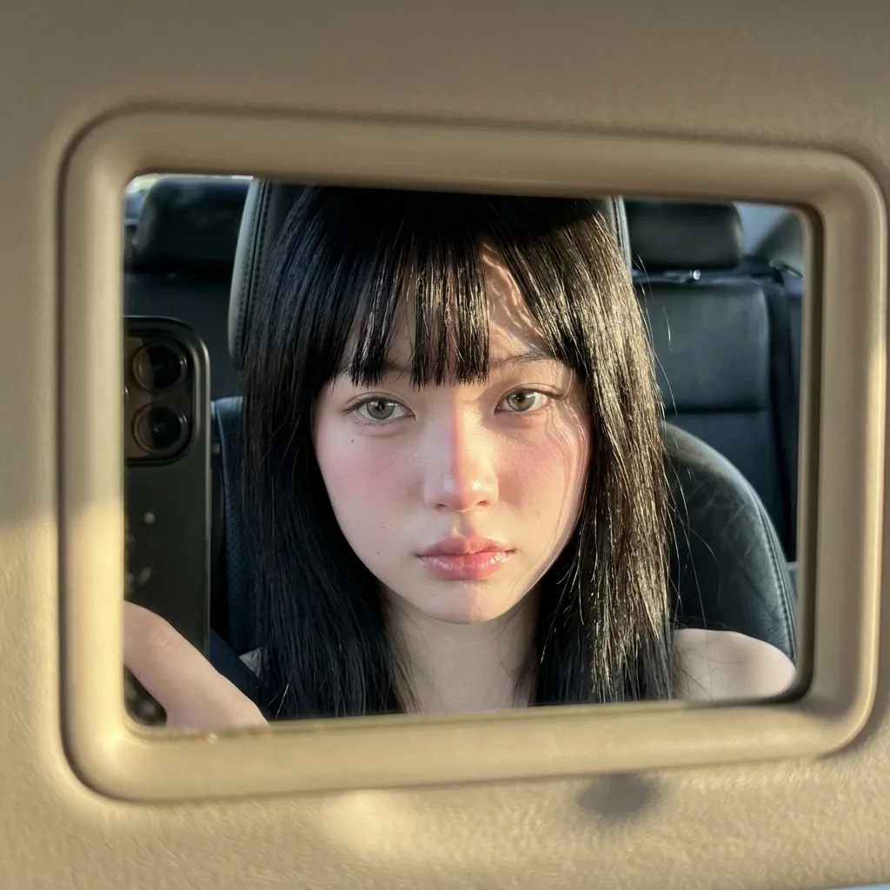

# 9:16 , quality

[← Back to the collection](../../README.md) · Category: [Photography](../../gallery/photography.md) · Model: `Vinano Image v2` · ID: `vn-00884`

<a href="https://vinano.ai?utm_source=github&utm_medium=readme&utm_campaign=awesome-image-video-prompts-updating&utm_content=prompt-page-image"></a>

<sub>Preview generated with <a href="https://vinano.ai?utm_source=github&utm_medium=readme&utm_campaign=awesome-image-video-prompts-updating&utm_content=prompt-page-caption">vinano.ai</a></sub>

## Prompt

```text
{
  "meta": {
    "aspect_ratio": "9:16",
    "quality": "ultra_photorealistic",
    "resolution": "8K",
    "camera": "iPhone front camera",
    "lens": "24mm",
    "style": "raw iphone realism, pinterest girl aesthetic, natural skin texture, zero plastic look"
  },

  "composition": {
    "concept": "frame within a frame",
    "framing": "extreme close-up face reflection inside car sun visor vanity mirror",
    "mirror_frame": {
      "material": "thick beige / cream plastic",
      "visibility": "dominant around edges of photo, slightly worn texture"
    },
    "phone_visibility": {
      "type": "iPhone",
      "detail": "partial phone edge visible on left side of mirror, controlling the shot",
      "camera_bump": "subtle, realistic"
    }
  },

  "scene": {
    "location": "inside parked car",
    "environment": ["dark car interior",
      "black leather seats",
      "headrest visible in reflection"],
    "time": "golden hour",
    "atmosphere": "quiet, intimate, candid daily life moment"
  },

  "lighting": {
    "type": "direct golden hour sunlight",
    "direction": "sharp side sunlight from afternoon sun",
    "color_temperature": "warm golden",
    "contrast": "high",
    "effects": ["strong highlights on skin",
      "abstract hair shadow patterns across forehead and cheek",
      "natural light bloom on lips and eyes"]
  },

  "subject": {
    "gender": "female",
    "age": "early 20s (clearly adult)",
    "ethnicity": "East Asian / mixed pale tone",

    "face_structure": {
      "shape": "soft oval",
      "cheeks": "full, youthful, slightly flushed",
      "jawline": "delicate and smooth",
      "nose": "small, straight, soft rounded tip"
    },

    "eyes": {
      "size": "large",
      "shape": "round-almond hybrid",
      "color": "grey-green / light hazel",
      "vibe": "doll-like, calm, distant",
      "lashes": "long, natural, softly separated",
      "under_eye": "subtle natural shadow for soft tired-cute look",
      "gaze": "looking directly into mirror/lens"
    },

    "lips": {
      "size": "full",
      "shape": "soft cupid’s bow",
      "color": "natural pink",
      "finish": "slightly glossy",
      "state": "relaxed, faint pout"
    },

    "skin": {
      "tone": "very pale porcelain",
      "undertone": "cool pink",
      "texture": "real skin visible pores",
      "finish": "natural glow, no smoothing",
      "blush": "soft pink blush across cheeks and nose bridge"
    },

    "hair": {
      "color": "deep black",
      "length": "long",
      "style": "straight",
      "bangs": "full blunt bangs just above the eyes",
      "behavior": "hair framing face symmetrically, strands catching sunlight"
    },

    "makeup": {
      "style": "no-makeup makeup",
      "base": "sheer skin tint",
      "eyes": "very subtle eyeliner, emphasis on lashes",
      "cheeks": "natural pink flush",
      "lips": "clear or soft pink gloss"
    },

    "outfit": {
      "visibility": "minimal",
      "detail": "only hint of bare shoulders or thin strap visible",
      "color": "dark clothing",
      "note": "no bra visible, focus remains entirely on face"
    }
  },

  "vibe": {
    "aesthetic": ["pinterest girl",
      "soft doll face",
      "car mirror selfie",
      "candid",
      "raw photography"],
    "mood": "quiet, slightly melancholic confidence",
    "social_feel": "looks like an accidental golden hour story shot"
  }
}

Render with rich micro-detail while keeping the layout uncluttered and intentional.
```

## Try it on vinano.ai

1. Copy the prompt above.
2. Open **[vinano.ai](https://vinano.ai?utm_source=github&utm_medium=readme&utm_campaign=awesome-image-video-prompts-updating&utm_content=prompt-page-try)**, paste it into the image generator and pick a model.
3. Swap any placeholders (brand, product, city, person…) for your own details, then generate.

More prompts like this: [Photography gallery](../../gallery/photography.md) · [all categories](../../README.md#contents)
