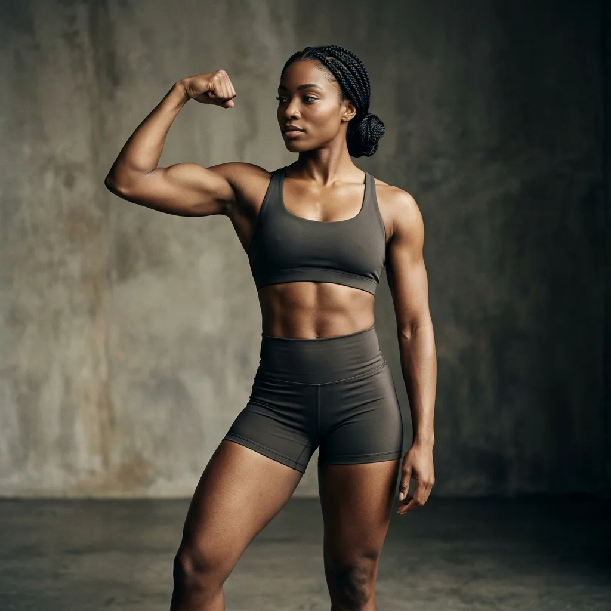

# Athletic feminine body performing a controlled flex pose

[← Back to the collection](../../README.md) · Category: [Photography](../../gallery/photography.md) · Model: `Vinano Image v2` · ID: `vn-00885`

<a href="https://vinano.ai?utm_source=github&utm_medium=readme&utm_campaign=awesome-image-video-prompts-updating&utm_content=prompt-page-image"></a>

<sub>Preview generated with <a href="https://vinano.ai?utm_source=github&utm_medium=readme&utm_campaign=awesome-image-video-prompts-updating&utm_content=prompt-page-caption">vinano.ai</a></sub>

## Prompt

```text
{
 "image_type":
 "athletic flex pose editorial photography",
 "visual_style":
"high-end fitness editorial, cinematic, premium",
 "composition": {
 "framing":
 "full body, powerful stance emphasizing muscle definition",
 "camera_angle":
"slightly low angle to enhance strength and dominance",
 "perspective":
"cinematic perspective strong body presence"
 },
 "subject": {
 "description":
"athletic feminine body performing a controlled flex pose",
 "pose":
"strong flex pose engaged core, defined arms and legs, balanced posture",
 "body_language":
 "confident, controlled, disciplined strength",
 "expression":
"calm, focused, effortless power"
 },
 "facial_details": {
 "emotion": "self-control, confidence",
 "micro_details": "relaxed jaw, steady eyes, natural intensity"
 },
 "wardrobe": {
 "clothing": "minimal athletic wear highlighting muscle lines",
 "textures": "matte, stretch performance fabric",
 "color_tones": "neutral, muted, dark or earthy tones"
 },
 "environment": {
 "location": "minimal indoor studio or clean gym space",
 "background": "plain, distraction-free, editorial backdrop",
 "atmosphere": "focused, intense, professional"
 },
 "lighting": {
 "type": "cinematic studio lighting",
 "quality": "high contrast soft falloff",
 "direction": "side and rim lighting to sculpt muscles"
 },
 "color_palette": {
 "primary": ["charcoal", "warm beige", "muted skin tones"],
 "mood": "powerful, disciplined, modern"
 },
 "camera_details": {
 "lens": "35mm–50mm cinematic look",
 "focus": "sharp focus on body definition",
 "realism": "ultra-realistic, editorial quality"
 },
 "overall_mood": "quiet power, control, strength without aggression",
 "intended_use": "viral flex pose post on X (Twitter), fitness branding, editorial content"
}

Aim for an editorial, design-driven look with deliberate negative space.
```

## Try it on vinano.ai

1. Copy the prompt above.
2. Open **[vinano.ai](https://vinano.ai?utm_source=github&utm_medium=readme&utm_campaign=awesome-image-video-prompts-updating&utm_content=prompt-page-try)**, paste it into the image generator and pick a model.
3. Swap any placeholders (brand, product, city, person…) for your own details, then generate.

More prompts like this: [Photography gallery](../../gallery/photography.md) · [all categories](../../README.md#contents)
