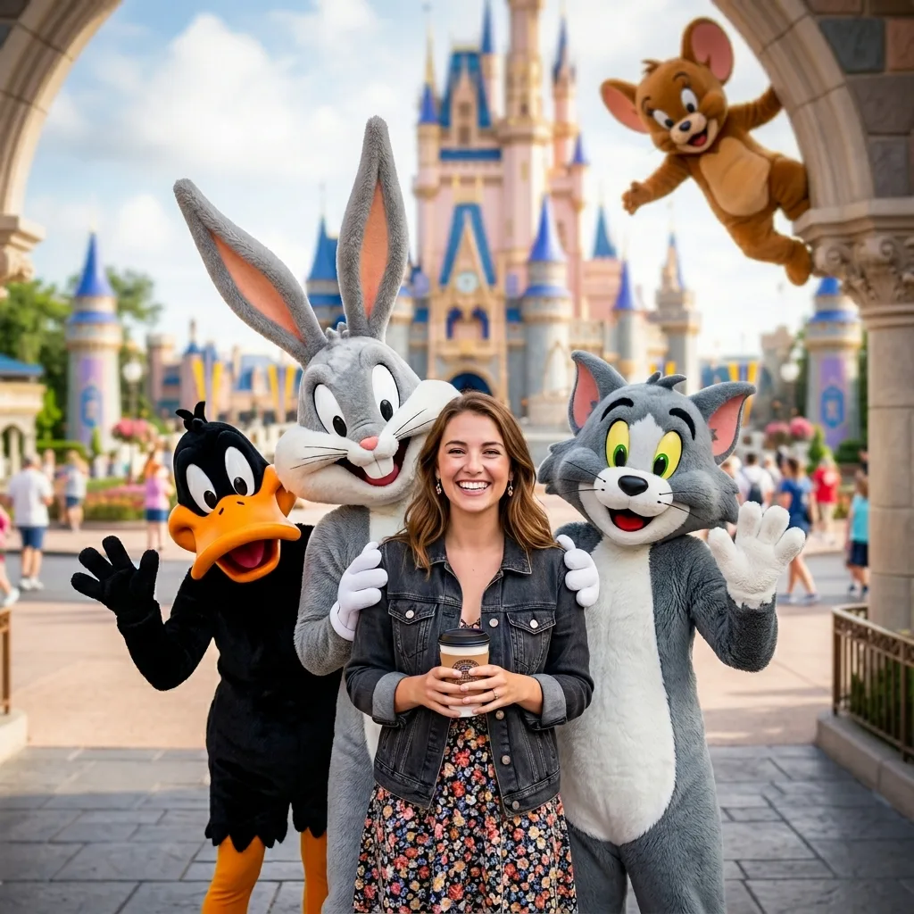

# Famous theme park

[← Back to the collection](../../README.md) · Category: [Photography](../../gallery/photography.md) · Model: `Vinano Image v2` · ID: `vn-00898`

<a href="https://vinano.ai?utm_source=github&utm_medium=readme&utm_campaign=awesome-image-video-prompts-updating&utm_content=prompt-page-image"></a>

<sub>Preview generated with <a href="https://vinano.ai?utm_source=github&utm_medium=readme&utm_campaign=awesome-image-video-prompts-updating&utm_content=prompt-page-caption">vinano.ai</a></sub>

## Prompt

```text
{
 "Objective": "Create a cheerful lifestyle portrait set in a magical theme park joyful mascot characters",
 "PersonaDetails": {
 "PrimarySubject": {
 "Type": "Young woman",
 "Pose": "Standing relaxed, holding a takeaway coffee cup both hands",
 "Expression": "Warm smile, cheerful and relaxed",
 "Style": "Casual lifestyle look"
 },
 "MascotCharacters": [{
 "Type": "Tall grey rabbit mascot",
 "Interaction": "Hugging the woman from behind",
 "Emotion": "Joyful, playful"
 },
 {
 "Type": "Grey cat mascot",
 "Position": "Standing at her side",
 "Emotion": "Friendly, happy"
 },
 {
 "Type": "Black duck mascot",
 "Position": "Standing on the opposite side",
 "Emotion": "Playful and welcoming"
 },
 {
 "Type": "Small brown mouse mascot",
 "Position": "Playfully posing above the group",
 "Emotion": "Energetic and mischievous"
 }]
 },
 "SceneDescription": {
 "Location": "Famous theme park",
 "Background": {
 "Landmark": "Fairytale castle",
 "Treatment": "Softly blurred for depth"
 },
 "Environment": "Open plaza a lively, family-friendly atmosphere"
 },
 "Composition": {
 "Framing": "Medium lifestyle portrait",
 "Grouping": "Centered subject surrounded by characters",
 "DepthOfField": "Shallow depth of field",
 "Focus": "Sharp focus on faces softly blurred background"
 },
 "LightingAndColor": {
 "Lighting": "Bright natural daylight",
 "ColorPalette": "Vibrant, saturated yet balanced colors",
 "Highlights": "Soft, clean highlights enhancing cheerful mood"
 },
 "ArtDirection": {
 "Style": "High realism blended animated character charm",
 "Aesthetic": "Playful, magical, family-friendly",
 "DetailLevel": "Ultra-detailed textures on clothing and mascot costumes"
 },
 "PhotographyStyle": {
 "Genre": "Theme park lifestyle photography",
 "CompositionStyle": "Cinematic yet candid",
 "ImageQuality": "High resolution, crisp detail"
 },
 "Mood": {
 "Tone": "Happy, welcoming, whimsical",
 "Energy": "Lighthearted, joyful, magical"
 },
 "NegativePrompt": ["dark mood",
 "empty background",
 "scary characters",
 "low resolution",
 "blurry faces",
 "harsh shadows",
 "desaturated colors"],
 "ResponseFormat": {
 "Type": "Single image",
 "Orientation": "Portrait",
 "AspectRatio": "2:3"
 }
}

Keep edges clean and the overall composition balanced for a polished, gallery-ready result.
```

## Try it on vinano.ai

1. Copy the prompt above.
2. Open **[vinano.ai](https://vinano.ai?utm_source=github&utm_medium=readme&utm_campaign=awesome-image-video-prompts-updating&utm_content=prompt-page-try)**, paste it into the image generator and pick a model.
3. Swap any placeholders (brand, product, city, person…) for your own details, then generate.

More prompts like this: [Photography gallery](../../gallery/photography.md) · [all categories](../../README.md#contents)
