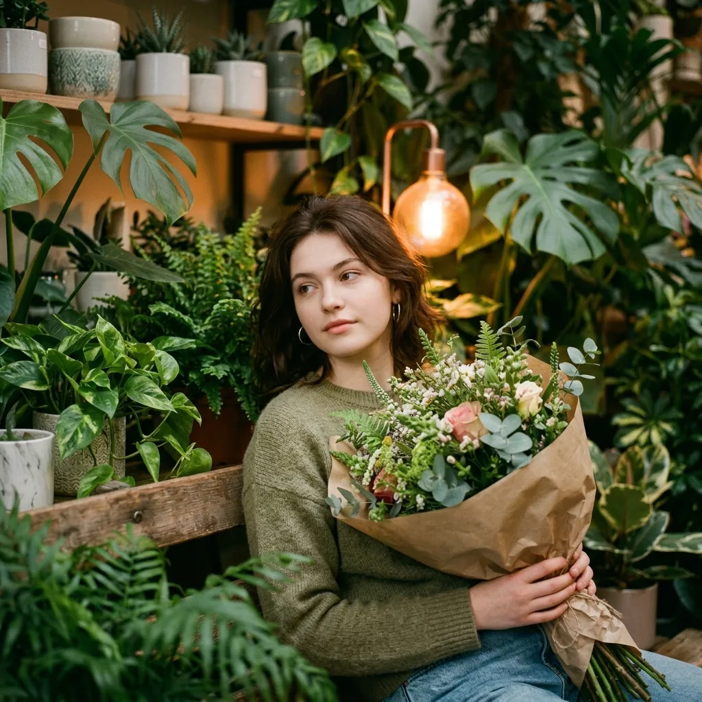

# Use the uploaded image as a reference

[← Back to the collection](../../README.md) · Category: [Photography](../../gallery/photography.md) · Model: `Vinano Image v2` · ID: `vn-00902`

<a href="https://vinano.ai?utm_source=github&utm_medium=readme&utm_campaign=awesome-image-video-prompts-updating&utm_content=prompt-page-image"></a>

<sub>Preview generated with <a href="https://vinano.ai?utm_source=github&utm_medium=readme&utm_campaign=awesome-image-video-prompts-updating&utm_content=prompt-page-caption">vinano.ai</a></sub>

## Prompt

```text
Use the uploaded image as a reference for the character. Create a sweet, cute, youthful-looking girl a relaxed, languid posture and expressive emotions.
She is holding a large bouquet of flowers wrapped in kraft paper, She is surrounded by many green plants. The image should feel tactile, immersive, and atmospheric, a sense of surreal sophistication and subtle motion blur. The girl has soft dark brown hair styled naturally, an asymmetrical composition, glancing left and right,and her hairstyle should enhance the mood. Her makeup is sweet and natural, facial features delicate and realistic.
Lighting should be soft, warm and a lamp orange bulb behind her creates softly orange, nuanced shadows, creating a warm light on her hair, head and on her face, comforting atmosphere. Clothing should feel casual and realistic, and her pose should be natural and coordinated, conveying a relaxed, comfortable lifestyle. She wears silver hoop earrings.

Keep edges clean and the overall composition balanced for a polished, gallery-ready result.
```

## Try it on vinano.ai

1. Copy the prompt above.
2. Open **[vinano.ai](https://vinano.ai?utm_source=github&utm_medium=readme&utm_campaign=awesome-image-video-prompts-updating&utm_content=prompt-page-try)**, paste it into the image generator and pick a model.
3. Swap any placeholders (brand, product, city, person…) for your own details, then generate.

More prompts like this: [Photography gallery](../../gallery/photography.md) · [all categories](../../README.md#contents)
