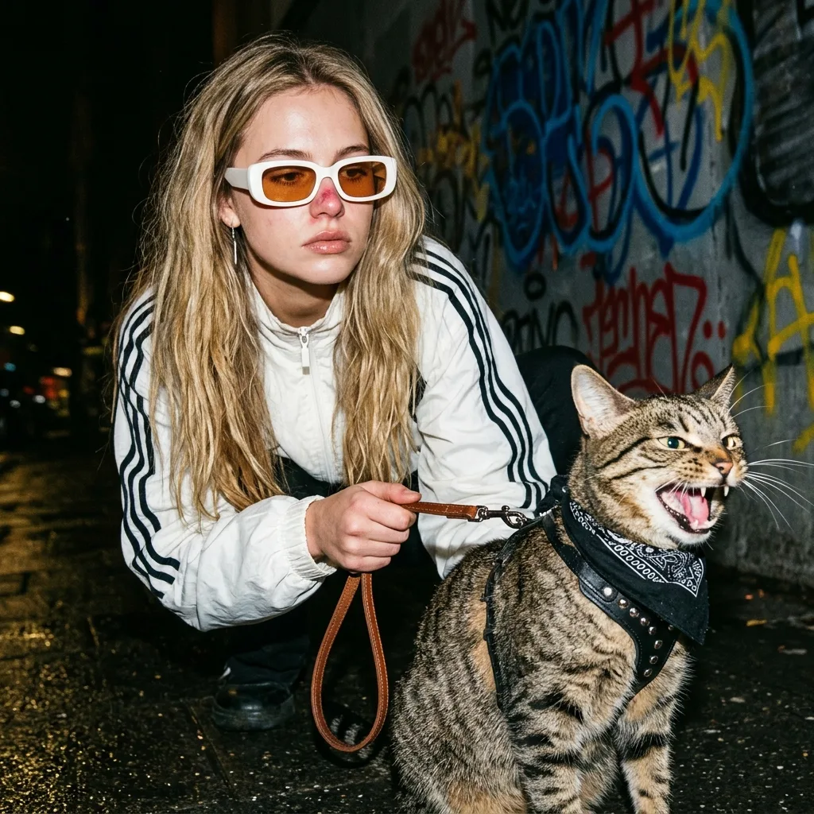

# Young woman long, tousled blonde hair falling over shoulders

[← Back to the collection](../../README.md) · Category: [Photography](../../gallery/photography.md) · Model: `Vinano Image v2` · ID: `vn-00903`

<a href="https://vinano.ai?utm_source=github&utm_medium=readme&utm_campaign=awesome-image-video-prompts-updating&utm_content=prompt-page-image"></a>

<sub>Preview generated with <a href="https://vinano.ai?utm_source=github&utm_medium=readme&utm_campaign=awesome-image-video-prompts-updating&utm_content=prompt-page-caption">vinano.ai</a></sub>

## Prompt

```text
{
 "image_prompt_data": {
 "subjects": {
 "human": {
 "appearance": "Young woman long, tousled blonde hair falling over shoulders.",
 "facial_features": "Neutral to serious expression, visible rosy mark or redness on the bridge of the nose, glossy lips.",
 "pose": "Crouching or leaning forward, hand gripping a leather leash."
 },
 "animal": {
 "type": "Tabby cat (brown, black, and grey stripes).",
 "expression": "Mouth wide open in a hiss, meow, or yawn; visible teeth and tongue; intense and energetic expression.",
 "position": "Foreground, sitting or standing while leashed."
 }
 },
 "attire_and_accessories": {
 "human_clothing": "White nylon track jacket or windbreaker black piping/stripes running down the sleeves; retro sporty aesthetic.",
 "eyewear": "Thick-framed white rectangular sunglasses amber/orange tinted lenses.",
 "animal_gear": "Black leather harness adorned metal studs, black paisley bandana around the neck.",
 "props": "Brown leather leash held taut."
 },
 "setting_and_background": {
 "location": "Urban exterior at night.",
 "background": "Dark wall covered in colorful, blurred graffiti tags (blue, yellow, red paint visible).",
 "atmosphere": "Gritty, underground, street-style vibe."
 },
 "lighting_and_style": {
 "lighting_technique": "Direct camera flash (flash photography), hard lighting high contrast, bright foreground subjects against a dark background.",
 "visual_style": "Paparazzi style, candid, edgy fashion editorial, raw and realistic.",
 "color_palette": "High contrast; bright whites, deep blacks, amber tints, and muted graffiti colors."
 },
 "technical_specifications": {
 "quality": "4K, Ultra HD, true-to-life photorealistic.",
 "details": "High resolution, sharp focus on the woman and cat, detailed texture on the cat's fur and the jacket fabric.",
 "aspect_ratio": "Portrait."
 }
 }
}

Preserve realistic proportions and depth for a confident, professional finish.
```

## Try it on vinano.ai

1. Copy the prompt above.
2. Open **[vinano.ai](https://vinano.ai?utm_source=github&utm_medium=readme&utm_campaign=awesome-image-video-prompts-updating&utm_content=prompt-page-try)**, paste it into the image generator and pick a model.
3. Swap any placeholders (brand, product, city, person…) for your own details, then generate.

More prompts like this: [Photography gallery](../../gallery/photography.md) · [all categories](../../README.md#contents)
