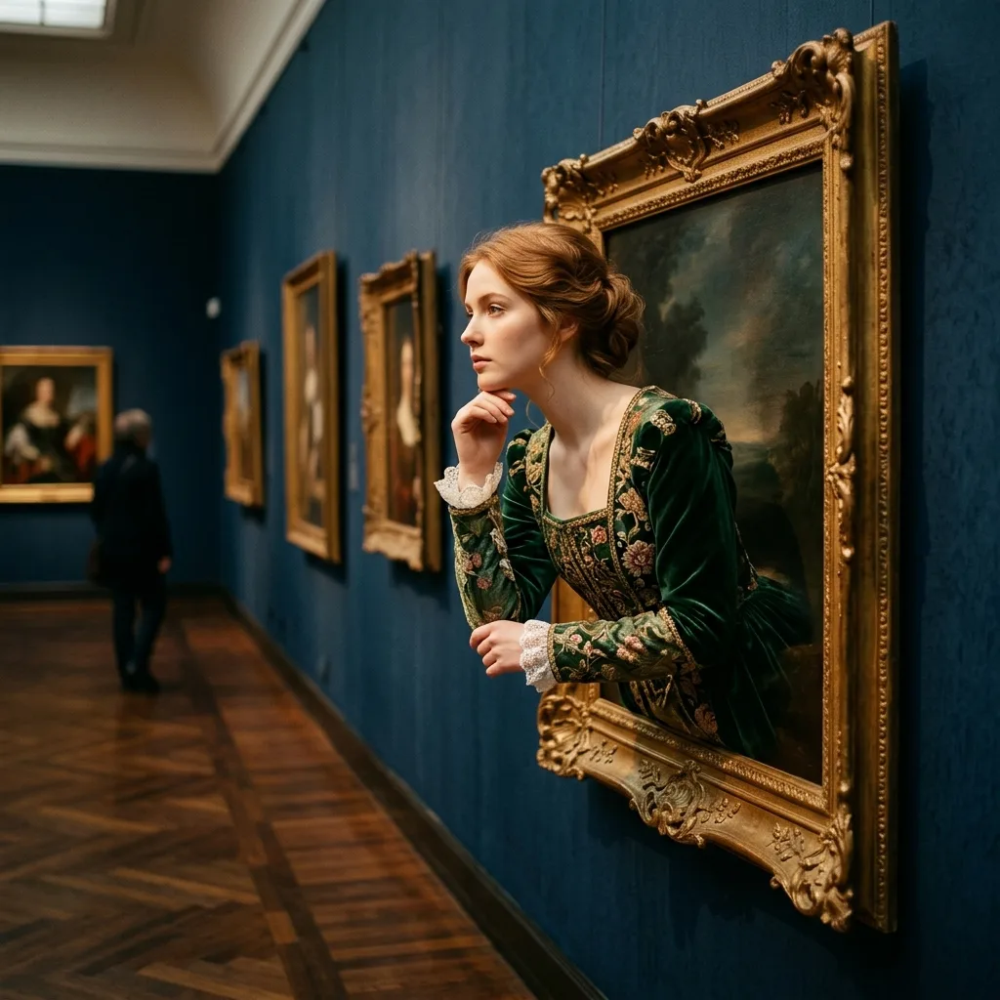

# Surreal, ultra-realistic scene of a young woman emerging

[← Back to the collection](../../README.md) · Category: [Photography](../../gallery/photography.md) · Model: `Vinano Image v2` · ID: `vn-00915`

<a href="https://vinano.ai?utm_source=github&utm_medium=readme&utm_campaign=awesome-image-video-prompts-updating&utm_content=prompt-page-image"></a>

<sub>Preview generated with <a href="https://vinano.ai?utm_source=github&utm_medium=readme&utm_campaign=awesome-image-video-prompts-updating&utm_content=prompt-page-caption">vinano.ai</a></sub>

## Prompt

```text
A surreal, ultra-realistic scene of a young woman emerging from an ornate golden picture frame mounted on a deep blue gallery wall. She has soft auburn hair styled in an elegant updo, delicate features, and wears a richly detailed Renaissance-inspired dress embroidered floral patterns and lace cuffs. Her chin rests thoughtfully on her hand as she gazes sideways a pensive expression. Warm, filmic, cinematic lighting highlights her face and the gilded frame. The setting is an art gallery hallway wooden parquet floors, framed paintings along the walls, and a softly blurred figure in the distance. Shallow depth of field, dramatic perspective, high detail, true-to-life photorealistic, 8k resolution, painterly yet lifelike textures, golden hour tones Render with rich micro-detail while keeping the layout uncluttered and intentional.
```

## Try it on vinano.ai

1. Copy the prompt above.
2. Open **[vinano.ai](https://vinano.ai?utm_source=github&utm_medium=readme&utm_campaign=awesome-image-video-prompts-updating&utm_content=prompt-page-try)**, paste it into the image generator and pick a model.
3. Swap any placeholders (brand, product, city, person…) for your own details, then generate.

More prompts like this: [Photography gallery](../../gallery/photography.md) · [all categories](../../README.md#contents)
