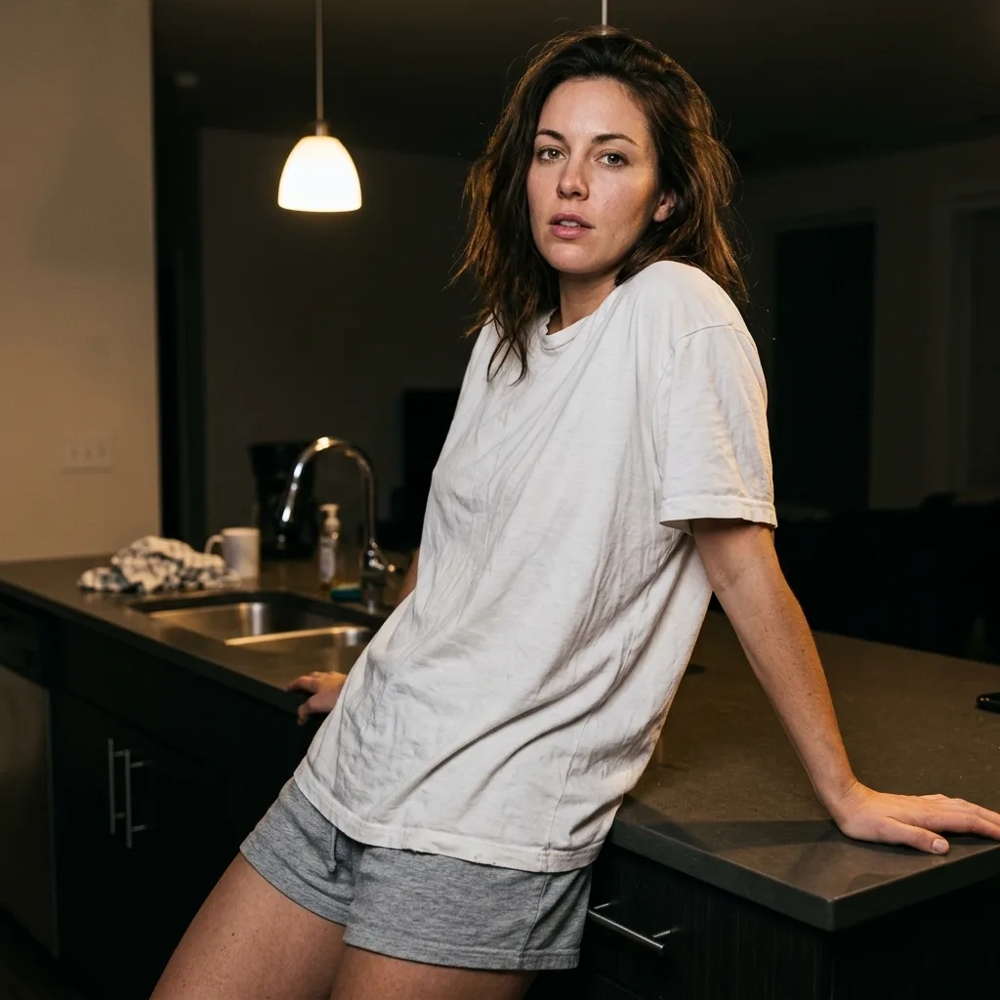

# Ultra true-to-life photorealistic , resolution

[← Back to the collection](../../README.md) · Category: [Photography](../../gallery/photography.md) · Model: `Vinano Image v2` · ID: `vn-00917`

<a href="https://vinano.ai?utm_source=github&utm_medium=readme&utm_campaign=awesome-image-video-prompts-updating&utm_content=prompt-page-image"></a>

<sub>Preview generated with <a href="https://vinano.ai?utm_source=github&utm_medium=readme&utm_campaign=awesome-image-video-prompts-updating&utm_content=prompt-page-caption">vinano.ai</a></sub>

## Prompt

```text
{
  "meta": {
    "quality": "ultra true-to-life photorealistic",
    "resolution": "8k",
    "camera": "iPhone 15 Pro",
    "lens": "24mm wide",
    "aspect_ratio": "2:3",
    "style": "raw iphone realism, low light, slight grain, natural skin texture, not polished"
  },

  "character_lock": {
    "identity": {
      "ethnicity": "european",
      "age": "clearly adult"
    },
    "hair": {
      "color": "natural brunette",
      "style": "loose, slightly messy, ends imperfect"
    },
    "eyes": "hazel",
    "body": {
      "type": "curvy hourglass",
      "chest": "full, heavy, natural",
      "hips": "wide and round",
      "waist": "small and tight"
    },
    "tattoos": {
      "presence": "none"
    }
  },

  "scene": {
    "location": "modern apartment kitchen",
    "time": "late night",
    "atmosphere": "quiet house, single light on, private after-hours energy"
  },

  "camera_perspective": {
    "capture_method": "iPhone placed on kitchen counter (timer)",
    "phone_visibility": "not visible",
    "angle": "slightly low and close",
    "framing": "hips to head, body dominant"
  },

  "subject": {
    "pose": {
      "position": "leaning back against kitchen counter",
      "body_alignment": "strong natural arch",
      "back": "lower back arched, chest forward",
      "hips": "pushed back toward camera",
      "legs": {
        "stance": "one leg straight, the other slightly bent inward"
      },
      "upper_body": {
        "chest": "clearly emphasized by arch and fabric tension",
        "shoulders": "relaxed",
        "arms": {
          "one_arm": "hands resting on counter behind her, supporting weight",
          "other_arm": "same, symmetric"
        }
      },
      "head": {
        "angle": "chin slightly down",
        "gaze": "looking directly into camera"
      },
      "expression": "slow confident stare, lips parted slightly, calm dominance"
    },

    "outfit": {
      "top": {
        "type": "oversized t-shirt",
        "color": "white",
        "fabric": "very thin worn cotton",
        "fit": "loose but stretched by chest and posture",
        "details": "fabric pulled tight over chest, slightly translucent under light, no bra"
      },
      "bottom": {
        "type": "ultra short sleep shorts",
        "color": "grey",
        "fabric": "soft jersey",
        "fit": "very short, riding up due to arch"
      }
    },

    "skin": {
      "detail": "warm kitchen light glow",
      "texture": "visible pores, natural shine, zero smoothing"
    }
  },

  "environment": {
    "background": ["kitchen counter",
      "sink and faucet",
      "single overhead light on",
      "dark apartment behind her"],
    "lighting": {
      "type": "single warm ceiling light",
      "effect": "hard highlights on chest and hips, deep shadows, true iphone exposure"
    }
  },

  "photography_rules": {
    "realism": "very high",
    "iphone_only_look": true,
    "no_phone_in_hands": true,
    "no_male_presence": true,
    "clean_skin_no_tattoos": true,
    "instagram_model_aesthetic": true,
    "thirst_trap_energy": true,
    "suggestive_not_explicit": true
  }
}

Preserve realistic proportions and depth for a confident, professional finish.
```

## Try it on vinano.ai

1. Copy the prompt above.
2. Open **[vinano.ai](https://vinano.ai?utm_source=github&utm_medium=readme&utm_campaign=awesome-image-video-prompts-updating&utm_content=prompt-page-try)**, paste it into the image generator and pick a model.
3. Swap any placeholders (brand, product, city, person…) for your own details, then generate.

More prompts like this: [Photography gallery](../../gallery/photography.md) · [all categories](../../README.md#contents)
