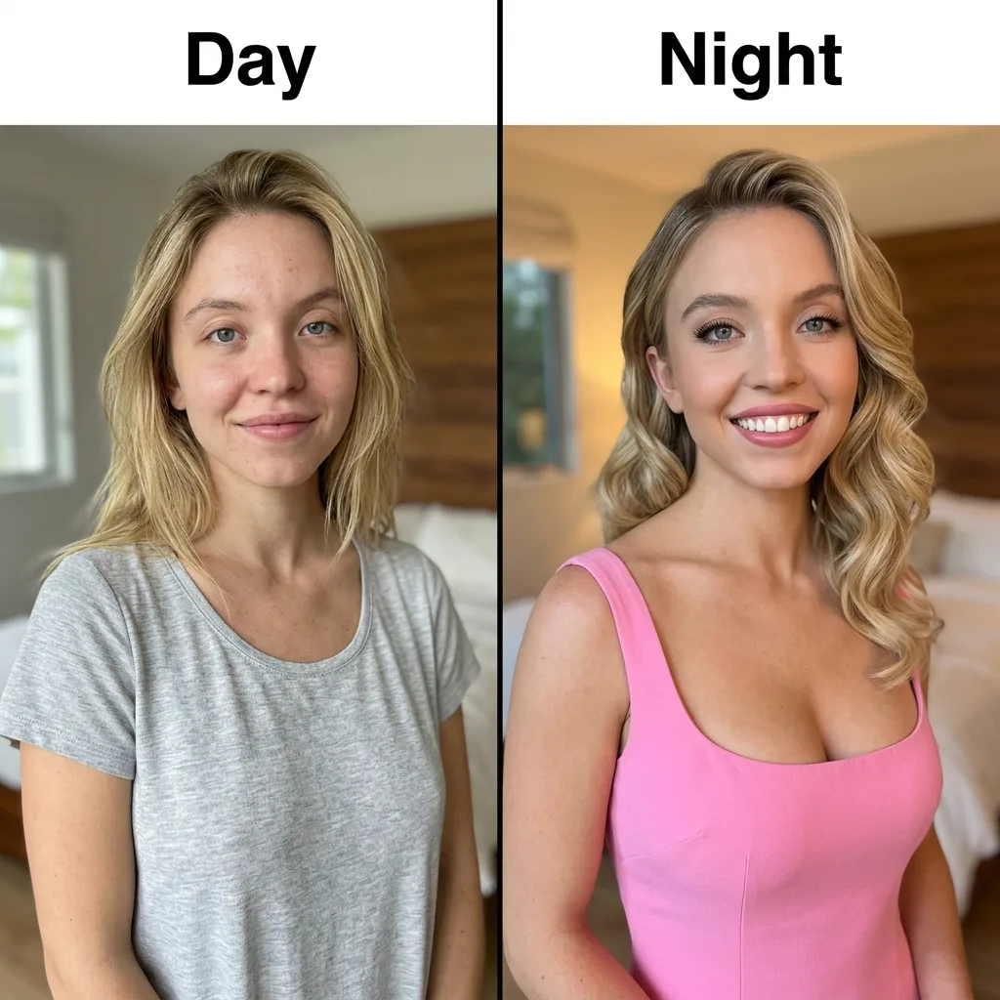

# Before-and-after upper-body portrait photo of Sydney Sweeney, smiling

[← Back to the collection](../../README.md) · Category: [Photography](../../gallery/photography.md) · Model: `Vinano Image v2` · ID: `vn-00933`

<a href="https://vinano.ai?utm_source=github&utm_medium=readme&utm_campaign=awesome-image-video-prompts-updating&utm_content=prompt-page-image"></a>

<sub>Preview generated with <a href="https://vinano.ai?utm_source=github&utm_medium=readme&utm_campaign=awesome-image-video-prompts-updating&utm_content=prompt-page-caption">vinano.ai</a></sub>

## Prompt

```text
Before-and-after upper-body portrait photo of Sydney Sweeney, smiling in both images, split vertically down the center into two equal halves for a direct visual comparison. Clear text labels appear at the top of each half.

Left side – “Day” (label at top):
Natural, no makeup look. Realistic skin texture visible pores, slight under-eye shadows, natural lips, minimal grooming. Soft, relaxed smile. Hair casually styled. She is wearing a simple nightgown for bed, comfortable and modest. Daytime feeling, fresh and unstyled, authentic at-home appearance.

Right side – “Night” (label at top):
Professional makeup applied: even skin tone, subtle contouring, enhanced eyes mascara and eyeliner, defined brows, soft lipstick. Bright, confident smile. Hair styled elegantly. She is wearing a beautiful, pink dress a deep neckline

Both sides show the same pose, framing, camera distance, background, and angle to ensure the contrast comes purely from makeup, styling, and wardrobe.

Photography & Camera Style:
Smartphone camera realism, portrait mode look, handheld feel, natural lighting, slight digital noise, mild compression artifacts, realistic color balance, minimal retouching, honest skin detail. Casual but clear comparison photo rather than studio perfection.

Aspect ratio:
3:4 (portrait)

negative prompt:
beauty filters, over-smoothed skin, exaggerated makeup, inconsistent lighting, mismatched expressions, face distortion, studio glamour lighting, cinematic look, watermark, text artifacts (except “Day” and “Night” labels)

Keep edges clean and the overall composition balanced for a polished, gallery-ready result.
```

## Try it on vinano.ai

1. Copy the prompt above.
2. Open **[vinano.ai](https://vinano.ai?utm_source=github&utm_medium=readme&utm_campaign=awesome-image-video-prompts-updating&utm_content=prompt-page-try)**, paste it into the image generator and pick a model.
3. Swap any placeholders (brand, product, city, person…) for your own details, then generate.

More prompts like this: [Photography gallery](../../gallery/photography.md) · [all categories](../../README.md#contents)
