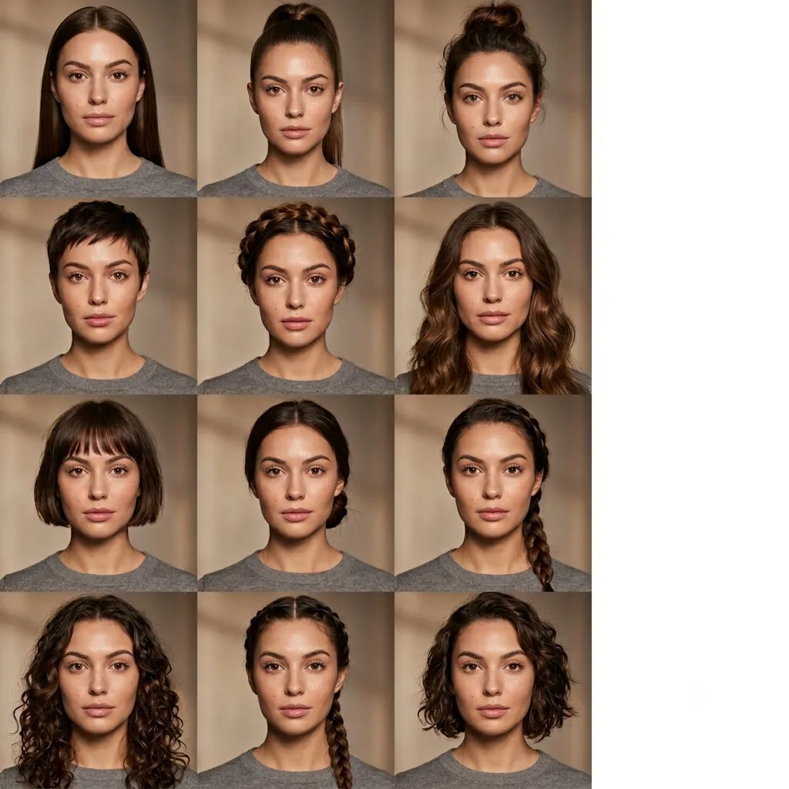

# Perfectly matched across all frames

[← Back to the collection](../../README.md) · Category: [Photography](../../gallery/photography.md) · Model: `Vinano Image Pro` · ID: `vn-00935`

<a href="https://vinano.ai?utm_source=github&utm_medium=readme&utm_campaign=awesome-image-video-prompts-updating&utm_content=prompt-page-image"></a>

<sub>Preview generated with <a href="https://vinano.ai?utm_source=github&utm_medium=readme&utm_campaign=awesome-image-video-prompts-updating&utm_content=prompt-page-caption">vinano.ai</a></sub>

## Prompt

```text
{
 "scene_type": "editorial beauty collage",
 "subject": {
 "identity_lock": true,
 "face_consistency": "perfectly matched across all frames",
 "expression": "unchanged, neutral and relaxed",
 "skin": "realistic texture, natural pores, high fidelity"
 },
 "layout": {
 "grid": "4x3",
 "framing": "equal-sized portrait panels",
 "consistency": "symmetrical facial alignment in every frame"
 },
 "hairstyle_variations": ["sleek long straight hair",
 "high ponytail",
 "textured messy bun",
 "pixie haircut",
 "braided crown",
 "soft flowing waves",
 "short bob bangs",
 "low tied bun",
 "side braid",
 "loose defined curls"],
 "styling": {
 "outfit": "same neutral wardrobe across all panels",
 "makeup": "identical clean beauty makeup in every shot"
 },
 "lighting": {
 "type": "soft studio lighting",
 "tone": "warm",
 "shadows": "gentle and natural"
 },
 "background": {
 "style": "subtle blurred studio backdrop",
 "color": "warm neutral tones"
 },
 "quality": {
 "detail": "ultra-detailed",
 "photography": "professional portrait",
 "finish": "high-end editorial look"
 }
}

Render with rich micro-detail while keeping the layout uncluttered and intentional.
```

## Try it on vinano.ai

1. Copy the prompt above.
2. Open **[vinano.ai](https://vinano.ai?utm_source=github&utm_medium=readme&utm_campaign=awesome-image-video-prompts-updating&utm_content=prompt-page-try)**, paste it into the image generator and pick a model.
3. Swap any placeholders (brand, product, city, person…) for your own details, then generate.

More prompts like this: [Photography gallery](../../gallery/photography.md) · [all categories](../../README.md#contents)
