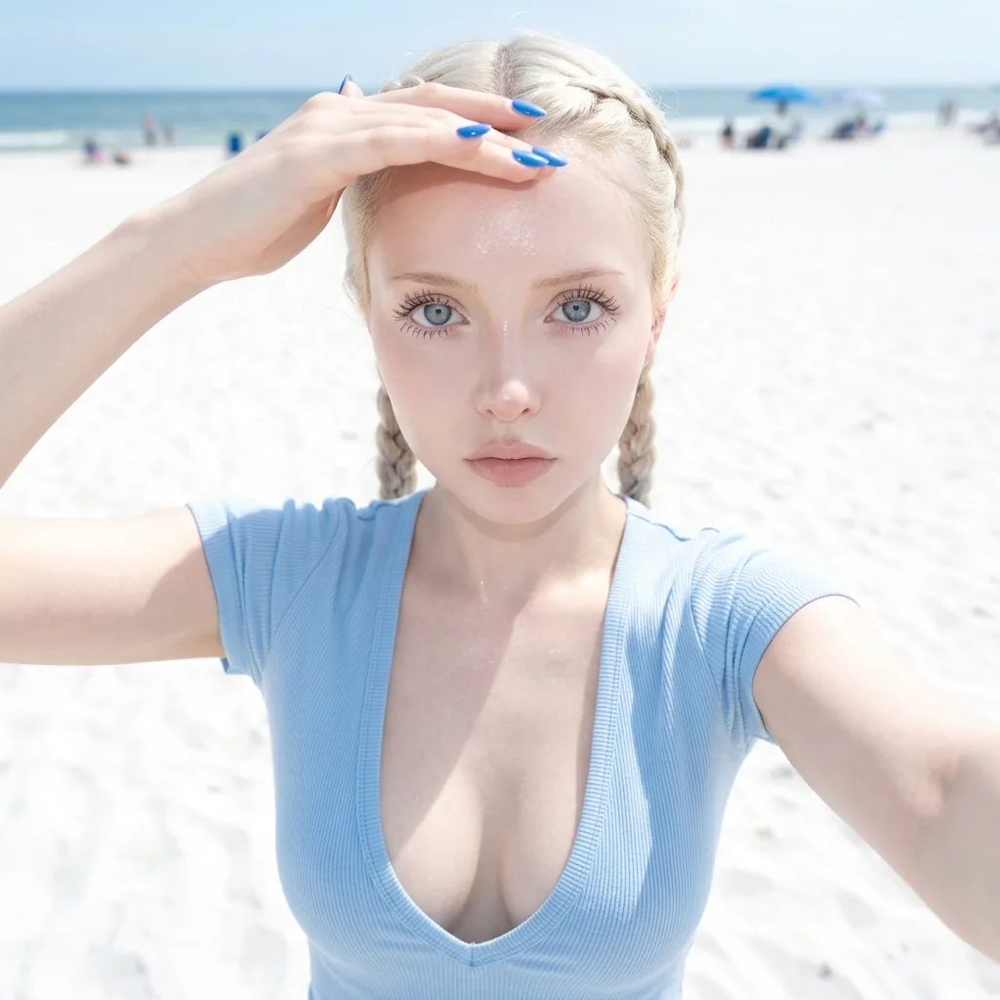

# Photography prompt #944

[← Back to the collection](../../README.md) · Category: [Photography](../../gallery/photography.md) · Model: `Vinano Image v2` · ID: `vn-00944`

<a href="https://vinano.ai?utm_source=github&utm_medium=readme&utm_campaign=awesome-image-video-prompts-updating&utm_content=prompt-page-image"></a>

<sub>Preview generated with <a href="https://vinano.ai?utm_source=github&utm_medium=readme&utm_campaign=awesome-image-video-prompts-updating&utm_content=prompt-page-caption">vinano.ai</a></sub>

## Prompt

```text
{
 "format": {
 "type": "editorial",
 "intent": "candid/selfie/accidental",
 "aspect_ratio": "9:16",
 "resolution": "4K"
 },
 "camera_system": {
 "body": "iPhone 15 Pro",
 "lens": "Main Camera",
 "focal_length": "24mm",
 "associative_traits": "computational photography, deep depth of field, sharp digital readout, auto-exposure"
 },
 "subject": {
 "identity": "young woman specific porcelain doll features",
 "physical_details": "flawless pale skin, large round icy blue eyes defined lashes, small defined nose, pouty neutral mouth, platinum blonde hair in two tight braids, vibrant blue manicured nails",
 "clothing": "light blue form-fitting top a very deep, wide plunging V-neckline revealing significant cleavage",
 "action": "high-angle selfie POV, shielding eyes one hand against bright coastal light, looking up at camera",
 "expression": "neutral, wide-eyed, deadpan, vacant doll-like stare"
 },
 "lighting": {
 "source": "bright natural coastal daylight + sand bounce",
 "direction": "overhead and omnidirectional fill",
 "quality": "soft, diffused but very bright",
 "color_temp": "neutral daylight (5500K)",
 "fill": "maximum fill from bright white sand reflection",
 "distribution": "even illumination, few shadows, flattering on skin texture",
 "intent": "bright beach day"
 },
 "environment": {
 "setting": "sandy beach during the day",
 "hero_materials": [{
 "material": "sand",
 "micro_detail": "fine white grains, highly reflective"
 },
 {
 "material": "fabric",
 "micro_detail": "light blue swimwear/stretch cotton blend"
 },
 {
 "material": "skin",
 "micro_detail": "smooth, poreless, porcelain texture, slightly dewy from heat"
 }],
 "objects": "ocean horizon line blurred in far background, expansive sand",
 "state": "bright, sunny, coastal"
 },
 "technical_finish": {
 "film_stock": "Digital Source",
 "exposure": "brightly exposed (high key)",
 "grain": "none/digital noise",
 "tone_curve": "linear neutral",
 "color_science": "pastel palette (light blues, white sand, pale skin), natural daylight colors"
 },
 "constraints": {
 "avoid": ["snow",
 "winter clothes",
 "red nails",
 "black top",
 "modest neckline",
 "heavy shadows"],
 "must_include": ["blue nails",
 "light blue top",
 "deep cleavage",
 "beach background",
 "porcelain doll features"]
 }
 }
}

Keep edges clean and the overall composition balanced for a polished, gallery-ready result.
```

## Try it on vinano.ai

1. Copy the prompt above.
2. Open **[vinano.ai](https://vinano.ai?utm_source=github&utm_medium=readme&utm_campaign=awesome-image-video-prompts-updating&utm_content=prompt-page-try)**, paste it into the image generator and pick a model.
3. Swap any placeholders (brand, product, city, person…) for your own details, then generate.

More prompts like this: [Photography gallery](../../gallery/photography.md) · [all categories](../../README.md#contents)
