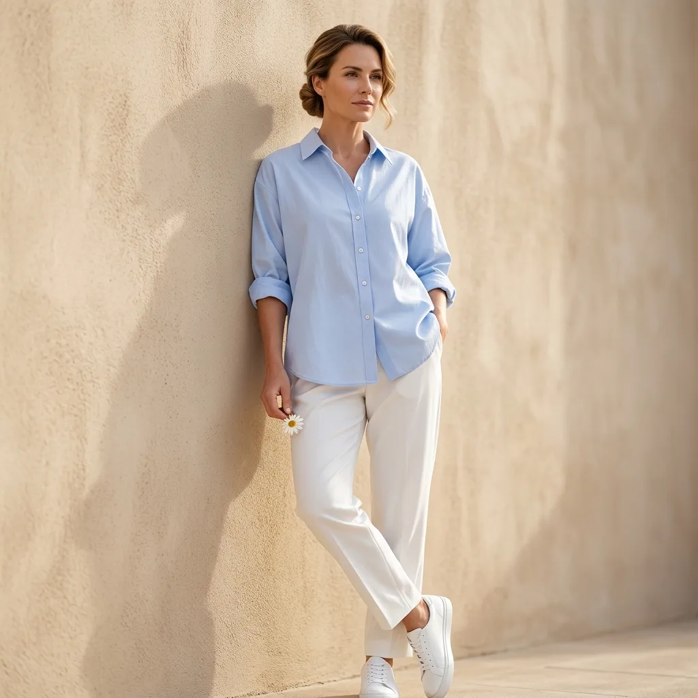

# Uploaded reference image STRICTLY, preserve the same woman’s face

[← Back to the collection](../../README.md) · Category: [Photography](../../gallery/photography.md) · Model: `Vinano Image Pro` · ID: `vn-00956`

<a href="https://vinano.ai?utm_source=github&utm_medium=readme&utm_campaign=awesome-image-video-prompts-updating&utm_content=prompt-page-image"></a>

<sub>Preview generated with <a href="https://vinano.ai?utm_source=github&utm_medium=readme&utm_campaign=awesome-image-video-prompts-updating&utm_content=prompt-page-caption">vinano.ai</a></sub>

## Prompt

```text
the uploaded reference image STRICTLY, preserve the same woman’s face, identity, age, facial structure, skin tone, and natural expression 100% accuracy. No facial alteration, beautification, or identity change.\n\nGenerate a highly realistic cinematic fashion editorial photoshoot featuring a stylish adult woman leaning casually against a warm beige textured wall. Her body is slightly angled, one shoulder gently resting on the wall, conveying relaxed confidence, elegance, and quiet strength.\n\nOutfit:\nShe wears a loose pastel blue button-down shirt softly rolled-up sleeves, styled effortlessly. Paired tailored white relaxed-fit trousers that drape naturally. Footwear consists of clean refined minimalist white or soft blue-white sneakers, maintaining a modern, understated luxury feel.\n\nPose & Expression:\nShe stands natural posture — one hand casually placed in her trouser pocket, the other delicately holding a small white daisy flower. Her facial expression is calm, self-assured, and serene, a soft editorial gaze slightly away from the camera. Emotion feels confident yet gentle.\n\nHair & Makeup:\nHair is neatly styled in a natural, modern look (soft waves, low ponytail, or loose bun). Makeup is minimal and refined — clean skin, subtle blush, neutral lips, no heavy contouring or glow.\n\nLighting & Atmosphere:\nWarm natural sunlight streams from the side, creating soft highlights along her face and clothing, gentle shadows adding depth to the textured wall. The mood is airy, sunlit, and cinematic.\n\nVisual Style:\nHigh-end fashion editorial aesthetic realistic skin texture, crisp fabric details, refined neutral color palette, and elegant composition.\n\nCamera & Quality:\nProfessional fashion photography style, shallow depth of field, cinematic framing, ultra-realistic 8K quality, sharp focus on subject smooth background falloff.\n\nOverall Feel:\nModern, minimal, sun-drenched lifestyle fashion campaign — confident, graceful, and timeless.",

 "style": "cinematic, high-end female fashion editorial",
 "lighting": "warm natural sunlight soft shadows",
 "background": "minimal beige textured wall, sunlit",
 "quality": "ultra-realistic, 8K, ultra-sharp",
 "camera": "professional fashion photography, shallow depth of field",
 "mood": "clean, modern, elegant, confident, relaxed"

Keep edges clean and the overall composition balanced for a polished, gallery-ready result.
```

## Try it on vinano.ai

1. Copy the prompt above.
2. Open **[vinano.ai](https://vinano.ai?utm_source=github&utm_medium=readme&utm_campaign=awesome-image-video-prompts-updating&utm_content=prompt-page-try)**, paste it into the image generator and pick a model.
3. Swap any placeholders (brand, product, city, person…) for your own details, then generate.

More prompts like this: [Photography gallery](../../gallery/photography.md) · [all categories](../../README.md#contents)
