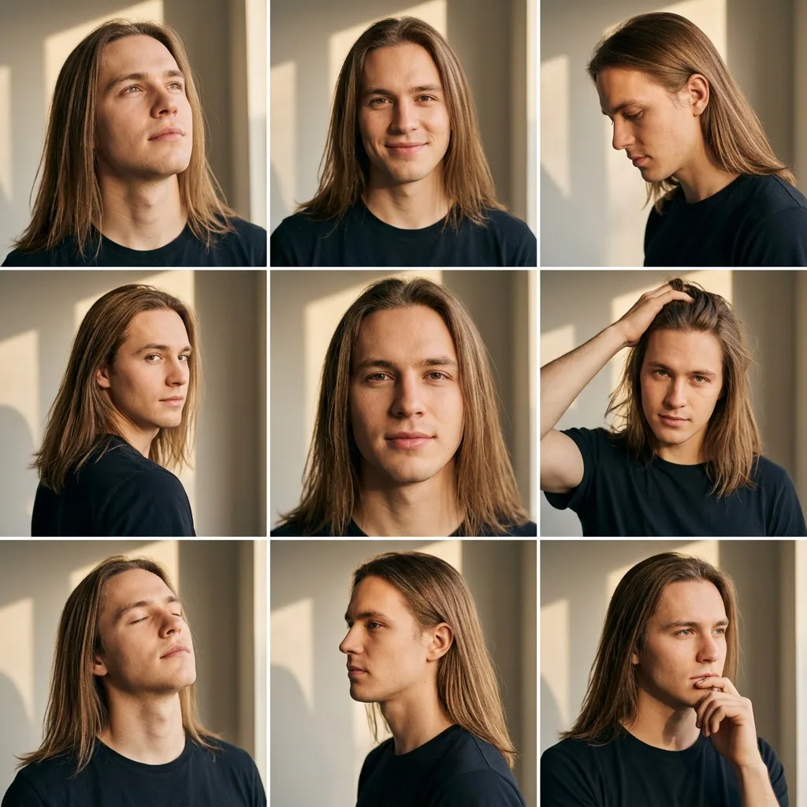

# Looking upward toward light

[← Back to the collection](../../README.md) · Category: [Photography](../../gallery/photography.md) · Model: `Vinano Image Pro` · ID: `vn-00960`

<a href="https://vinano.ai?utm_source=github&utm_medium=readme&utm_campaign=awesome-image-video-prompts-updating&utm_content=prompt-page-image"></a>

<sub>Preview generated with <a href="https://vinano.ai?utm_source=github&utm_medium=readme&utm_campaign=awesome-image-video-prompts-updating&utm_content=prompt-page-caption">vinano.ai</a></sub>

## Prompt

```text
{
 "image_generation": {
 "face": {
 "preserve_original": true,
 "reference_match": true,
 "description": "Maintain the same facial structure, skin tone, eye shape, and natural expressions across all frames, consistent identity in each pose."
 },
 "photo_style": {
 "type": "golden hour portrait collage",
 "camera_angle": "varied close-up and medium portrait angles",
 "lighting": "warm golden hour sunlight casting soft window shadows",
 "mood": "soft, calm, intimate, aesthetic",
 "texture": "natural skin texture, soft highlights, gentle contrast",
 "focus": "sharp focus on face smooth background falloff"
 },
 "subject": {
 "gender": "male",
 "age": "young adult",
 "poses": ["looking upward toward light",
 "soft smile facing camera",
 "side profile downward gaze",
 "over-the-shoulder glance",
 "direct close-up relaxed lips",
 "hand in hair casual pose",
 "head tilted back toward light",
 "clean side profile portrait",
 "thoughtful pose hand near chin"],
 "expression": "natural, minimal, relaxed, emotionally subtle",
 "hair": {
 "style": "long straight hair worn loose",
 "color": "light to medium brown",
 "details": "natural shine soft light highlights"
 },
 "clothing": {
 "type": "casual refined minimalist outfit",
 "details": "simple dark t-shirt no visible branding"
 }
 },
 "composition": {
 "layout": "3x3 grid collage",
 "consistency": "uniform lighting and background across all frames",
 "framing": "clean portrait framing slight pose variation"
 },
 "environment": {
 "setting": "indoor space near a window",
 "background": "plain wall warm sunlight and shadow patterns",
 "atmosphere": "quiet, minimal, artistic indoor ambiance"
 },
 "aesthetic": {
 "style": "Instagram aesthetic portrait set",
 "features": ["golden hour light",
 "window shadow patterns",
 "minimal makeup",
 "natural expressions",
 "clean editorial portrait look"]
 }
 }
}

Preserve realistic proportions and depth for a confident, professional finish.
```

## Try it on vinano.ai

1. Copy the prompt above.
2. Open **[vinano.ai](https://vinano.ai?utm_source=github&utm_medium=readme&utm_campaign=awesome-image-video-prompts-updating&utm_content=prompt-page-try)**, paste it into the image generator and pick a model.
3. Swap any placeholders (brand, product, city, person…) for your own details, then generate.

More prompts like this: [Photography gallery](../../gallery/photography.md) · [all categories](../../README.md#contents)
