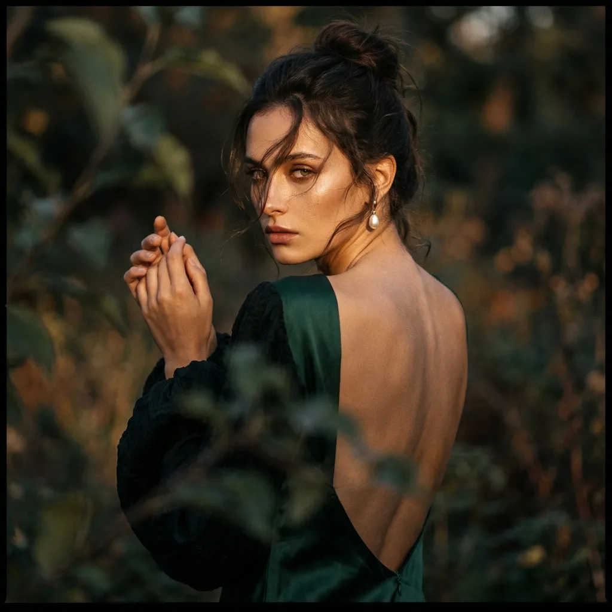

# Moody, ethereal cinematic portrait of a woman a dramatic

[← Back to the collection](../../README.md) · Category: [Photography](../../gallery/photography.md) · Model: `Vinano Image v2` · ID: `vn-00961`

<a href="https://vinano.ai?utm_source=github&utm_medium=readme&utm_campaign=awesome-image-video-prompts-updating&utm_content=prompt-page-image"></a>

<sub>Preview generated with <a href="https://vinano.ai?utm_source=github&utm_medium=readme&utm_campaign=awesome-image-video-prompts-updating&utm_content=prompt-page-caption">vinano.ai</a></sub>

## Prompt

```text
Create a moody, ethereal cinematic portrait of a woman a dramatic over-the-shoulder pose.

1. Pose and Expression
• Perspective: subject positioned her back facing the camera, torso elegantly twisted, looking back over her shoulder, creating a graceful curve along the spine and highlighting shoulder blades
• Gaze: direct eye contact the camera, piercing yet soft expression, chin slightly tucked toward shoulder to evoke intimacy and mystery
• Hand Placement: hands gently raised near chest/shoulder, fingers softly interlaced or delicately touching
• Hair: loose messy bun soft wispy strands falling naturally across the face, slightly windswept look

2. Lighting and Color Palette
• Lighting: strong side lighting, warm golden-hour sunlight, high contrast chiaroscuro effect, one side illuminated while the other fades into deep shadow
• Skin Tone: luminous, glowing, pearlescent skin texture
• Color Scheme: earthy muted tones, deep greens, dark browns, soft neutral background, warm skin tones as focal point

3. Wardrobe and Accessories
• Outfit: backless silky dress or top, smooth light fabric, paired dark voluminous sleeves for strong texture contrast
• Accessories: elegant drop pearl earrings reflecting light subtly

4. Composition and Atmosphere
• Framing: medium close-up shot, framed naturally blurred foreground leaves for a voyeuristic, through-the-foliage effect
• Depth of Field: shallow depth of field, sharp focus on face, soft bokeh in background and foreground
• Mood: cinematic, melancholic, romantic, high-fashion editorial style, soft dreamy atmosphere

Face reference: soft oval face, smooth glowing skin, symmetrical features, natural makeup, gentle but expressive eyes, slightly parted lips

Keep edges clean and the overall composition balanced for a polished, gallery-ready result.
```

## Try it on vinano.ai

1. Copy the prompt above.
2. Open **[vinano.ai](https://vinano.ai?utm_source=github&utm_medium=readme&utm_campaign=awesome-image-video-prompts-updating&utm_content=prompt-page-try)**, paste it into the image generator and pick a model.
3. Swap any placeholders (brand, product, city, person…) for your own details, then generate.

More prompts like this: [Photography gallery](../../gallery/photography.md) · [all categories](../../README.md#contents)
