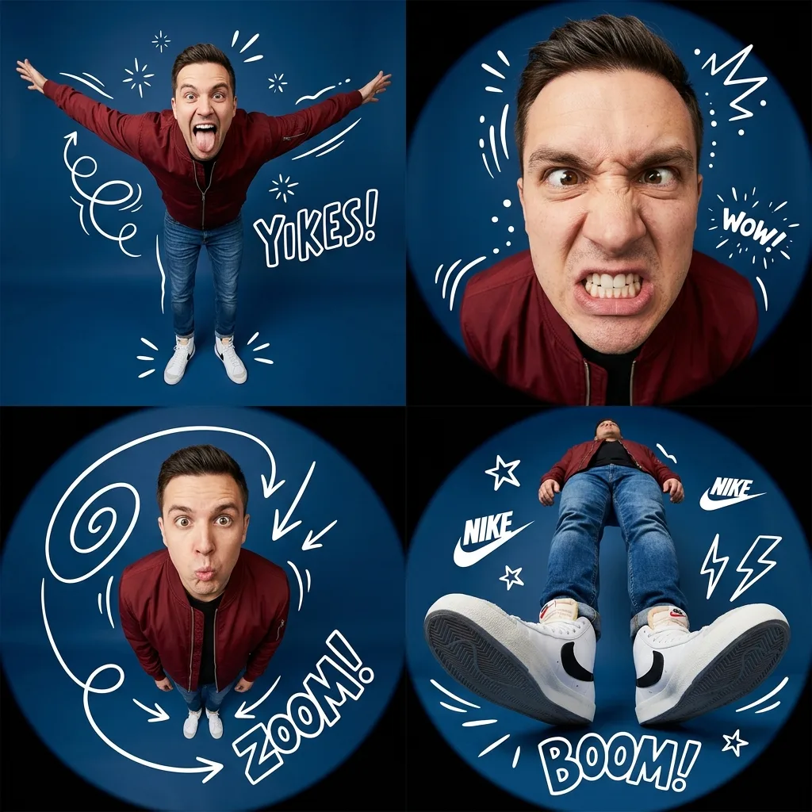

# 2x2 grid image

[← Back to the collection](../../README.md) · Category: [Photography](../../gallery/photography.md) · Model: `Vinano Image Pro` · ID: `vn-00968`

<a href="https://vinano.ai?utm_source=github&utm_medium=readme&utm_campaign=awesome-image-video-prompts-updating&utm_content=prompt-page-image"></a>

<sub>Preview generated with <a href="https://vinano.ai?utm_source=github&utm_medium=readme&utm_campaign=awesome-image-video-prompts-updating&utm_content=prompt-page-caption">vinano.ai</a></sub>

## Prompt

```text
Create a 2x2 grid image. In each frame include a medium shot, closeup shot, high angle looking down and extreme low angle view looking up from the sneakers. Utilize a fish eye lens perspective in each frame as well as an aesthetic pose foreshortening. The character is wearing a dark red bomber jacket, blue jeans and white nike high top sneakers and posing a different wacky facial expression in each frame. Include white doodle hand drawn elements around them in each frame. Studio photography against a dark blue background. Ensure the background encompasses the entire background, no circular framing. Aim for an editorial, design-driven look with deliberate negative space.
```

## Try it on vinano.ai

1. Copy the prompt above.
2. Open **[vinano.ai](https://vinano.ai?utm_source=github&utm_medium=readme&utm_campaign=awesome-image-video-prompts-updating&utm_content=prompt-page-try)**, paste it into the image generator and pick a model.
3. Swap any placeholders (brand, product, city, person…) for your own details, then generate.

More prompts like this: [Photography gallery](../../gallery/photography.md) · [all categories](../../README.md#contents)
