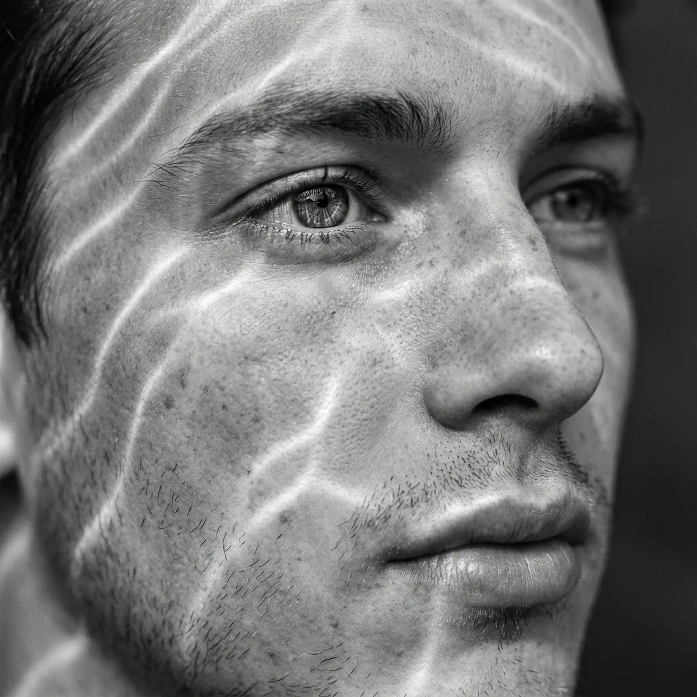

# Hyperrealistic 8K black and white extreme close-up portrait

[← Back to the collection](../../README.md) · Category: [Photography](../../gallery/photography.md) · Model: `Vinano Image v2` · ID: `vn-00985`

<a href="https://vinano.ai?utm_source=github&utm_medium=readme&utm_campaign=awesome-image-video-prompts-updating&utm_content=prompt-page-image"></a>

<sub>Preview generated with <a href="https://vinano.ai?utm_source=github&utm_medium=readme&utm_campaign=awesome-image-video-prompts-updating&utm_content=prompt-page-caption">vinano.ai</a></sub>

## Prompt

```text
A hyperrealistic 8K black and white extreme close-up portrait of a young man's face, focusing tightly on his eye, cheekbone, and lips. Bright sunlight breaks into soft, wavy luminous lines that ripple across his skin like underwater reflections. The light flows diagonally, wrapping around the contours of his face in surreal patterns, while the shadows dissolve into smooth mid-gray tones instead of deep black. The skin is rendered in lifelike detail-visible pores, faint freckles, subtle stubble, and natural imperfections catch the glowing light realistically. The lips are softly highlighted, and the eye reflects fragments of the luminous waves, adding depth and emotion without artificial glow. The camera framing feels macro, pressed close to the face, razor-thin depth of field: one illuminated ridge of skin is perfectly sharp, while the rest melts into velvety blur. The glassy, fluid quality of the light lines gives the portrait a surreal dreamlike aesthetic while remaining grounded in photographic realism. The background disappears into soft gray gradients, leaving only the interplay of skin texture and luminous wave-like rays. Fine cinematic grain overlays the frame, enhancing the tactile analog feel. The overall mood is intimate, surreal, and emotionally evocative - a monochrome portrait. Preserve realistic proportions and depth for a confident, professional finish.
```

## Try it on vinano.ai

1. Copy the prompt above.
2. Open **[vinano.ai](https://vinano.ai?utm_source=github&utm_medium=readme&utm_campaign=awesome-image-video-prompts-updating&utm_content=prompt-page-try)**, paste it into the image generator and pick a model.
3. Swap any placeholders (brand, product, city, person…) for your own details, then generate.

More prompts like this: [Photography gallery](../../gallery/photography.md) · [all categories](../../README.md#contents)
