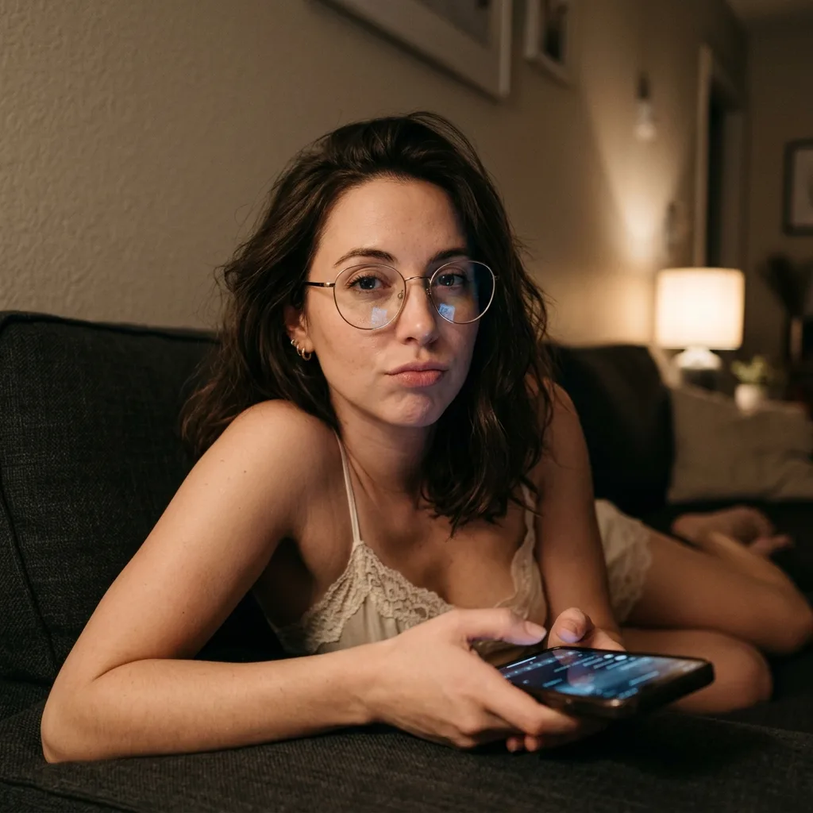

# Young adult woman soft refined features, thin metal glasses

[← Back to the collection](../../README.md) · Category: [Photography](../../gallery/photography.md) · Model: `Vinano Image v2` · ID: `vn-00988`

<a href="https://vinano.ai?utm_source=github&utm_medium=readme&utm_campaign=awesome-image-video-prompts-updating&utm_content=prompt-page-image"></a>

<sub>Preview generated with <a href="https://vinano.ai?utm_source=github&utm_medium=readme&utm_campaign=awesome-image-video-prompts-updating&utm_content=prompt-page-caption">vinano.ai</a></sub>

## Prompt

```text
{ "subject": { "description": "A young adult woman soft refined features, thin metal glasses, and shoulder-length dark hair, leaning across a couch at night while holding a smartphone, captured in a quiet low-light candid moment.", "mirror_rules": "not a mirror shot", "age": "young adult", "expression": { "eyes": { "look": "soft, slightly tired, subtly attentive", "energy": "low-key and intimate", "direction": "toward the camera, as if she just looked up from her phone" }, "mouth": { "position": "gently closed a relaxed pout", "energy": "quiet and unforced" }, "overall": "a dreamy late-night expression, calm, distant, and mildly seductive without exaggeration" }, "face": { "preserve_original": "keep the face proportions delicate and realistic, a narrow jawline, soft cheeks, defined eyes, glossy lips, and no exaggerated facial distortion", "makeup": "soft glam makeup, subtle eyeliner, long lashes, smooth skin finish, glossy pink-nude lips, lightly defined brows" } }, "hair": { "color": "dark brown to black", "style": "shoulder-length, loose, softly tousled slight volume around the crown", "effect": "natural flyaways and soft separation, not overly polished" }, "body": { "frame": "slim and softly curved", "waist": "gently defined", "chest": "natural and softly framed by the neckline", "legs": "bare, partially folded and extending out of frame", "skin": { "visible_areas": "shoulders, collarbone, arms, upper chest, thighs, lower legs", "tone": "fair a warm indoor cast", "texture": "smooth, velvety, lightly softened by low light and lens blur", "lighting_effect": "warm ambient light on the skin faint cool phone-screen reflections near the face and hands" } }, "pose": { "position": "leaning forward across a couch, one arm supporting the body, the other hand holding a phone in the foreground", "base": "casual lounging posture caught mid-movement", "overall": "informal, intimate, slightly off-balance, as if she paused while scrolling and looked up" }, "clothing": { "top": { "type": "lace-trim camisole or slip-style sleepwear", "color": "pale cream a soft blush tint", "details": "thin straps, delicate lace texture, soft fitted bodice, lightweight fabric", "effect": "sleepwear-like softness, feminine and understated" }, "bottom": { "type": "matching soft shorts or the lower part of a slip", "color": "pale cream", "details": "mostly obscured, softly wrinkled fabric, blending into the pose" } }, "accessories": { "jewelry": "small subtle earrings", "device": "smartphone held close to the camera, dark reflective case, screen glow lighting the fingers", "prop": "thin metal-framed eyeglasses visible screen reflections on the lenses" }, "photography": { "camera_style": "realistic social-media night portrait, smartphone candid aesthetic", "angle": "slightly above eye level, close and intimate, the phone hand entering the foreground", "shot_type": "medium close-up to three-quarter portrait in vertical framing", "aspect_ratio": "3:4 vertical", "texture": "soft focus, slight motion blur, low-light grain, gentle facial smoothing from dim conditions, natural imperfect sharpness", "lighting": "dim warm room light mixed cool phone-screen reflections, no hard flash, soft falloff across the couch and wall", "depth_of_field": "shallow to moderate, face prioritized but softened, foreground hand and phone slightly blurred" }, "background": { "setting": "an indoor living room or lounge at night", "wall_color": "warm beige-gray", "elements": ["dark upholstered couch", "plain softly lit wall", "minimal visible decor"], "atmosphere": "quiet, private, late-night, softly blurred and still", "lighting": "very low ambient tungsten-like room light shadows pooling in the background" }, "the_vibe": { "energy": "slow, hushed, intimate", "mood": "late-night pause, private and emotionally suspended", "aesthetic": "realistic social-media softness, low-light candid beauty, imperfect but magnetic", "authenticity": "retain the accidental blur, the off-center body angle, the screen glare on the glasses, and the lived-in couch posture", "intimacy": "close enough to feel the warmth of the room and the softness of fabric against skin", "story": "She had been scrolling in silence, then something made her stop and lift her eyes for one quiet second.", "caption_energy": "soft nocturnal allure, unspoken attention, the kind of moment that feels borrowed rather than staged" }, "constraints": { "must_keep": ["young adult woman", "thin metal glasses", "visible screen reflections on the lenses", "smartphone in hand close to the foreground", "dark shoulder-length tousled hair", "pale lace-trim sleepwear", "leaning across a couch", "warm dim indoor night lighting", "soft blur and low-light texture", "minimal beige-gray wall and dark couch background"], "avoid": ["studio lighting", "hard flash", "over-sharpened skin", "perfect commercial glamour retouching", "extra background clutter", "bright daylight", "mirror selfie composition", "heavy accessories", "exaggerated body proportions", "watermarks, logos, extra text"] }, "negative_prompt": ["mirror selfie", "hard flash", "studio backdrop", "ultra sharp DSLR clarity", "over-retouched skin", "cartoonish face", "exaggerated anatomy", "extra fingers", "deformed hands", "heavy jewelry", "busy room", "daylight window light", "smiling broadly", "strong action pose", "symmetrical formal composition", "text overlay", "watermark", "logo"] } Aim for an editorial, design-driven look with deliberate negative space.
```

## Try it on vinano.ai

1. Copy the prompt above.
2. Open **[vinano.ai](https://vinano.ai?utm_source=github&utm_medium=readme&utm_campaign=awesome-image-video-prompts-updating&utm_content=prompt-page-try)**, paste it into the image generator and pick a model.
3. Swap any placeholders (brand, product, city, person…) for your own details, then generate.

More prompts like this: [Photography gallery](../../gallery/photography.md) · [all categories](../../README.md#contents)
