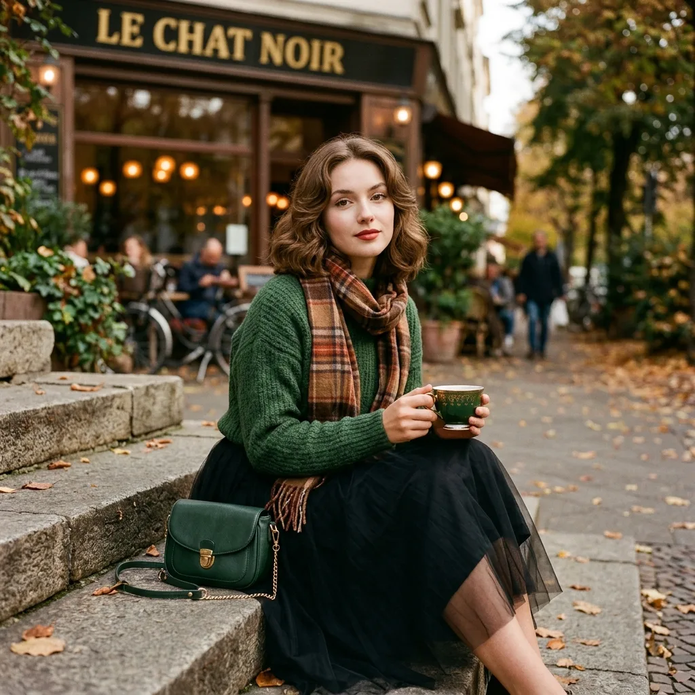

# 1970s-inspired fashion portrait of a graceful young woman seated

[← Back to the collection](../../README.md) · Category: [Photography](../../gallery/photography.md) · Model: `Vinano Image v2` · ID: `vn-00990`

<a href="https://vinano.ai?utm_source=github&utm_medium=readme&utm_campaign=awesome-image-video-prompts-updating&utm_content=prompt-page-image"></a>

<sub>Preview generated with <a href="https://vinano.ai?utm_source=github&utm_medium=readme&utm_campaign=awesome-image-video-prompts-updating&utm_content=prompt-page-caption">vinano.ai</a></sub>

## Prompt

```text
A cinematic 1970s-inspired fashion portrait of a graceful young woman seated on worn stone steps outside a cozy street café. She holds an ornate deep-green ceramic coffee cup delicate gold rim accents, gently resting it in her hands as she gazes softly toward the camera calm confidence. Her expression feels serene, thoughtful, and timeless.
Her hair falls in soft, natural waves loose strands framing her face, styled in a classic vintage manner. Makeup reflects 1970s elegance: matte crimson-red lips, subtle winged eyeliner, warm-toned blush, and softly defined brows. She wears a luxurious forest-green knitted sweater a relaxed fit, paired a flowing black tulle skirt that moves lightly the air.
A warm plaid scarf in earthy browns, burnt orange, and muted reds is draped casually around her neck. Beside her rests a premium dark-green leather crossbody bag gold filigree hardware and a delicate chain strap.
The background features an autumn café street scattered fallen leaves, glowing amber lights behind glass windows, and a soft urban stillness. Shot an 85mm lens at f/1.8, shallow depth of field, warm analog film grain, muted earthy palette, dreamy cinematic mood, ultra-realistic fashion editorial photography inspired by classic 1970s film aesthetics.

Maintain consistent colour harmony and crisp focus across the whole frame.
```

## Try it on vinano.ai

1. Copy the prompt above.
2. Open **[vinano.ai](https://vinano.ai?utm_source=github&utm_medium=readme&utm_campaign=awesome-image-video-prompts-updating&utm_content=prompt-page-try)**, paste it into the image generator and pick a model.
3. Swap any placeholders (brand, product, city, person…) for your own details, then generate.

More prompts like this: [Photography gallery](../../gallery/photography.md) · [all categories](../../README.md#contents)
