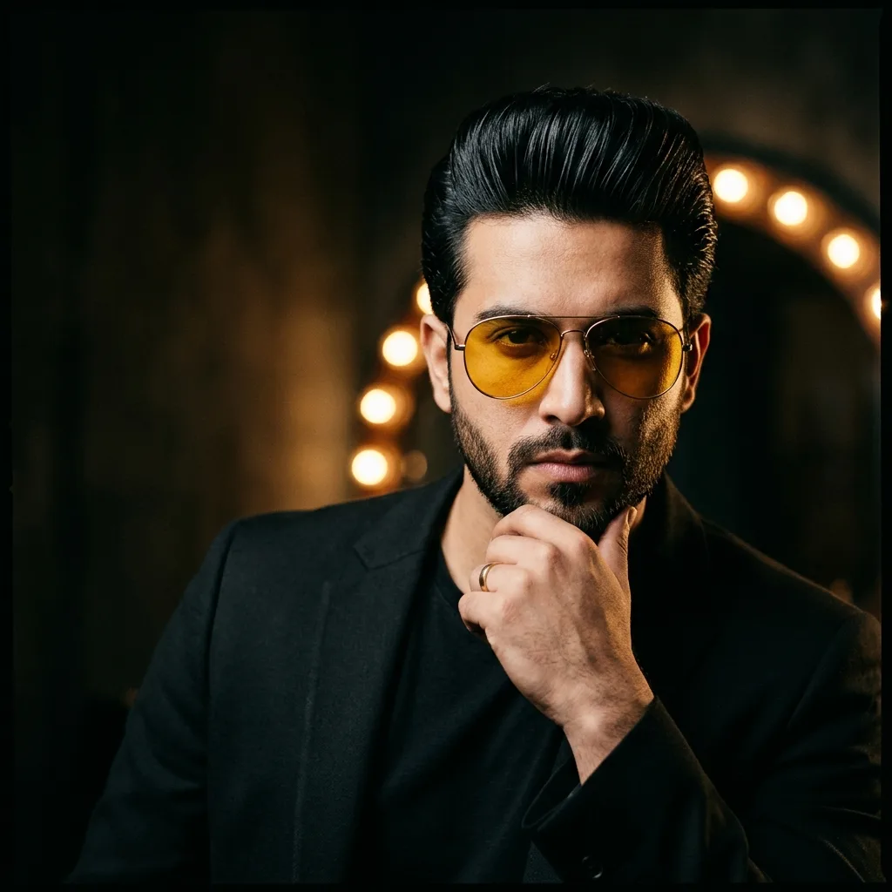

# Young adult male

[← Back to the collection](../../README.md) · Category: [Photography](../../gallery/photography.md) · Model: `Vinano Image v2` · ID: `vn-01011`

<a href="https://vinano.ai?utm_source=github&utm_medium=readme&utm_campaign=awesome-image-video-prompts-updating&utm_content=prompt-page-image"></a>

<sub>Preview generated with <a href="https://vinano.ai?utm_source=github&utm_medium=readme&utm_campaign=awesome-image-video-prompts-updating&utm_content=prompt-page-caption">vinano.ai</a></sub>

## Prompt

```text
{
 "objective": "Create a dramatic, high-contrast cinematic portrait of a stylish young man in a premium black suit selective warm lighting and intense mood",
 "subject": {
 "type": "Young adult male",
 "age_appearance": "25-30",
 "hair": "Black, voluminous, slicked back pompadour style, perfectly styled high shine",
 "facial_hair": "Well-groomed short boxed beard and mustache",
 "expression": "Intense, confident, serious, slightly mysterious",
 "pose": "Hand under chin thoughtful/contemplative pose, looking directly at camera",
 "accessories": {
 "sunglasses": "Classic aviator style, gold metal frame, strong yellow/orange tinted lenses",
 "clothing": {
 "outerwear": "Premium matte black tailored blazer/jacket, sharp lapels, high-end luxurious fabric texture",
 "innerwear": "Dark charcoal or black crew-neck t-shirt"
 }
 }
 },
 "lighting": {
 "style": "Cinematic studio lighting",
 "main": "Strong side and rim lighting creating deep shadows and dramatic highlights",
 "background": "Dark gradient circular warm spotlight array (vanity/makeup studio lights)",
 "contrast": "Very high contrast, deep blacks, bright highlights on face and hair",
 "mood": "Moody, masculine, powerful, film-noir inspired"
 },
 "composition": {
 "framing": "Tight mid-close-up portrait, head and shoulders",
 "angle": "Slightly below eye level for commanding presence",
 "depth_of_field": "Shallow, sharp focus on face and sunglasses, soft background"
 },
 "color_palette": {
 "dominant": "Black & deep charcoal",
 "accents": "Warm yellow-orange from sunglasses lenses and background lights",
 "skin_tone": "Natural subtle cinematic glow"
 },
 "style_references": ["Modern film-noir",
 "High-end fashion editorial",
 "Hollywood dramatic portrait",
 "David LaChapelle meets classic menswear advertising"],
 "image_quality": {
 "resolution": "Ultra-high detail, 8K",
 "sharpness": "Crisp facial features, hair strands visible",
 "texture": "Detailed skin pores, fabric weave, hair shine"
 },
 "negative_prompt": ["low quality",
 "blurry",
 "overexposed",
 "underexposed",
 "cartoon",
 "anime",
 "distorted face",
 "extra limbs",
 "bad anatomy",
 "logo",
 "text",
 "watermark",
 "bright colored clothing",
 "casual outfit"],
 "aspect_ratio": "2:3 (portrait orientation)"
}

Aim for an editorial, design-driven look with deliberate negative space.
```

## Try it on vinano.ai

1. Copy the prompt above.
2. Open **[vinano.ai](https://vinano.ai?utm_source=github&utm_medium=readme&utm_campaign=awesome-image-video-prompts-updating&utm_content=prompt-page-try)**, paste it into the image generator and pick a model.
3. Swap any placeholders (brand, product, city, person…) for your own details, then generate.

More prompts like this: [Photography gallery](../../gallery/photography.md) · [all categories](../../README.md#contents)
