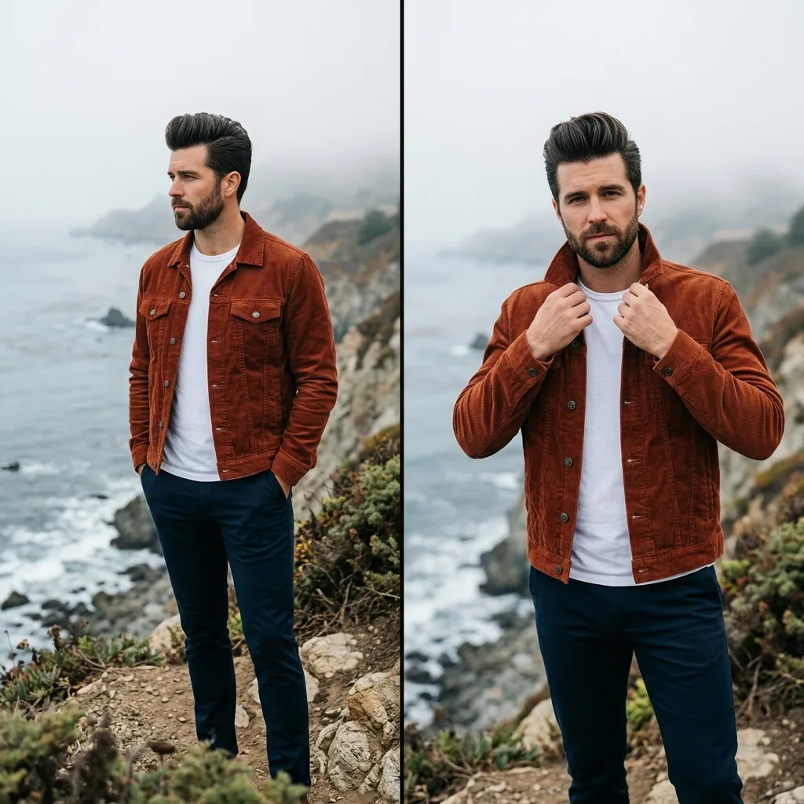

# Mid-30s, well-groomed beard, thick dark hair styled

[← Back to the collection](../../README.md) · Category: [Photography](../../gallery/photography.md) · Model: `Vinano Image v2` · ID: `vn-01021`

<a href="https://vinano.ai?utm_source=github&utm_medium=readme&utm_campaign=awesome-image-video-prompts-updating&utm_content=prompt-page-image"></a>

<sub>Preview generated with <a href="https://vinano.ai?utm_source=github&utm_medium=readme&utm_campaign=awesome-image-video-prompts-updating&utm_content=prompt-page-caption">vinano.ai</a></sub>

## Prompt

```text
{
 "image_description": "A premium-quality side-by-side comparison of a handsome man posing on a coastal cliffside.",
 "subject": {
 "gender": "male",
 "appearance": "mid-30s, well-groomed beard, thick dark hair styled in a modern voluminous pompadour",
 "poses": ["standing hands in pockets looking away from the camera",
 "standing one hand adjusting the collar of his jacket"]
 },
 "outfit": {
 "outerwear": "burnt orange or rust-colored corduroy trucker jacket metal buttons",
 "base_layer": "crisp white crew-neck t-shirt",
 "bottoms": "dark navy blue or black slim-fit trousers"
 },
 "setting": {
 "location": "rugged coastal cliff overlooking the ocean",
 "background": "misty horizon, calm sea, rocky shoreline",
 "lighting": "overcast, soft diffused natural light, moody atmospheric fog"
 },
 "technical_details": {
 "camera_angle": "eye-level medium shot",
 "composition": "diptych (two images side-by-side)",
 "aesthetic": "lifestyle photography, cinematic color grading, shallow depth of field soft background bokeh"
 }
}

Maintain consistent colour harmony and crisp focus across the whole frame.
```

## Try it on vinano.ai

1. Copy the prompt above.
2. Open **[vinano.ai](https://vinano.ai?utm_source=github&utm_medium=readme&utm_campaign=awesome-image-video-prompts-updating&utm_content=prompt-page-try)**, paste it into the image generator and pick a model.
3. Swap any placeholders (brand, product, city, person…) for your own details, then generate.

More prompts like this: [Photography gallery](../../gallery/photography.md) · [all categories](../../README.md#contents)
