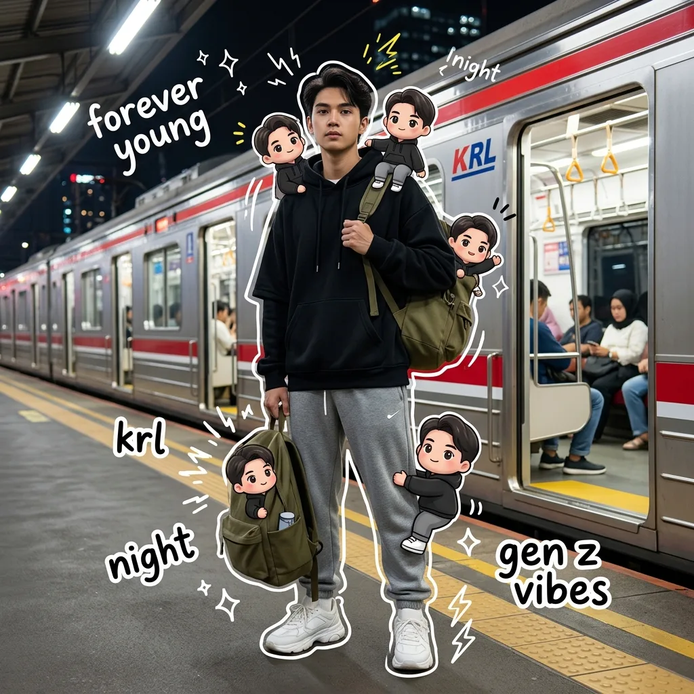

# Premium quality mixed media portrait of a trendy young

[← Back to the collection](../../README.md) · Category: [Photography](../../gallery/photography.md) · Model: `Vinano Image v2` · ID: `vn-01026`

<a href="https://vinano.ai?utm_source=github&utm_medium=readme&utm_campaign=awesome-image-video-prompts-updating&utm_content=prompt-page-image"></a>

<sub>Preview generated with <a href="https://vinano.ai?utm_source=github&utm_medium=readme&utm_campaign=awesome-image-video-prompts-updating&utm_content=prompt-page-caption">vinano.ai</a></sub>

## Prompt

```text
A premium quality mixed media portrait of a trendy young man (my uploaded person photo) standing on a train station platform at night. The subject is posing coolly, holding the strap of an olive backpack one hand. He is wearing a stylish streetwear outfit an oversized layered black hoodie, gray sweatpants, and chunky sneakers.

The background features a realistic KRL Jabodetabek Commuter Line train side view its signature red striping, the train doors wide open, bathed in bright cinematic station lighting and city night ambiance.

Surrounding the realistic main subject are several cute 3D style chibi versions of himself, same outfit and same face. These chibis are interacting playfully, one sitting on his shoulder, one climbing his leg, and another peeking out from the backpack.

Overlay the image vibrant hand drawn doodle effects, white drawn outlines around the subject, playful scribbles, stars, sparkles, electric sparks, and floating white and black handwritten slogans like “forever young”, “krl”, “night”, and “gen z vibes”. The style should seamlessly blend hyper realistic photography colorful flat cartoon illustrations while keeping the face and body shape unchanged.

Emphasise material texture and natural light so the final frame feels tactile and premium.
```

## Try it on vinano.ai

1. Copy the prompt above.
2. Open **[vinano.ai](https://vinano.ai?utm_source=github&utm_medium=readme&utm_campaign=awesome-image-video-prompts-updating&utm_content=prompt-page-try)**, paste it into the image generator and pick a model.
3. Swap any placeholders (brand, product, city, person…) for your own details, then generate.

More prompts like this: [Photography gallery](../../gallery/photography.md) · [all categories](../../README.md#contents)
