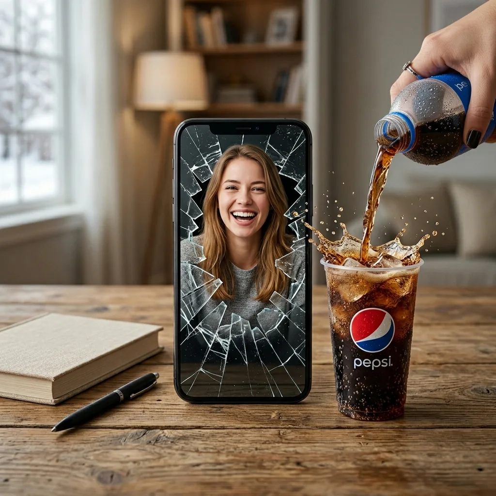

# Upper body visible through phone screen

[← Back to the collection](../../README.md) · Category: [Photography](../../gallery/photography.md) · Model: `Vinano Image v2` · ID: `vn-01033`

<a href="https://vinano.ai?utm_source=github&utm_medium=readme&utm_campaign=awesome-image-video-prompts-updating&utm_content=prompt-page-image"></a>

<sub>Preview generated with <a href="https://vinano.ai?utm_source=github&utm_medium=readme&utm_campaign=awesome-image-video-prompts-updating&utm_content=prompt-page-caption">vinano.ai</a></sub>

## Prompt

```text
{
 "resolution": "8K UHD",
 "style": "true-to-life photorealistic AI-edited composite, cinematic realism",
 "scene_type": "surreal product-style composition",
 "camera": {
 "angle": "slightly elevated top-down angle",
 "focus": "sharp foreground shallow depth of field",
 "lens_effects": ["natural depth of field",
 "high clarity",
 "macro-level liquid detail"]
 },
 "environment": {
 "surface": "wooden table visible grain texture",
 "lighting": {
 "type": "soft natural daylight",
 "direction": "from upper left",
 "shadows": "soft realistic shadows under objects"
 },
 "background": {
 "indoor": true,
 "elements": ["blurred interior background",
 "snowy outdoor scenery visible inside phone screen in one image"]
 }
 },
 "main_object": {
 "smartphone": {
 "position": "lying flat on wooden table",
 "orientation": "vertical portrait orientation",
 "color": "black",
 "screen_state": "visibly cracked glass radial fracture lines",
 "screen_interaction": "screen appears broken outward, allowing subject to emerge"
 }
 },
 "human_subject": {
 "visibility": "upper body visible through phone screen",
 "expression": "wide smile, visible teeth",
 "eye_direction": "looking toward the viewer",
 "gender_presentation": "female-presenting",
 "hair": {
 "color": "light brown",
 "style": "loose, shoulder-length"
 },
 "clothing_variants": [{
 "outfit": "casual indoor look",
 "details": "neutral top visible behind phone screen"
 },
 {
 "outfit": "winter clothing",
 "details": ["dark padded jacket",
 "light turtleneck sweater",
 "black gloves",
 "black fur hat"]
 }]
 },
 "action": {
 "primary_action": "soda being poured into a transparent plastic cup",
 "motion": "liquid splash frozen mid-air",
 "liquid_behavior": ["visible carbonation bubbles",
 "splash droplets",
 "overflow splash effect"]
 },
 "beverage": {
 "type": "cola",
 "cup": {
 "material": "transparent plastic",
 "filled_with": "dark carbonated soda ice",
 "logo": "Pepsi logo clearly visible"
 },
 "bottle": {
 "material": "plastic",
 "label": "Pepsi branding visible",
 "condition": "condensation droplets on bottle surface",
 "held_by": "human hand entering frame from top right"
 }
 },
 "secondary_objects": [{
 "object": "book",
 "position": "left side of phone",
 "color": "light beige cover",
 "state": "closed"
 },
 {
 "object": "pen",
 "position": "near book on table",
 "color": "black",
 "orientation": "diagonal"
 }],
 "effects": {
 "surreal_elements": ["subject emerging from phone screen",
 "physical interaction between digital and real space"],
 "particles": ["liquid droplets",
 "snow particles in winter scene variant"],
 "glass_effects": ["cracked screen shards",
 "reflections on broken glass"]
 },
 "color_palette": {
 "dominant_colors": ["warm brown",
 "black",
 "deep cola brown",
 "blue and red branding accents"],
 "contrast": "high contrast between warm table tones and cool screen elements"
 },
 "post_processing": {
 "sharpness": "ultra-sharp",
 "clarity": "high micro-detail",
 "noise": "none",
 "dynamic_range": "high"
 },
 "mood": "playful, surreal, visually striking",
 "realism_level": "high realism intentional AI-edited surreal effect"
}

Maintain consistent colour harmony and crisp focus across the whole frame.
```

## Try it on vinano.ai

1. Copy the prompt above.
2. Open **[vinano.ai](https://vinano.ai?utm_source=github&utm_medium=readme&utm_campaign=awesome-image-video-prompts-updating&utm_content=prompt-page-try)**, paste it into the image generator and pick a model.
3. Swap any placeholders (brand, product, city, person…) for your own details, then generate.

More prompts like this: [Photography gallery](../../gallery/photography.md) · [all categories](../../README.md#contents)
