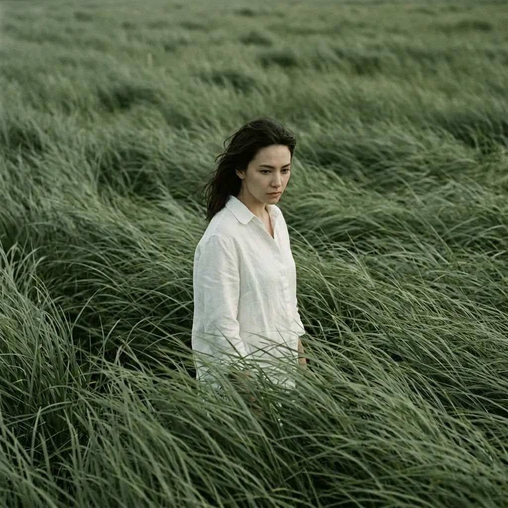

# 3:4 cinematic, atmospheric editorial portrait the attached photo as

[← Back to the collection](../../README.md) · Category: [Photography](../../gallery/photography.md) · Model: `Vinano Image v2` · ID: `vn-01061`

<a href="https://vinano.ai?utm_source=github&utm_medium=readme&utm_campaign=awesome-image-video-prompts-updating&utm_content=prompt-page-image"></a>

<sub>Preview generated with <a href="https://vinano.ai?utm_source=github&utm_medium=readme&utm_campaign=awesome-image-video-prompts-updating&utm_content=prompt-page-caption">vinano.ai</a></sub>

## Prompt

```text
Create a 3:4 cinematic, atmospheric editorial portrait the attached photo as the exact face and identity reference. A solitary man/woman stands alone in the middle of vast, wind-swept sage green grass fields. Tall grass surrounds the subject completely, flowing in strong currents like ocean waves, partially obscuring the body and creating motion,depth, and solitude. The subject wears a simple, loose white shirt that softly contrasts the rich green landscape.
Dark hair is slightly messy, natural strands moving in the wind. The head is gently tilted downward, eyes cast toward the ground, conveying a quiet, introspective, melancholic mood. Expression is calm, distant, and emotionally restrained. Compose the frame slightly off-center, from a subtle elevated angle. No visible horizon, the frame is fully immersed in grass texture. Use a muted natural palette of sage green, deep olive, and soft off-white. Shoot vertical 3:4, telephoto perspective, shallow depth of field, cinematic framing. Film photography aesthetic visible grain, soft edge falloff, atmospheric light, wind-driven motion blur in the grass. Quiet, poetic storytelling; ultra-detailed yet natural, magazine-cover editorial quality. No text, no watermark.

Emphasise material texture and natural light so the final frame feels tactile and premium.
```

## Try it on vinano.ai

1. Copy the prompt above.
2. Open **[vinano.ai](https://vinano.ai?utm_source=github&utm_medium=readme&utm_campaign=awesome-image-video-prompts-updating&utm_content=prompt-page-try)**, paste it into the image generator and pick a model.
3. Swap any placeholders (brand, product, city, person…) for your own details, then generate.

More prompts like this: [Photography gallery](../../gallery/photography.md) · [all categories](../../README.md#contents)
